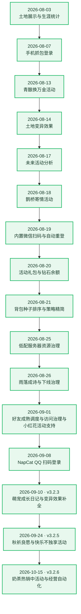

# 🌱 农场成长记录

[← 返回项目首页](../README.md)

这里记录 QQ Farm Bot 已完成的重要功能和改进。最新记录在最前面。

## 版本总览

> **版本号规则**：采用 `MAJOR.MINOR.PATCH`，每次更新提交后自动递增 —— 新增功能 → `MINOR` 进 1、`PATCH` 归零；修复 / 优化 / 回滚 → `PATCH` 进 1；重大不兼容变更 → `MAJOR` 进 1（手动 `--type major`）。
> **跳过数字 4**：版本号三段与更新序号在递增时，只要十进制表示任意位置含 `4` 就继续跳到下一个不含 `4` 的整数（`4 → 5`、`14 → 15`、`39 → 50`）。
> **全量重排**：全部历史记录已按时间正序重新编号，以 `v3.0.0 · 第 1 次更新` 为起点；此前 `v2.x` / `v2.9.x` 等旧版本序列的对应关系已作废，一律以本表为准。详细记录正文里提到的旧版本号属于当时的叙述，同样已作废。
> **更新序号**：累计更新次数，每次提交无条件 +1（遇到含 `4` 的序号自动跳过）；所有详细记录都带版本号与更新序号。
> 版本号由 `version.json` 统一维护，可用 `pnpm version:bump` 手动递增，安装 `pnpm hooks:install` 后每次提交自动递增。**版本号与更新内容合并进同一次提交**，不再单独产生 `chore(version)` 提交；因此「提交」列显示 `—` 即代表这次提交自身（早期分批提交的历史记录同样是 `—`）。
> **提交标题格式**：`vX.Y.Z · 第 N 次更新 · 更新内容`，由 `commit-msg` 钩子自动改写，原始提交说明下沉为正文首行。

| 版本 | 更新序号 | 日期 | 更新内容 | 提交 |
| --- | --- | --- | --- | --- |
| v3.23.3 | #163 | 2026-11-13 | 全仓完整性复查：修复凭证吊销闸门失效、续期窗口被推迟与续期异常打断主进程 | — |
| v3.23.2 | #162 | 2026-11-13 | Docker Hub 直连超时时，NapCat 镜像改用加速站或本地标签 | — |
| v3.23.1 | #161 | 2026-11-13 | QQ 取码链路收口：优先 getOpenAuth，NapCat 基础镜像补固定版本与离线导入路径 | — |
| v3.23.0 | #160 | 2026-11-13 | 移植 YYB-Go-Enhanced 完整保活方案：会话复用、错误分级与只滚令牌续期 | — |
| v3.22.11 | #159 | 2026-11-12 | 掉线后无法自愈：补上 QQ 重登与登录失败兜底 | — |
| v3.22.10 | #158 | 2026-11-12 | 全仓完整性复查：修复统计基线、登录初始化与若干判定缺陷 | — |
| v3.22.9 | #157 | 2026-11-12 | 成熟唤醒与活动/好友成熟计划的时间基准修正 | — |
| v3.22.8 | #156 | 2026-11-12 | 自家农场成熟驱动唤醒与农场调度健壮性补强 | — |
| v3.22.7 | #155 | 2026-11-12 | 全仓完整性检查：修复六处影响统计与农场自动化的缺陷 | — |
| v3.22.6 | #153 | 2026-11-12 | 修正调度器注释与清理帮忙间隔的无效配置读取 | — |
| v3.22.5 | #152 | 2026-11-12 | 回滚 README 的 Docker 部署命令补全，恢复精简安装说明 | — |
| v3.22.3 | #151 | 2026-11-12 | 补全 README 的 Docker 部署命令集 | — |
| v3.22.2 | #150 | 2026-11-12 | 精简 README 的 Docker 部署章节，只保留正常安装说明 | — |
| v3.22.1 | #139 | 2026-11-12 | 金豆今日数值改由后端同源统计，移除浏览器本地基线 | — |
| v3.22.0 | #138 | 2026-11-12 | 新增今日统计的金豆与点券今日数值卡片 | — |
| v3.21.0 | #137 | 2026-11-11 | 新增一键更新 / 一键清理 / 一键重构三条固定流水线 | — |
| v3.20.2 | #136 | 2026-11-11 | README 的「Docker 部署」只留通用步骤，删掉某台机器的实测数据 | — |
| v3.20.1 | #135 | 2026-11-11 | 修掉 `--scan-volume` 下「让你再跑一遍自己」的自相矛盾提示 | — |
| v3.20.0 | #133 | 2026-11-11 | 新增 `--scan-volume`：把「Docker 之外那 27G」自动摊开，查出来是 fnOS 的 `@appmeta` / `@sysappmeta` | — |
| v3.19.1 | #132 | 2026-11-11 | 磁盘对账汇总补上 `-x`：15G 虚报其实是 9.3G，另有 5.7G 是 overlay 视图重复算的 | — |
| v3.19.0 | #131 | 2026-11-11 | NAS 空间诊断新增磁盘对账与健康检查明细，探针不再依赖 wget | — |
| v3.18.0 | #130 | 2026-11-11 | `--report` 改为全量诊断并新增 `--prune-orphans`，纠正「构建缓存占大头」的误判 | — |
| v3.17.9 | #129 | 2026-11-11 | 修复 NAS 反复构建后空间清不干净：`builder prune` 补上 `-a`，日志加体积上限 | — |
| v3.17.8 | #128 | 2026-11-11 | 提交标题改为「版本号 · 第 N 次更新 · 更新内容」，原始说明下沉为正文 | — |
| v3.17.7 | #127 | 2026-11-11 | 修正钩子文件可执行位，Linux/macOS 上版本递增才会真正执行 | — |
| v3.17.6 | #126 | 2026-11-11 | 版本号与更新内容合并为同一条提交，不再单独产生 chore(version) 记录 | — |
| v3.17.5 | #125 | 2026-11-11 | chore(deploy): NAS 部署脚本构建缓存回收窗口由 24 小时收紧到 1 分钟 | `ce55f8b1` |
| v3.17.3 | #123 | 2026-11-11 | fix(version): 修正 CHANGELOG 标题版本号误判，补上 hook 回归测试 | `f22b21b8` |
| v3.17.2 | #122 | 2026-11-11 | fix(core): 复核运行完整性，补修 v3.17.1 分项开关实时性回归 | `c4a1640f` |
| v3.17.1 | #121 | 2026-11-11 | fix(core): 收口 visit-strategy 二次开关判断，options 成为单次好友访问唯一决策来源 | `1a1be415` |
| v3.17.0 | #120 | 2026-11-11 | feat(web): 落地上游 PR #125 稀有度徽章，宠物卡片显示四档稀有度 | `9106971f` |
| v3.16.2 | #119 | 2026-11-11 | fix(core/web): 复核前两次上游同步，补修 3 处漏网缺陷并逐条对账 24 项 | `497c226e` |
| v3.16.1 | #118 | 2026-11-11 | fix(core/web): 全仓完整性体检，修复 14 处逻辑缺陷并补齐回归测试 | `450266f0` |
| v3.16.0 | #117 | 2026-11-10 | feat(web): 同步上游 PR #125 评估并等价落地宠物页可用性改进 | `b0a1f456` |
| v3.15.6 | #116 | 2026-11-10 | chore(web): 补齐 tests 与样式检查范围，格式化后 web 全仓 lint 清零 | `a264fe0f` |
| v3.15.5 | #115 | 2026-11-10 | fix(core): 种植轮闸门缓存失效判断修正，清理死代码并清空 core lint | `39b871f0` |
| v3.15.3 | #113 | 2026-11-10 | fix(web/core): 邮箱时刻输入非法不再拖垮整份设置保存，并给两份 hour-of-day 加一致性测试 | `1374aa1a` |
| v3.15.2 | #112 | 2026-11-10 | fix(core): 好友 tick 不再套自动化锁，修复与内部 detached 调用互相等死的死锁 | `0914db06` |
| v3.15.1 | #111 | 2026-11-10 | fix(web): QQ 账号卡片底部横线与微信卡片对齐，手机端显示今日成功次数 | `3b4cd7fb` |
| v3.15.0 | #110 | 2026-11-10 | feat(core/web): 同步上游 20261109 更新（PR #122-#124），采纳邮件定时检查、种植延迟生效与图片懒加载 | `158473a2` |
| v3.13.0 | #109 | 2026-11-10 | feat(core): 网关诊断日志改为中文文案，压力/超时/心跳/让路不再输出英文键值 | `8363558f` |
| v3.12.0 | #108 | 2026-11-10 | feat(web/core): 账号卡片显示上次自动续期时间与今日失败次数 | `d60b9537` |
| v3.11.2 | #107 | 2026-11-10 | docs(deploy): NAS 反复部署的空间维护脚本与清理说明 | `f0ebb42d` |
| v3.11.1 | #106 | 2026-11-10 | style(web): PC 端账号登录与重连卡片开关移到说明文字下方 | `b5910d3e` |
| v3.11.0 | #105 | 2026-11-10 | feat(web/core): 账号管理页新增免扫码续期标记，账号列表不再下发凭证明文 | `edff9d1c` |
| v3.10.6 | #103 | 2026-11-10 | fix(docker): 基础镜像默认走全限定地址，无需改动环境配置即可构建 | `50269f7d` |
| v3.10.5 | #102 | 2026-11-10 | fix(docker): 去掉外部 frontend 指令，修复国内镜像站构建 401 | `780c34c` |
| v3.10.3 | #101 | 2026-11-10 | fix(core): 2×2 预留时间策略完整落地，消除部分空出时的重复请求 | `7a8366e` |
| v3.10.2 | #100 | 2026-11-10 | fix(web/core): 去除定时重登 + 账号保活卡片改名合并 + 修复种植日志合并 | `b0fe642` |
| v3.10.1 | #99 | 2026-11-10 | fix(core): 日熔断额度只统计失败，成功续期不占额度 | `ee43f58` |
| v3.10.0 | #98 | 2026-11-10 | fix(core): 参考老版本新增后端自主到期前预防性续期与失败熔断 | `a52e05b` |
| v3.9.6 | #97 | 2026-11-10 | revert: 回滚「去除账号管理内 Code 自动监听」，恢复完整链路 | `2a1ffa0` |
| v3.9.5 | #96 | 2026-11-10 | refactor(web/core): 去除账号管理内 Code 自动监听 | `aaaaee5` |
| v3.9.3 | #95 | 2026-11-09 | style(web): 手机端头像放大到与三行文字等高，PC 端不变 | `880b4c6` |
| v3.9.2 | #93 | 2026-11-09 | style(web): 首页头像改为圆形 + 全站头像风格统一 | `843a62a` |
| v3.9.1 | #92 | 2026-11-09 | fix(test): 修正版本总览重渲染后的一次性迁移说明断言 | `6f04aad` |
| v3.9.0 | #91 | 2026-11-09 | feat(web): 移植老版本个人页（角色生涯）并把入口改为首页头像 | `4e0321c` |
| v3.8.5 | #90 | 2026-11-09 | 版本号与更新次数自动跳过数字 4 | `f1c9397` |
| v3.8.3 | #89 | 2026-11-09 | 修复「游戏商城」页签被弹回神秘商人 + 默认页签作用域收窄 | `c6105dc` |
| v3.8.2 | #88 | 2026-11-09 | 修复容器部署时首页显示「第 0 次更新」 | `e2b965a` |
| v3.8.1 | #87 | 2026-11-09 | 快成熟判定默认值改回 300 秒 + 阈值命中率模拟结论 | `ae83736` |
| v3.8.0 | #86 | 2026-11-09 | 新增版本号功能 + 快成熟判定默认值改为 60 秒 | — |
| v3.7.2 | #85 | 2026-11-09 | 首页诊断移除 + 快成熟回滚 + 神秘商人来访横幅 + 日志刷屏治理 + 奶茶支撑时间修正 | — |
| v3.7.1 | #83 | 2026-11-08 | 今日统计去掉单位「次」 + 账号管理 Code 过期自动监听与自动补码 | — |
| v3.7.0 | #82 | 2026-11-08 | 快成熟判定随机化 + 图鉴每日自动领奖/补种与背包过滤 + 今日金币支持负数 | — |
| v3.6.1 | #81 | 2026-11-07 | 运行日志筛选手机端显示完整 + 神秘商人页签移到第 4 + 催熟时间核查 | — |
| v3.6.0 | #80 | 2026-11-07 | 新增面板内消息（局内通知）：顶栏铃铛 + 本地持久化 | — |
| v3.5.15 | #79 | 2026-11-07 | 补齐神秘商人「到货提醒 / 购买通知」开关与保存后立即巡查 | — |
| v3.5.13 | #78 | 2026-11-07 | 节令日历手机端可下滑 + 神秘商人购买历史回归 + 自动化开关验证 | — |
| v3.5.12 | #77 | 2026-11-06 | 功能模块「土地与施肥」2x2催熟开关间距 | — |
| v3.5.11 | #76 | 2026-11-06 | 同步上游 muyuewang/qq-farm-bot-404（ed75089..3b3608c，PR #119–#121）并保留本地改动 | — |
| v3.5.10 | #75 | 2026-11-06 | 图鉴标题与收藏计数等高 + 奶茶两行左对齐 | — |
| v3.5.9 | #73 | 2026-11-06 | 奶茶页返回按钮文案简化为「活动中心」 | — |
| v3.5.8 | #72 | 2026-11-06 | 首页已运行手机端换行 + 去除奶茶侧栏「活动中心」/「快乐不独享」日期 | — |
| v3.5.7 | #71 | 2026-11-06 | 土地等级二级弹窗缩小，与作物气泡同尺寸同风格 | — |
| v3.5.6 | #70 | 2026-11-06 | 奶茶头部返回按钮合并 + 恢复「剩余时间」靠右对齐 | — |
| v3.5.5 | #69 | 2026-11-06 | 首页状态行再退一格 + 回滚「剩余时间」靠右对齐 | — |
| v3.5.3 | #68 | 2026-11-06 | 手机端排版再调整：首页恢复原方案 + 领取收益 PC/手机同排 | — |
| v3.5.2 | #67 | 2026-11-06 | 手机端固定排版：首页已运行状态行 + 奶茶活动三处对齐 | — |
| v3.5.1 | #66 | 2026-11-06 | 土地气泡收益跟随变异叠加 + 奶茶活动 4 个新开关 | — |
| v3.5.0 | #65 | 2026-11-06 | 首页「已运行」不再跳位 + 重新登录后自动上线 | — |
| v3.3.18 | #63 | 2026-11-06 | 微信授权续期稳定性 + 土地详情恢复老版作物气泡 | — |
| v3.3.17 | #62 | 2026-11-06 | 任意页面切换账号后保持原页面与原滚动位置 | — |
| v3.3.16 | #61 | 2026-11-06 | 修复背包种子页仍每 10 秒自动刷新 | — |
| v3.3.15 | #60 | 2026-11-05 | 同步上游 20261104 更新（PR #117-#118 至 ed75089） | — |
| v3.3.13 | #59 | 2026-11-05 | 今日统计卡片样式统一 + 增量逻辑分离 + 农场页整体刷新治理 | — |
| v3.3.12 | #58 | 2026-11-05 | 今日统计加金币/经验增量 + 背包排序 + 农场自动刷新开关 + 移动端导航调整 | — |
| v3.3.11 | #57 | 2026-11-05 | 切换账号后保持在所有活动页面 | — |
| v3.3.10 | #56 | 2026-11-05 | 切换账号后保持在奶茶热销中页面 | — |
| v3.3.9 | #55 | 2026-11-05 | 活动中心默认进入奶茶热销中 | — |
| v3.3.8 | #53 | 2026-11-05 | 营业记录数据链路对齐老版（补回 normalizeWireMaps） | — |
| v3.3.7 | #52 | 2026-11-05 | 再次恢复 milk_tea_work_interaction_type / milk_tea_hire_policy 接线 | — |
| v3.3.6 | #51 | 2026-11-05 | 再次撤销 milk_tea_work_interaction_type / milk_tea_hire_policy 接线 | — |
| v3.3.5 | #50 | 2026-11-05 | 恢复 milk_tea_work_interaction_type / milk_tea_hire_policy 两项接线 | — |
| v3.3.3 | #39 | 2026-11-05 | 页面闪烁治理 + 策略预览秒开 + 背包默认页签 | — |
| v3.3.2 | #38 | 2026-11-05 | 营业记录图标补全 + 图鉴搜索框位置调整 | — |
| v3.3.1 | #37 | 2026-11-05 | 四页控件显示效果统一（对齐全站 BaseButton 规范） | — |
| v3.3.0 | #36 | 2026-11-05 | 15 项功能开关失效修复（老版方案移植） | — |
| v3.2.12 | #35 | 2026-11-05 | 回滚 3 项开关接线（milk_tea_work_interaction_type / milk_tea_seed_policy / milk_tea_hire_policy） | — |
| v3.2.11 | #33 | 2026-11-05 | 2×2 催熟功能修复与背包多格种子角标 | — |
| v3.2.10 | #32 | 2026-11-05 | 服务启动自动登录与登录 Code 续期修复 | — |
| v3.2.9 | #31 | 2026-11-05 | 回滚硬预算期的省请求改动 + 修复奶茶手动兑换 | — |
| v3.2.8 | #30 | 2026-11-05 | 网关流量机制重构：前台操作不再被限额 | — |
| v3.2.7 | #29 | 2026-11-05 | 手机端账号入口与操作按钮统一 | — |
| v3.2.6 | #28 | 2026-10-15 | 奶茶热销中活动与经营自动化 | — |
| v3.2.5 | #27 | 2026-09-24 | 秋祈良愿与快乐不独享活动 | — |
| v3.2.3 | #26 | 2026-09-10 | 萌宠成长日记与变异效果补全 | — |
| v3.2.2 | #25 | 2026-09-08 | NapCat QQ 扫码登录与 Docker 部署 | — |
| v3.2.1 | #23 | 2026-09-08 | NapCat QQ 扫码登录与 Docker 部署 | — |
| v3.2.0 | #22 | 2026-09-01 | 公益小红花活动支持 | — |
| v3.1.1 | #21 | 2026-09-01 | 好友成熟调度与访问治理 | — |
| v3.1.0 | #20 | 2026-09-01 | 公益小红花活动支持 | — |
| v3.0.18 | #19 | 2026-09-01 | 好友成熟调度与访问治理 | — |
| v3.0.17 | #18 | 2026-08-26 | 雨落成诗活动适配 | — |
| v3.0.16 | #17 | 2026-08-26 | 限时活动下线与开关防回启 | — |
| v3.0.15 | #16 | 2026-08-25 | 低配服务器资源治理与线程调度优化 | — |
| v3.0.13 | #15 | 2026-08-21 | 背包种子排序与选种策略精简 | — |
| v3.0.12 | #13 | 2026-08-20 | 活动礼包与钻石余额 | — |
| v3.0.11 | #12 | 2026-08-19 | 内置微信扫码、版本同步与运行自愈 | — |
| v3.0.10 | #11 | 2026-08-18 | 鹊桥寄情活动 | — |
| v3.0.9 | #10 | 2026-08-17 | 未来活动分析 | — |
| v3.0.8 | #9 | 2026-08-14 | 土地变异效果 | — |
| v3.0.7 | #8 | 2026-08-13 | 青酿换万金活动 | — |
| v3.0.6 | #7 | 2026-08-07 | 手机抓包登录 | — |
| v3.0.5 | #6 | 2026-08-03 | 土地展示重做 | — |
| v3.0.3 | #5 | 2026-08-03 | 生涯统计与体验优化 | — |
| v3.0.2 | #3 | 2026-08-03 | 心许千灯星垂野活动 | — |
| v3.0.1 | #2 | 2026-08-03 | TSDK/WASM 协议更新 | — |
| v3.0.0 | #1 | 2026-08-03 | 2×2 作物种植 | — |

## 更新流水图



## 详细记录
### 2026-11-13 · v3.23.3（#163） · 全仓完整性复查：修复凭证吊销闸门失效、续期窗口被推迟与续期异常打断主进程

- **复查范围**：v3.23.x 引入的协议层与保活层（`wx-login/` 四个模块、`wx-credential`、`wx-keepalive`），以及账号存储、worker 进程管理、账号列表投影三处与它们直接相接的代码。
- **缺陷一（高）·「授权已吊销」标记从未落盘**：`addOrUpdateAccount` 的白名单收下了 `wxCredentialNeedsRescan`，但 `normalizeAccount` 重建账号对象时只挑固定字段，把它丢掉了；而 `saveAccounts` 正是用它归一化后才写文件并回填内存缓存。结果这个标记在内存里只存在一瞬，`wx-keepalive` 里 `if (account.wxCredentialNeedsRescan) continue` 永远为假——凭证被 `-109` 吊销后，当天靠连续失败熔断挡住，跨日后状态重建，第二天又拿死 token 空打 OAuth 层。修法：账号类型补该字段，`normalizeAccount` 只保留 `true`（缺失等价于 false）。
- **缺陷二（高）·只换 Code 也会把续期窗口推后最多两小时**：`rotatedKeys` 里含 `code`，于是「用 loginBuffer 直接换 Code」「手动填 Code」这类**完全不碰 token** 的操作也会把 `wxCredentialRefreshedAt` 刷成当前时间。而 `code-watch` 与前端都按 `max(expires_at, refreshedAt + 2h)` 重算到期——真实 access token 只剩十分钟，界面和保活却以为还有两小时，等发现时已经过期掉线。这条正好命中「刚换过码、过一阵还是掉」。修法：把「换 Code」与「换令牌」拆成两组 key，只有 `refreshtoken` / `accesstoken` / `loginBuffer` / `expires_at` 真的变了才推进基准时间。
- **缺陷三（高）·续期异常会打断主进程**：`refreshAndMaybeRestart` 只有 `finally` 没有 `catch`，而掉线重登那条路径是裸 `void refreshAndMaybeRestart(key, 'offline')`。任何预期外异常（账号文件写入失败、上游返回结构异常）都会变成未处理拒绝，Node 20 默认按致命错误处理，**主进程直接退出，所有账号同时掉线**。修法：函数内部把异常收口成「一次失败」——记账号日志、写系统日志、推进退避状态；调用点再加一层 `catch` 兜底。
- **缺陷四（高）·worker 消息处理没有兜底**：`child.on('message')` 的回调里会写账号库（落盘失败抛 `storageError`）、会往子进程 `send`（IPC 通道关闭时**同步抛** `ERR_IPC_CHANNEL_CLOSED`）。这些都跑在事件回调里，抛出去等价于 `uncaughtException`，同样会带走主进程。修法：消息处理整体 try/catch；新增 `safeSend()` 包装全部 `send` 调用点；`stopWorker` 的 `send` 失败时直接清掉 worker 条目（否则 `startWorker` 的判重会让账号永远起不来，面板却显示运行中）；`callWorkerApi` 发不出去就立即 `reject` 并摘掉超时定时器，不让调用方白等 10~180 秒。
- **缺陷五（中）·保活巡检的互斥是假的**：`tick()` 里用 `void runCodePreflight(...)` 触发异步任务后，`finally` 立刻把 `running` 置回 `false`——上一轮还在等上游，下一个 tick 照样进来，只靠 `inFlight` 与退避闸门兜着。修法：改成等 Promise 真正结束再释放，并给巡检异常加日志（原来是 `catch(() => {})` 全吞，出问题完全看不见）。
- **缺陷六（中）·面板账本用了错误的判定口径**：后端下发的 `wxPreflightSupported` 表示「能滚 token」（`wxid` + `refreshtoken`），而真正的恢复能力 `canRecoverAccount` 还要包含「只有 loginBuffer」的账号。后者滚不了 token，但掉线后会自动换 Code 并写进账本，前端却因为 `wxPreflightSupported === false` 把整段账本隐藏，用户看到的是与事实相反的「不支持」。修法：投影新增 `wxCanRecover`（直接复用 `canRecoverAccount`，只在微信账号上下发），前端账本门禁改用它，字段缺失时回落到旧判定。
- **顺手更正的三条测试**：`account-credential-state.test.js` 原来断言「换 Code 后 `refreshedAt` 会刷新」——正是缺陷二的错误语义，已改成「换 Code 不推进基准、换令牌才推进」；`code-preflight.test.js` 与 `account-online-card.test.mjs` 里断言 `void runCodePreflight(...).catch` 的接线，已改为断言新的「Promise 结束才释放 running + 异常必须落日志」。
- **已知未修（记录，单独一版处理）**：`worker-manager` 的「持续离线 N 分钟自动删除账号」在主路径上不可达——计时状态 `disconnectedSince` 挂在 worker 条目上，而真实掉线会在 300ms~1s 内删掉该条目，分钟级的阈值永远累积不到。修法需要把计时提到账号维度并用独立定时任务，属于功能重做，本次不动。
- **测试**：core **640 → 648**（新增凭证落盘、换 Code 不推进基准、异常吸收、单账号异常不影响同批、投影双口径等用例），web **215 → 216**。`pnpm lint` 0 error、`build:ts` / `vue-tsc -b` / `vite build` 全过。
- **边界**：不改任何协议常量、不改 Docker Compose、不改 NAS / 服务器配置。

### 2026-11-13 · v3.23.2（#162） · Docker Hub 直连超时时，NapCat 镜像改用加速站或本地标签

- **现象**：在宿主机上执行 `docker manifest inspect mlikiowa/napcat-docker:v4.18.42` 返回 `failed to configure transport: error pinging v2 registry: Get "https://registry-1.docker.io/v2/": net/http: request canceled while waiting for connection (Client.Timeout exceeded while awaiting headers)`。
- **定性**：这是网络层的连接超时，不是「标签不存在」。`docker manifest inspect` 由 Docker CLI **直接连接 registry**，不经过宿主机的 `registry-mirrors` 配置；因此在 `docker.io` 无法直连的网络里，它必然超时，也**不能用来判断标签是否可用**。会走镜像加速的是 `docker pull`，两者行为不同。
- **文档缺口**：上一版只写了「用 `--build-arg NAPCAT_IMAGE=<版本号>` 固定版本」和「离线 `docker load`」两条路，没有覆盖「registry 直连不通、但加速站可用」这种最常见的情况，也没有说明 `manifest inspect` 与 `pull` 的差异，排查时容易被超时误导成版本不存在。
- **补全获取路径**（`docs/detailed-reference.md`「部署细节」）：① 明确 `manifest inspect` 不走 `registry-mirrors`、验证标签请改用 `docker pull`；② 给出加速站前缀的构建写法 `--build-arg NAPCAT_IMAGE=docker.m.daocloud.io/mlikiowa/napcat-docker:<版本号>`，与 `docker-compose.yml` 里 `NODE_IMAGE` 的写法一致；③ 补一句「宿主机已有该镜像时直接把 `NAPCAT_IMAGE` 写成 `docker images` 里的本地标签，构建阶段不产生任何拉取」。
- **注释同步**（`napcat/Dockerfile`）：在 `ARG NAPCAT_IMAGE` 上方注明它接受任意完整镜像地址、加速站前缀怎么写、以及 `manifest inspect` 不吃 `registry-mirrors` 这一点。默认值仍保持 `mlikiowa/napcat-docker:latest`，可由 `--build-arg` 覆盖。
- **事实核对**：归档仓的 release 产物里实际存在 `napcat-docker-v4.15.0-{amd64,arm64}.tar`、`v4.18.19-*`、`v4.18.42-*` 三组版本。至于 Docker Hub 上这些标签是否仍然存活，本机与部署机都无法直连 `registry-1.docker.io`，仍未能确认，所以没有把某个版本号写死成默认值。
- **测试**：`core/tests/napcat-plugin-ladder.test.js` 由 5 条增至 6 条——新增「文档说明 manifest inspect 不走镜像加速」一条（锁 `registry-mirrors`、加速站前缀、`docker pull` 三处表述），并在「`NAPCAT_IMAGE` 仍可覆盖」里加断言锁住 Dockerfile 注释中的加速站示例。
- **边界**：不改任何 QQ 协议常量、不改 Docker Compose、不改 NAS / 服务器配置；`NAPCAT_IMAGE` 默认值保持原样。

### 2026-11-13 · v3.23.1（#161） · QQ 取码链路收口：优先 getOpenAuth，NapCat 基础镜像补固定版本与离线导入路径

- **来源**：为排查 QQ 账号掉线，横向核对了两个第三方项目——`DandanLLab/SnowCatQQ`（自称 NapCat 4.18.28 底座 + SnowLuma 融合）与 `XingYunStar/NapCatQQ`（NapCat 归档仓）。前者 `packages/` 目录与 NapCat 逐个对应（`snowcat-core` ↔ `napcat-core` 等），实为同一份源码的改名分支，没有独立的 QQ 登录协议实现；后者提供了当前版本的源码与 release 产物，正好用来核对我们的插件。
- **取码入口的确定答案**：`NodeIKernelNodeMiscService` 的接口声明里**只有** `getOpenAuth(arg1, arg2)`，而在 `NodeIKernelMiniAppService` 里同样找不到 `checkSessionForMiniApp` / `loginWithAppId` / `getOpenCodeWithAppId`。这三个名字是更早版本 NapCat 的命名，在当前版本上不存在，插件的四步探测实际只有最后一步有效。
- **顺序改成 getOpenAuth 优先**（`napcat/plugins/qq-miniapp-openauth`）：它第一个参数传 `true` 表示「要新的 Code」；而 `checkSessionForMiniApp` 语义是查已有会话，很可能返回上一轮已被 worker 消费掉的旧 Code——那种 Code 写进账号后连接会被网关拒绝，要等下一轮才能自愈。三个老命名保留为兜底（老版本 NapCat 上 `getOpenAuth` 不存在），但不再排在新 Code 之前。
- **供应链问题**：NapCat 上游源码仓库 `NapNeko/NapCat` 已返回 404，`NapNeko/NapCatQQ` 只剩 1KB 空壳。而 `napcat/Dockerfile` 的基础镜像是 `mlikiowa/napcat-docker:latest`——浮动标签在这种情况下一旦被覆盖或清理，重建会失败，也无法复现当前正在运行的版本。
- **补上两条部署路径**（`docs/detailed-reference.md`「部署细节」）：① 用 `--build-arg NAPCAT_IMAGE=mlikiowa/napcat-docker:<版本号>` 固定版本；② 镜像仓库不可达时，从归档仓的 release 产物取分架构的 `napcat-docker-v<版本号>-<架构>.tar`，`docker load` 后指向本地标签，全程不访问 registry。`napcat/Dockerfile` 相应加注释，`NAPCAT_IMAGE` 构建参数本身保持不变。
- **未做的两件事（附原因）**：① `NAPCAT_IMAGE` 默认值仍是 `:latest`——本机到 Docker Hub 与 `registry-1.docker.io` 均不可达（连接直接失败），无法确认哪些 tag 还存活，凭空写一个版本号不如留待部署侧用 `docker manifest inspect` 确认；② 内置插件会忽略请求里的 `uin`（`index.mjs` 只读 `appId`），而 `qq-credential` 拿到 Code 后直接写盘，多 QQ 账号场景存在把 A 的 Code 写进 B 账号的串号风险。修法是在写入前比对返回的 `uin` 与账号 `uin`，但账号 `uin` 在扫码登录路径下可能为空、格式也未经真机验证，改动会让自动重签在格式不符时整体失效，因此单独一版先小范围验证。
- **测试**：新增 `core/tests/napcat-plugin-ladder.test.js`（5 条静态回归）：锁定「`getOpenAuth` 排第一」「三个老命名不得删除且不得前置」「`getOpenAuth` 首参为 `true`」「`NAPCAT_IMAGE` 仍可覆盖」「文档同时给出固定版本与离线导入两条路」。
- **边界**：不改任何 QQ 协议常量、不改 Docker Compose、不改 NAS / 服务器配置；本次只动插件取码顺序与部署文档。

### 2026-11-13 · v3.23.0（#160） · 移植 YYB-Go-Enhanced 完整保活方案：会话复用、错误分级与只滚令牌续期

- **来源**：对照 `525815266/YYB-Go-Enhanced`（同一套应用宝 PC 微信授权协议，实现比本项目完整）逐文件比对后，把它的保活模型、错误分类、登录预算与 HTTPDNS 策略移植过来。协议常量本来就一致（host appid `wxd44977328b36e647`、服务端 ECDH 公钥、`/ilink/ilinkapp/mp/wxaruntime_transfer`、`js-login` cmdID `1029`、clientVersion `524545`），所以这次改的不是协议本身，而是「什么时候、以什么代价去用它」。
- **根因（为什么老版本能跑好几天，现在两天就掉）**：原来在到期前 **45 分钟**就去打 `pcyyb_refresh_token_auth`，拿到 token 后顺手再取一次 loginBuffer、换一次 Code、把账号连接重启一遍。三个后果叠加：① 官方续期窗口只有约 4 分钟，提前 45 分钟属于窗口外空打，YYB-Go-Enhanced 的注释里明确记着这条路由有「延时失效」记录；② 每 2 小时重启一次连接，面板上看起来就像频繁掉线；③ 每次续期多打一次 `pcyyb_get_wx_login_buffer_auth`，而决定授权存活的是 OAuth 层调用次数，不是业务请求数。
- **只滚令牌续期**：`WxLoginService` 拆出 `refreshOAuthToken()`（只滚 access/refresh token）；`wx-credential` 相应分成 `renewOAuthToken()`（后台保活专用，不取 loginBuffer、不换 Code、不重启）与 `refreshAccountCredential()`（token + buffer + Code 全链路，只在确实缺 Code 时调用）。`wx-keepalive` 的预检改走前者，提前量 `RENEW_AHEAD_MS` 由 45 分钟收紧到 **5 分钟**，且成功后**不再 `restartWorker`**——面板上「每 2 小时闪一次」随之消失。
- **按需换码**：掉线重登改为先用 `ensureFreshGameCode()` 拿 loginBuffer 直接换 Code（**零 OAuth 调用**），只有 buffer 被服务端拒绝且存在 refresh token 时才滚一次 token。`-14` 与 `-109` 都不再触发滚动续期。
- **错误分级**（新增 `core/src/services/wx-login/recovery-policy.ts`，对应 Go 的 `code_recovery.go`）：`-14` 判为 AppID 侧拒绝（`application_rejected`，不是凭证失效）；`-10` 判为 ticket 被拒（允许重取一次）；`-101 / 40014 / 42001` 判为 access token 失效（还能救）；`-109 / 42007 / 40030 / 42002` 与 `40188 + invalid scope` 判为凭证已吊销（`needsRescan`，停止自动重试）；其余传输错误保持可重试。文案判定只在同时出现「invalid/expired/无效/过期/失效」与「refresh token/刷新令牌」时才判死，避免把代理的 `token expired` 当成微信吊销。
- **-14 修复闸门**：同一会话在两分钟内刚成功拿到过 Code 时，`-14` 不再触发重新登录（`FRESH_SESSION_WINDOW_MS`），避免「AppID 拒绝 → 重新登录 → 更频繁被拒」的反向循环。
- **动态退避**：`computeRefreshBackoff()` 取 `min(5 分钟, max(30 秒, 剩余寿命 / 2))`；token 已过期给 15 分钟（续期窗口已过，每 tick 重试只是重复被拒）；确定吊销直接熔断到当天结束。原来的固定 5 分钟退避会整窗错过官方 4 分钟窗口。
- **登录预算**（新增 `core/src/services/wx-login/login-budget.ts`，对应 `login_budget.go`）：滑动窗口 **10 分钟 3 次 / 账号**，只在「新建 ticket + ManualAuth」这种真正让 OAuth 层干活的路径上扣额度；会话缓存命中、保活滚令牌、用户手动续期都不计数。额度用尽时直接返回原有错误，不再打上游。
- **会话复用**（新增 `core/src/services/wx-login/session-cache.ts` + `native-protocol` 改造）：把握手结果（sendKey / recvKey / f9 / uin / deviceId / hostAppId / PSK / ticket）按「loginBuffer 摘要 + AppID」缓存 20 分钟，换 Code 时直接走短链 early data，跳过整个长链握手与 ManualAuth。会话被拒或超时才退回完整握手。缓存只在进程内，**不落盘**（会话密钥写进 `store.json` 等于把可解密通道的钥匙存到磁盘上）。
- **业务拒绝码解析**：`native-protocol` 解析 `wx.login` 的 JSLoginResponse 时，先看 `BaseResponse.ret` / `JSAPI Result.ret`，非 0 就抛 `-14` 这类业务拒绝，再找 `code`。早期实现只找 code，找不到就报「解密失败」，于是把「AppID 拒绝」误当成「会话失效」去重新登录。`ret` 是 varint 全 64 位编码的负数，要按 `BigInt.asIntN(32)` 还原，否则 `-14` 会打印成 `18446744073709551602`。
- **HTTPDNS 修正**（新增 `core/src/services/wx-login/httpdns.ts`，对应 `newdns.go`）：去掉已被微信下线的短链兜底 IP `120.241.131.173`，换成 `116.128.171.253` / `140.207.120.146` / `182.50.15.223` / `182.50.15.171`；短链协议优先 `mmtlsoverhttp`（当前后端在用），长链优先 `mmtlsovertcp`；长链端口按 `443 → 8080 → 80 → 5000` 排序（部分代理只放行 443）；DNS 查询的 `clientversion` 由 `0` 改为 `524545`（传 0 服务端可能返回空列表）；新增 `longcloud.weixin.com:443` 域名直连槽位，DNS 全挂时仍有路可走；结果缓存 10 分钟。
- **降级而不是判死**：授权被吊销但连接仍在线时，日志输出「仅会话模式」并暂停自动续期，等用户重新扫码，而不是立刻把账号判死；`wxCredentialNeedsRescan` 标记让保活下一轮不再空转，重新扫码 / 手动填 Code 换到新凭据时自动清除。
- **未采纳（并说明原因）**：① `cmd 3198 AutoAuth` 需要持久化会话密钥并用硬编码公钥验 ECDSA 签名，属于协议核心改造，没有离线实验台不敢上，先用「会话缓存 + 按需换码」拿到同等收益；② H5 取码路线（完全不走 mmtls）与 PCMgr 通道属于第三条兜底链路，自用单账号用不上；③ `pool.go` 的多 channel / provider 抽象 / 熔断总控是为「授权服务商、几十个账号并发」设计的，照搬只增加维护面。
- **行为变化（用户可见）**：① 账号不再每 2 小时重启一次连接；② 「即将到期」提示窗口由 45 分钟收紧到 10 分钟（后端 5 分钟才真正续期，原来琥珀色会亮 40 分钟却什么都不发生）；③ 凭证真死时日志直接写「授权已被服务端吊销，需要重新扫码」，不再每 60 秒空转一次。
- **测试与验证**：新增 `wx-recovery-policy.test.js`（6）、`wx-httpdns.test.js`（6）、`wx-login-budget.test.js`（6）、`wx-session-cache.test.js`（5）、`wx-login-code-parse.test.js`（5）；`code-preflight.test.js` 按新模型重写（28），`wx-credential-refresh.test.js` 补 4 条分层续期用例。core **598 → 634**、web **215/215**、`pnpm lint` 0、`build:ts` / `vue-tsc -b` / `vite build` 全过。
- **边界**：会话缓存只在进程内有效，容器重启后首次换 Code 仍要完整握手一次；登录预算对「手动点续期」不设限，与上游一致；本次未改动任何协议常量，也未改动 NAS / 服务器配置。

### 2026-11-12 · v3.22.11（#159） · 掉线后无法自愈：补上 QQ 重登与登录失败兜底

**问题**：账号跑两天左右就掉线，并且一直离线；老版本能连着好几天在线。先分两件事查：掉线本身是代码问题还是登录协议过期。

**协议核对（结论：协议是新的，不需要更新）**

- 本地 `DEFAULT_CLIENT_VERSION` / `DEFAULT_WX_CLIENT_VERSION` = `1.16.3.8_20261028`，TSDK 为 `v3.9.0.1793764291`（微信 `v3.9.0.1793763796`），WASM SHA-256 与官方包一致。
- 对照上游 `liyangpengs/qq-farm-bot`（2026-11-12 仍在提交）与镜像 `muyuewang/qq-farm-bot-404`（2026-11-10）：两者的客户端版本号、TSDK 版本、WASM 校验值与本地完全相同，没有更新的协议可用。11-12 的上游提交只是奶茶弹窗的样式改动，不涉及登录链路。
- 协议过期会「直接登录失败（HTTP 400 / 版本不符）」，不会先正常在线两天再掉，所以症状形态也对不上协议失效。

**代码侧根因（掉线是触发，回不来才是缺陷）**

- **掉线重登只对微信生效**：`wx-keepalive.notifyAccountOffline` 的准入条件是 `hasWxCredential()`（`platform === 'wx'` 且有 `wxid + refreshtoken`），QQ 账号掉线后连「尝试重登」都不会发起，只能人工点启动。这是「掉线后一直离线」最直接的原因。
- **登录失败直接杀进程**：`network.ts` 的 `sendLogin` 遇到 `code=` 错误走 `process.exit(0)`，而 worker-manager 的 `exit` 分支不会 `reportAccountOffline`，主进程根本收不到掉线信号，自然也不会补 Code 重登。一次性 Code 被消费、Code 过期、版本不符都会落到这条路上。
- **掉线重登默认关闭**：`autoCodeRefresh.offlineEnabled` 默认 `false`，且归一化只看 `=== true`，老配置里没有该字段时也是关的。对「已经掉线的账号」来说这是纯自愈动作，默认关闭等于把恢复能力关掉了。
- **QQ 重签能力判定过严**：`qq-credential` 把所有 `ok:false` 与 `LOGIN_REQUIRED` 都当成「服务不支持免扫码重签」并永久停止探测，NapCat 里 QQ 掉登录后即使重新登录也不会再试。

**改动**

- `core/src/services/wx-keepalive.ts`：新增 `platformOf` / `canRecoverAccount` / `refreshCredentialFor`，把「能否免扫码恢复」作为唯一准入条件 —— 微信看滚动凭证，QQ 看 NapCat 重签是否可用；`refreshAndMaybeRestart` 按平台选择 `refreshAccountCredential` 或 `tryRefreshQqGameCode`，成功后统一用新 Code 重启。新增掉线重登次数闸门 `reserveReconnectSlot`：一小时窗口最多 5 次，超了暂停 30 分钟（暂停期满重新起一轮额度），避免 Code 永久失效时每 60 秒重登一次刷屏、反复打续期接口；没有可恢复凭证时直接写清「需重新扫码」。所有尝试写入账号日志（`auto_reconnect` / `auto_reconnect_paused`）。
- `core/src/core/worker.ts` + `core/src/utils/network.ts`：登录失败不再 `process.exit(0)`，改为 `finalizeConnection({ source: 'login_failed' })` + terminate，走正常断线收尾，让主进程按平台补 Code 后重登。
- `core/src/runtime/worker-manager.ts`：新增 `DISCONNECT_SOURCE_LABELS`，断线与踢下线的账号日志直接写中文原因（服务端关闭连接 / 连接被拒绝 / 登录验证失败 / 心跳超时…）并带关闭码，下次掉线不用再翻英文 `source` 猜原因。
- `core/src/services/qq-credential.ts`：`LOGIN_REQUIRED` 移出「服务不支持」永久名单（NapCat 掉登录是可恢复状态）；只有明确的能力/鉴权类错误才停止探测；临时 5xx 与网络异常不再永久禁用自愈。新增导出 `isQqCodeRefreshConfigured()`。
- `core/src/config/config.ts`、`web/src/stores/setting.ts`、`web/src/components/settings/AccountKeepAliveCard.vue`：掉线重登默认开启；归一化只把「明确保存过的 false」当作用户主动关闭，缺省按开启处理。
- 未改：心跳阈值（25 秒 tick / 3 次漏拍 / 60 秒极端静默）、Code 一次性不重放、扫码工作流，以及微信到期前预防性续期（仍常开、每 2 小时小幅重启一次以滚动 token）。

**验证**：新增 `core/tests/qq-credential-refresh.test.js`（5 条：未配置、重签成功、明确不支持、NapCat 未登录可恢复、网络异常不永久禁用）；`core/tests/code-preflight.test.js` 扩到 25 条（QQ 掉线重签、失败不重启、限流与暂停、窗口滚动、登录失败不再杀进程、准入条件改为平台无关）。core **587→598**、web **215/215**、`pnpm lint` 0、`build:ts` / `vue-tsc -b` / `vite build` 全过。

**边界**：QQ 的免扫码重签依赖 NapCat 侧 `/miniapp` 能力与当前 QQ 会话，标准 `qq-miniapp-auth` 不支持，这类账号仍只能重新扫码（日志会写明原因）；掉线触发原因（服务端关闭连接 / 心跳静默 / 网络抖动）本次只增强可见性，没有伪造握手或修改网关参数。

### 2026-11-12 · v3.22.10（#158） · 全仓完整性复查：修复统计基线、登录初始化与若干判定缺陷

再次按「整个代码完整性」做只读审计（4 个只读子代理分模块扫描 + 逐条回源码核实），确认并修复以下真实缺陷；对需要协议行为或产品口径才能定性的条目，核实后不盲改。

- **今日统计基线被 null 误恢复成 0（最要紧）**：`stats.ts` 同日重启恢复当天基线时，`Number(null) === 0` 会通过 `>= 0` 检查，把跨天清空的 `gold/exp/coupon` 基线恢复成 0，导致「今日金币/经验/点券」直接显示成整个账户余额（金豆那段早已显式排除 null 并留了注释，金币三条是漏改的同型缺陷）。抽出 `restoreInitialBaseline()` 统一排除 null/undefined。
- **登录成功的连接被附属初始化掐断**：`worker.ts` 的 `onLoginSuccess` 里 `initStatsWithPersistence / processInviteCodes / syncStatus` 等未包 try/catch，而 network 的 `sendLogin` 会把 `onLoginSuccess` 抛错当成「登录初始化失败」直接 finalize + terminate。任一附属步骤（统计落盘失败、邀请码接口抖动）都可能把刚登录好的健康连接杀掉，形成「登录成功→立刻掉线→重启」循环。改为逐段兜底 + logWarn（作者在 `runStartupSequence` 注释里已明说该风险，中段漏做）。
- **2×2 催熟结果没带出返回值**：`planting.ts` 的 `runFertilizerByConfig` 只在 `multi_season && none` 分支返回 `size2` 计数，常规「2×2 催熟开 + 施肥 none/smart」下返回 0，scheduler 因此不立即收获刚催熟的地块（多等一轮约 20-25s，正落在最易被偷的窗口），日志也没有「2×2催熟」痕迹。改为统一返回 `fertilized + size2`；并给 smart 有机目标补上排除 2×2 主地块，避免重复施肥。
- **出售数量在 gold=0 时漏记**：`worker.ts` 的 `onSellGain` 用 `sellInfo.gold || sellInfo`，gold 为 0 时回落成对象、`Number(obj)` 得 NaN 直接 return，`recordOperation('sell')` 丢失。改为只认 `count`。
- **调度器旧 interval 任务改写新任务状态**：`scheduler.ts` 的 `setIntervalTask` finally 只用 key 取 entry，任务被 clear 后重建（如保存配置重建神秘商店定时器）时，仍在跑的旧 runner 会把新 entry 的 `running` 清掉、`nextRunAt` 覆盖，导致防重入失效。补代际校验 `updated === entry`（`setTimeoutTask` 早已有同类校验）。
- **末季多季作物被误判仍在生长**：`land-analysis.ts` 的 `hasRemainingSeasons` 写成 `currentSeason > 1 || currentSeason < totalSeason`，前一项与「是否有剩余季」无关且恒把末季判真，导致异常阶段下的末季作物被当 growing（跳过铲除、还对其补肥）。改为 `currentSeason < totalSeason`。
- **有机肥目标混入成熟地块**：`getOrganicFertilizerTargetsFromLands` 只排除枯死、不排除成熟（普通肥版本已排除），成熟地块排在前面会让「第一块不能施」中断整轮有机肥。补 MATURE 排除。
- **神秘商店缺字段被当有效商品**：`decideMysteryShopTick` 用 `Number(npc.reward.count) <= 0` 判无效，字段缺失时 `NaN <= 0` 为 false，会被当成有效商品继续下单。改为 `!(Number(...) > 0)`。
- **图鉴自动化一次失败吃掉一整天**：`illustrated-auto.ts` 在干活前就把 `lastRunDate` 置成今天，`getSnapshot`/`getBagSeeds` 抛错后当天后续调用全返回 `same_day`。改为真正跑完才标记，基础设施失败可当天重试。
- **`/api/automation` 空 body 500**：`farm-routes.ts` 直接 `Object.entries(req.body)`，`Content-Type` 不匹配时 `req.body` 为 undefined → TypeError → 500。补请求体守卫，空配置返回 400。
- **前端三处**：好友土地请求序号原来是全账号共享计数器，「展开 A 后立刻展开 B」会把 A 的结果丢弃且 A 的 loading 永真 → 改为按好友维度（Map）；账号列表请求失败不再清空 `accounts`/`currentAccountId`（原来一次超时就会静默把选中账号重置成第一个）；活动倒计时新增未知 state 的兜底文案（原会渲染成 `undefined`）。

核实后未改（避免盲改）：`mall.ts`/`pet-feed.ts` 读 `getUserState().ticket` 恒为 0，但商城商品计价币种是动态的 `goods.price.id`，不是固定点券，简单换成 `coupon` 会在币种不同时误暂停购买，留待「按币种取背包余额」的方案；`pet-feed` 自动买礼包失败后提前 return（与开关关闭分支语义不一致，属产品取舍）；`email` 批量领取回包被丢弃与 `nextCheckAt` 服务器分钟/本地毫秒混算；`task` 图鉴用点券差值 ≥200 判成功；`network` 登录业务错误码直接 `process.exit(0)` 不上报（涉及连接生命周期，改动面大）。

验证：core **575→587**（+12）、web **212→215**（+3）、`pnpm lint` 0、core `build:ts`、`vue-tsc -b`、`vite build` 全过。

### 2026-11-12 · v3.22.9（#157） · 成熟唤醒与活动/好友成熟计划的时间基准修正

再次按「整个代码完整性」做了一轮只读审计，重点核对 v3.22.8 新增的「自家农场成熟驱动唤醒」链路与全仓其它时间计算路径。发现并修复三处同一根因的缺陷：把「服务器时间」和「本地 Date.now()」混用做时长 / 延迟计算，一旦本机时钟与服务器时钟不一致（项目本就为这种偏移维护了 syncServerTime），唤醒线或开关节点会被错算。

- **自家成熟延迟按服务器时间计算（最要紧）**：`own-maturity.ts` 的 `getOwnFarmMaturityDelayMs` 原来用 `matureAtSec*1000`（服务器时间戳）去减本地 `Date.now()`，算出「还要等多久」。服务器比本地快 30 秒时，本应 10 秒后收的菜会被算成还要等约 40 秒，唤醒点跟着漂。现在改成纯服务器时间差 `(matureAtSec - getServerTimeSec())*1000`，与好友成熟计划 `nowMs + (matureAt - nowSec)*1000` 同一口径；`worker.ts` 调用处同步去掉已无意义的本地 nowMs 入参。
- **活动开放判定按服务器时间**：`activity-automation.ts` 的 `isActivityOpen` 在 DTO 不带 active 字段、只能按 endTime 兜底判定时，用了 `Math.floor(Date.now()/1000)`（本地秒），而同文件 `buildActivityWindowGate` / `rescheduleActivityEventTimers` 都按 `getServerTimeSec()`。青酿 / 七夕 / 公益等活动的开放与关闭边界因此会按本机时钟算，可能向已关闭活动发请求或漏领。改为 `getServerTimeSec()`。
- **好友成熟计划的过期清理按服务器时间**：`maturity-plan.ts` 的 `pruneExpiredPlans` 把服务器秒级的 `plan.matureAt` 和调用方传入的本地 `Date.now()`（nowMs）混在一起比，其余全部成熟数学（findNearestFutureMaturity / getNextStealDelayMs / observeFriendSummary 的 matureAt 比较）都正确用服务器时间。改成用 `getServerTimeSec()` 折算，调用方不再把本地 nowMs 喂进去。

补的回归测试：
- `core/tests/farm-scheduler-enhancements.test.js` 新增一条**真跑**用例：用 `syncServerTime` 把服务器时钟模拟得比本地快 30 秒，注入一个「服务器视角 10 秒后成熟」的墙钟，断言 `getOwnFarmMaturityDelayMs` 返回约 10 秒而非约 40 秒，锁死时间基准。
- `core/tests/maturity-plan.test.js` 新增一条结构锁：源码不再出现 `plan.matureAt * 1000 <= nowMs - DUE_GRACE_MS`，必须是 `nowSec * 1000 - DUE_GRACE_MS`。
- `core/tests/activity-automation.test.js`（新文件）新增一条结构锁：`isActivityOpen` 体内不再用 `Math.floor(Date.now()/1000)`，必须出现 `getServerTimeSec()`。

审查中另有两项**存疑、未改**：
- `commerce.ts` 的 `purchaseMysteryOffer` 购买成功后的确认判断里，`reward.count` 来自静态的 `npc.reward_count`，购买并不递减它，所以「`shop.npc.reward.count >= offer.reward.count`」在买成功后仍为真，理论上每次成功购买都会被判「未确认」并抛错、购买历史也写不进去。但这一判据真正能否触发取决于神秘商人购买后 `is_active` 是否翻转——这是协议回包层面的行为，本机无法验证，盲改购买路径风险更高，因此本次不动，仅标记为待线上确认。
- `capital-mode.ts` 的 `findNearestMatureSeconds` 用 `toTimeSec(begin_time)` 取成熟点。`toTimeSec` 只做毫秒→秒归一、不处理相对倒计时，若服务端对 phase 的 `begin_time` 下发相对值会被当成绝对时间戳。但全仓 `land-analysis.ts` / `ripen-all.ts` / `reservation-window.ts` 都用 `toTimeSec(begin_time) - getServerTimeSec()` 这一绝对时间口径，属既有统一约定，故不改（避免破坏既有正确假设）。

验证：core 575/575（较上轮 +3，来自新增回归用例）、web 212/212（web 未改动，沿用上轮基线）、`pnpm lint` 0 警告、core `build:ts` 全过。服务器 / NAS 环境配置未改动；这些改动要在 NAS 生效仍需走一次一键更新重新构建。

### 2026-11-12 · v3.22.8（#156） · 自家农场成熟驱动唤醒与农场调度健壮性补强

把上一轮只读分析里点名、当时按「没要求就不改」留着的增强项全部落地，另外清掉工作树里唯一的未跟踪文件。行为上只让巡查更及时、更不容易被卡住，没有改任何开关语义、协议请求或数据落盘。

- **自家农场改为成熟驱动唤醒（最要紧）**：以前只有好友偷菜按成熟时刻动态排程，自家农场永远是 20~25 秒随机轮询，作物熟了平均还要白等十几秒。现在新增 `own-maturity.ts`：每轮整片土地快照用与好友成熟计划同口径的 `phase=6 / phase_id=19` 的 `begin_time` 算出下一块作物的成熟墙钟（兼容绝对秒 / 毫秒 / 相对倒计时），土地变更推送也参与观察但只收紧、不清空；`worker.ts` 的 `planNextFarmRun` 把下一次到期线取 `min(常规间隔, 成熟点 + 1.5 秒缓冲)`。成熟点过了 90 秒仍没被刷新就作废，避免一次没收成的旧墙钟把唤醒永久钉在最小值。
- **配置下发不再「叫不醒」农场线**：统一调度器模式下 `refreshFarmCheckLoop(200)` 会因为 `scheduleNextFarmCheck` 直接 return 而什么也不做，面板保存配置后农场要等满 20~25 秒。现在该分支登记一次唤醒请求，`resetUnifiedSchedule` 与农场 tick 结束都统一走 `planNextFarmRun`，有请求就把到期线拉到 200ms 后。巡查中攒下的推送、收获失败、整轮超时也走同一条「尽快补跑」通道，一分钟内最多 3 次，防止推送风暴把常规节奏改成 1 秒空转。
- **两类土地推送不再互相挤掉**：原先土地变化与农场社交事件共用一个 `lastPushTime`，还共用一个 `farm_push_check` 计时器名（`setTimeoutTask` 同名会先清掉旧计时器），同时到达时后者会把前者的检查整个抹掉。现在拆成两条独立的节流时间戳与两个计时器名；巡查进行中或计时器落地时撞上巡查的推送不再无声丢弃，改为记脏标记，等本轮结束立刻补跑一轮。
- **自动化锁补优先级与排队超时**：`automation-lock.ts` 由 Promise 尾链改为显式等待队列，串行语义与「持锁内联 / detached 重新排队」完全不变，但农场巡查与推送补跑可以带 `priority` 插到所有低优先任务之前（不打断正在执行的任务），不再被排队中的卖果、活动自动化等长任务挡住；`timeoutMs` 只管「排队等锁」这一段，超时就跳过本轮并记日志（30 秒节流），已经开始执行的任务不受影响。
- **整轮软预算与失败快速重试**：自动巡田带 5 分钟整轮预算，在种植、解锁升级、巡田施肥三个阶段的边界检查，超预算就停在边界、剩余动作交下一轮并登记补跑，不让一次慢请求或长施肥循环无限期占住链路；`Harvest` 失败被 catch 吞掉后本轮不铲不种，现在同样登记一次补跑，1 秒级重试而不是等 20~25 秒。
- **工作树清理**：`qq-farm-bot/.workbuddy/` 里那份本机工作日志副本此前未跟踪、也没被忽略，现在在 `.gitignore` 加 `.workbuddy/` 规则。文件本身保留不删，只是不再出现在 `git status`、也不会被误提交或带到 NAS 的 `git pull` 工作区。
- **回归测试**：新增 `core/tests/farm-scheduler-enhancements.test.js` 20 条，其中成熟墙钟归一化 / 最近成熟点 / 计划收紧与作废 / 补跑限流、`planNextFarmRun` 四种到期线（vm 沙箱注入桩真跑）、锁的优先级插队与排队超时、超时后队列仍可用都是**真实执行**，其余为防止改回旧写法的结构锁（两条到期线都走 `planNextFarmRun`、两类推送各自节流、脏标记、external 模式唤醒、三处预算检查等）。
- **验证**：core 572/572、web 212/212、`pnpm lint` 0 警告、core `build:ts`、`vue-tsc -b`、`vite build` 全过。服务器 / NAS 环境配置未改动；这些改动要在 NAS 生效仍需走一次一键更新重新构建。

### 2026-11-12 · v3.22.7（#155） · 全仓完整性检查：修复六处影响统计与农场自动化的缺陷

对仓库做了一轮完整性体检：全量测试、lint、三个构建先跑基线（全绿），再分两路只读审查核心调度链与其余模块，逐条核实到代码行后只修确认的缺陷，不采纳风格建议与误报。共修复六处，另补一处可观测性改进。

- **金豆当日基线会被占位 0 钉死（最要紧，上一轮改动引入）**：登录时若背包 `getBag` 失败或返回里没有 1005 项，`userState.goldBean` 仍是初始 0；金豆基线按「首次观测」初始化就会把 0 当成今日起点，等 `ItemNotify` 把余额刷成真实值（如 600），首页今日统计会显示 `+600`，把全部余额算成今日净增，且错误基线会被写进存档、同日重启一直错。现在 `initStatsWithPersistence` 增加第 5 个参数：背包同步成功才用登录余额（含合法的 0）作基线，失败传 `null`；基线为 `null` 时净增按 0 显示，只有观测到有效余额（`> 0`）才起算；`doSave` 写的是 `null` 而非 0，同日重启不会被脏基线污染。前端四张卡片与显示逻辑一行未改。
- **铲除后服务端快照覆盖开场空地，导致整轮不种**：`autoPlantEmptyLands` 里 `landsToPlant = analyzeLands(latestLands).empty` 是覆盖而非合并，铲除后的回包只要「成功但滞后」（返回空数组或缺少开场已有空地），就会把已知真实空地抹成 0，直接 `return { plantedLands: [] }`；而收获后几乎每轮都会走这条路径。现在改为并集合并（只能补充新释放地块、不能反向删减），抽成可测试的纯函数 `mergeConfirmedEmptyLands`，按地块 id 归一化去重；空快照与异常一样只保留开场空地，连 `knownLands` 的土地类型映射也不再被清空。
- **分次种植续跑被清掉后没有接回**：`checkFarm` 开头无条件 `clear('farm_plant_continue')` + `deferred=false`，而 finally 只在本轮真正走到种植引擎、`deferred` 被重新置 true 时才重排。异常、网关让路、空 lands 快照、代次变更等提前退出路径都会把续跑丢掉，剩余空地只能等下一次 20~25 秒常规巡查。现在记录进入本轮时是否有待触发续跑，配合 `plantingResolved` 标记，只在「本轮没走到种植决策」时按原剩余间隔接回；剩余间隔为 0 或代次已变则不重排，避免 0ms 空转与串账号。
- **网关退避可无限期饿死农场巡查**：慢网关（心跳时好时坏、持续 5~20 秒慢请求）会让健康闸门长期为 false，`nextBusinessTickDeferMs` 每轮 30s→60s→60s 覆盖到期线，没有次数与累计上限，而前台让路本来就有 5 次上限。现在补上「连续 5 次或累计推迟 5 分钟」双上限，到顶强制照常跑一轮并重置计数（由 `checkFarm` 内部请求超时兜底），网关恢复、配置重置、停机时一并清零计数；农场与好友两条线独立计数。
- **农场整轮异常被空 catch 静默吞掉**：`runFarmTick` 的 `catch { // ignore }` 让任务领取、礼包等 helper 永久失效时面板毫无异常。现在改为记录一条带 `result:'error'` 的告警，`finally` 复位逻辑不变。
- **任务推送 debounce 绕过防重入锁**：`taskInfoNotify` 的 1 秒 debounce 直接跑 `claimTasksFromList`，不检查也不设置 `checking`，可与农场巡查的 `checkAndClaimTasks` 并发领取同一批任务，重复发起 `ClaimTaskReward` 并把 `taskClaim` 计数算重。现在 debounce 与巡查共用同一把锁，`try/finally` 保证复位。
- **另补一处可观测性**：面板通知读取失败仍按原设计降级为空列表（返回结构不变，不破坏前端），但不再静默，记一条带 `result:'error'` 的日志。

审查中另有几项经核实后**未改**：预检统计 / 微信保活固定 UTC+8 换日是注释写明的有意口径；今日统计前端四张卡片的数值计算本身无缺陷；土地变更推送在巡查中丢弃属于现有设计取舍（补脏标记属增强，改动面大，留待后续）；「测试只做文本匹配」是覆盖缺口而非当前故障，本次已为修复的关键逻辑补上真跑用例。

- **回归测试**：新增 `core/tests/farm-defect-fixes.test.js` 11 条，其中空地合并与网关退避是**真实执行**抽出的逻辑（vm 沙箱注入状态，验证 30s→60s 封顶、第 6 次强制探活、累计上限、恢复清零、双线独立），其余为防回退的结构锁；`core/tests/today-stats-gold-bean.test.js` 新增 4 条真跑用例（背包同步失败不钉死基线、脏存档写 null、合法 0 基线、登录直接传基线）；`web/tests/today-stats-bean-coupon.test.mjs` 的静态锁同步到新实现并新增后端/前端双向断言。
- **验证**：core 552/552、web 212/212、`pnpm lint` 0 警告、core `build:ts`、`vue-tsc -b`、`vite build` 全过。

### 2026-11-12 · v3.22.6（#153） · 修正调度器注释与清理帮忙间隔的无效配置读取

排查自动化运行节奏时发现的两处代码自洽问题，均不改变实际行为。

- **注释与实现脱节**：`core/src/core/worker.ts` 组装 `fullStats.nextChecks` 处的注释仍写着「好友帮忙与偷菜在同一轮好友巡查里一起做」，但帮忙与偷菜早已拆成两条独立到期时间线（`runFriendTick` 固定 10 分钟一轮，`runStealTick` 按好友作物成熟时刻动态唤醒）。注释改为如实描述两条线的取数来源与开关各自独立，避免后人按错误模型改倒计时。
- **永远不生效的间隔字段**：`runFriendTick` 原先读取 `workerConfig.helpCheckIntervalMin/Max`，这两个字段从未在 `applyIntervalsToRuntime` 里赋值，全靠兜底值算出 30~35 秒随机数，而该值每轮都被 `Math.max(10 分钟, …)` 丢弃，属于死代码。这里没有补赋值（补了只会制造「帮忙间隔可配置」的假象，因为 10 分钟下限仍会吃掉它），而是删掉这段无效计算，把 10 分钟提为命名常量 `HELP_TICK_INTERVAL_MS`，并在注释里说明设计原因。首次启动的到期窗口仍由可配置的 `friendCheckIntervalMin/Max` 决定（30~35 秒），这条链路未动。
- **回归锁**：`core/tests/unified-scheduler-regressions.test.js` 新增两条，分别锁住「帮忙固定 10 分钟且全文件不再出现未赋值字段、首次到期窗口仍可配置」与「`nextChecks` 注释不再宣称同一轮巡查、两条到期线各自推进」。

### 2026-11-12 · v3.22.5（#152） · 回滚 README 的 Docker 部署命令补全，恢复精简安装说明

应要求撤销上一次更新（v3.22.3 · #151）的内容改动。

- **还原范围**：`README.md` 的「Docker 部署」章节回到 33 行精简版（环境要求 → clone / `up -d --build` → 访问地址与首次登录 → 端口、数据卷、日志卷表格 → `ps` / `logs -f` / `down` 三条基础命令 → 「不要 `down -v`」提示 → NapCat 与详细参考链接）；`web/tests/nas-deploy.test.mjs` 的 README 断言同步回到「章节小于 40 行、不得出现脚本名与运维关键词、不得出现备份命令示例、必须含完整安装步骤」的锁。两个文件与 v3.22.2 逐字节一致。
- **不还原的部分**：版本号与更新序号只增不减，本次照常递增；`docs/CHANGELOG.md` 里 v3.22.3 的历史条目保留（变更历史不抹掉），由本条说明它已回滚。
- **其他内容不动**：`scripts/nas-deploy.sh` 的三条流水线、首页今日统计、后端统计、其他视图与测试全部保持原样。
- **回滚方式**：生成新的回滚提交，不改写已推送的远程历史。`git pull --ff-only` 与一键更新脚本都能正常快进，不会因强推造成本地与远程分叉。

### 2026-11-12 · v3.22.3（#151） · 补全 README 的 Docker 部署命令集

上一版为了「只保留正常安装」把 Docker 章节从 88 行压到 31 行，连部署命令也一起砍薄了，只剩 `git clone` / `up -d --build` / `ps` / `logs -f` / `down` 六行。实际照着部署会缺配置、验证、更新、重启和备份的命令，属于精简过头。这一版把命令补成一套可直接复制的完整流程，仍不写一键脚本和空间清理说明。

- **四个分块**：`1. 首次安装`（Git + Docker 20+ / Compose 2+，clone → `up -d --build` → 访问地址与首次登录）→ `2. 可选：调整配置`（根目录 `.env` 的 `PORT` / `TZ` / `NPM_REGISTRY`，并注明 `NODE_ENV` 由 Compose 固定、写进 `.env` 不生效）→ `3. 常用命令` → `4. 数据与备份`。
- **补齐的命令**：`docker compose config`、`logs -f --tail=100`、`restart qq-farm-bot`、`stop` / `start`、`git pull --ff-only` + `up -d --build`（更新）、`build --pull --no-cache` + `up -d --force-recreate`（强制重建）、命名卷备份的 `docker run ... tar czf`、NapCat 的 `docker build -f napcat/Dockerfile` 与 `docker run`。也写清了改 `PORT` / `TZ` 只需 `up -d`，改构建参数才必须重建镜像。
- **边界不变**：不出现 `scripts/nas-deploy.sh`、一键更新/清理/重构、构建缓存回收、磁盘对账等内容；脚本文件与三条流水线功能一字未动。命令全部用原生 `docker compose`，新用户不依赖脚本也能完成部署与日常操作。
- **测试同步**：`web/tests/nas-deploy.test.mjs` 里「章节行数小于 40」改为「小于 100」，把原先禁止出现的备份命令翻转为必须给出，并新增一组逐条断言锁住 12 条完整命令与 `.env` 配置写法；防设备信息泄露的脱敏锁、以及「不写运维脚本 / 清理空间」的关键词锁保持不变。

### 2026-11-12 · v3.22.2（#150） · 精简 README 的 Docker 部署章节，只保留正常安装说明

README 的「Docker 部署」原本有一大半是运维内容：一键更新/清理/重构的三条脚本命令、顺序不能调换的原因、六个可用开关、构建缓存与悬空镜像、「空间去哪了」的磁盘对账、备份命令示例和危险操作警告块。对第一次来装服务的人来说，这些内容既用不上，也把「怎么装起来」淹没了。现在整章收成 31 行（原来 88 行）。

- **删掉的两节**：`📦 一键更新 / 一键清理 / 一键重构`（脚本命令表、执行顺序说明、开关表、脚本边界说明）和 `📦 空间去哪了`（诊断命令、磁盘对账解释、应用目录处理、账号数据备份示例、危险命令警告块）。
- **保留并理顺的内容**：环境要求（Git + Docker Compose）→ `git clone` / `cd` / `docker compose up -d --build` → 访问地址与首次登录账号 → 端口、数据卷、日志卷一张表 → `ps` / `logs -f` / `down` 三条基础命令 → 一句「`down` 不删命名卷、不要加 `-v`」的安全提示 → NapCat 与详细参考链接。备份与迁移指向已有的「数据与备份」章节，不再重复贴命令。
- **脚本本身不动**：`scripts/nas-deploy.sh` 与三条流水线全部保留、功能不变，只是不再写进面向安装的公开文档；日常运维照旧走脚本。
- **测试同步**：`web/tests/nas-deploy.test.mjs` 里原先「README 必须出现脚本入口、备份命令、⚠️ 警告」的三条断言改为「Docker 章节必须包含完整安装步骤与基础命令，且不得出现脚本名、一键更新/清理/重构、构建缓存、磁盘对账等运维关键词，章节行数小于 40」，把「只讲安装」这个约束锁住；原来针对挂载路径 / 系统应用目录 / 实测容量的脱敏锁保持不变。

### 2026-11-12 · v3.22.1（#139） · 金豆今日数值改由后端同源统计，移除浏览器本地基线

上一版在首页「今日统计」新增了金豆、点券两张卡片，但后端只有金币/经验/点券的当日净增字段，金豆只能按「账号 + 本地日期」把当日基线存在浏览器里自己算。这带来一个真实差异：换浏览器、清缓存或清站点数据后，金豆会从当下这一刻重新起算，而金币和点券由后端统一记账、跨设备一致。现在把金豆也收进后端，四项数值完全同源。

- **后端新增 `sessionGoldBeanGained`**：`core/src/services/stats.ts` 沿用金币/点券的口径，净值 = 当前余额 − 当日基线，消费高于收益时为负、不做 `Math.max(0, ...)` 夹断；`getStats` 随 status 一起下发，`core/src/runtime/runtime-state.ts` 的未登录默认 status 也补上该字段，前端不会读到 undefined。
- **基线用「首次观测」初始化**：登录回调里金豆余额可能还没同步完，直接拿登录时的值（甚至 0）当今日起点会把全部余额算成今日净增。所以登录时把金豆当日基线留空，由第一次 status 观测到的真实余额初始化；金币/经验/点券原逻辑不变。
- **跨重启 / 跨天 / 换账号统一由后端记账**：当日基线写进原有持久化存档，同日重启恢复后继续累计；跨天、重新登录时清空基线与增量，从新的一天重新起算。旧存档没有金豆基线段时保持空值走首次观测——特别处理了 `Number(null) === 0` 这个陷阱，否则会把 0 误当基线。
- **前端整套浏览器基线逻辑删除**：`Dashboard.vue` 现在只读 `sessionGoldBeanGained`，和金币/点券一样一行 computed；`localStorage` 基线、内存兜底、本地日期键、专为金豆加的 watch 和可独立测试的纯函数全部移除。四张卡片的顺序、样式、图标、负数配色、空态判定一个字都没动。
- **资产卡不受影响**：没有新增「本次运行」金豆增量，资产卡 delta 仍是原来两项。

新增 `core/tests/today-stats-gold-bean.test.js` 共 7 条，真跑编译后的 stats 模块，覆盖首次 0 / 涨为正 / 消费为负 / 掉线不重算 / 同日重启基线恢复 / 跨天重新起算 / 旧存档兼容 / 非法值不产生 NaN / 资产卡三项增量不变；`web/tests/today-stats-bean-coupon.test.mjs` 重写为 9 条，锁住四项同源、负数同色、卡片同款、前端不再有本地基线。升级后旧的浏览器基线缓存不会再被读取，无需手动清理。

### 2026-11-12 · v3.22.0（#138） · 新增今日统计的金豆与点券今日数值卡片

首页「今日统计」原来只有金币和经验两张增量卡片，现在在它们后面补上金豆、点券两张（金豆在前、点券在后），四张卡排在同一个两列网格里。

- **显示逻辑与金币完全一致**：数值都是当日净值，不做 `Math.max(0, ...)` 夹断；花掉金豆或点券后当前余额低于当日基线就是负数，负号自带，不额外加号。为负数时套同一个 `--ui-danger` 负向色 token，跟金币卡片是同一个颜色，不是另配一套。
- **卡片风格一字不差**：容器（`rounded-xl bg-gray-50 px-3 py-2 transition-transform hover:scale-105 dark:bg-gray-700/30`）、图标尺寸（`h-5 w-5 object-contain 2xl:h-6 2xl:w-6`）、标签文字（`text-xs text-gray-500 2xl:text-sm`）、数字（`text-sm font-bold 2xl:text-base`）、暗色与悬停全部沿用原有卡片，没有给新卡单独写尺寸或颜色。经验卡原有的 carbon 星形图标保持不变。
- **图标用项目内已有素材**：金豆 `gold-bean.png`、点券 `coupon.png`，与金币 `gold.png` 同目录、同为项目自带资源，不引外链、不新增图片文件。
- **点券直接读后端**：`sessionCouponGained` 与金币 `sessionGoldGained` 同源，后端以当日基线算净值，本来就支持负数，直接复用即可。
- **金豆的当日基线在前端算**：后端只下发当前余额 `status.goldBean`，没有当日净增字段。为遵守「只改今日统计模块、不改动其他任何地方」，基线按「账号 + 本地日期」存在浏览器，净值 = 当前余额 − 基线，跨天、换账号各自重新起算；掉线或余额未下发时不记基线，避免恢复后冒出一个虚高的数字；localStorage 不可用或内容损坏时退回内存基线。这段是可独立测试的纯逻辑，不碰 core 统计结构。
- **空态判定同步补齐**：四项增量全为 0 且无动作记录时才显示「等待第一份收获」，避免金豆/点券有净值却被空态挡住。

只改动 `web/src/views/Dashboard.vue` 中今日统计相关的脚本、模板与一条负向色样式；资产卡、库存卡、后端统计、其他视图一律未动。新增 `web/tests/today-stats-bean-coupon.test.mjs` 共 11 条回归，覆盖卡片顺序与同款样式、图标素材存在性、点券同源、负数配色、空态，以及金豆基线在首次/涨/消费为负/跨天/换账号/掉线/非法值/storage 降级下的真实数值。

### 2026-11-11 · v3.21.0（#137） · 新增一键更新 / 一键清理 / 一键重构三条固定流水线

以前 `scripts/nas-deploy.sh` 只有一个默认行为，清理、诊断、回滚全靠 `--prune-logs` / `--deep` / `--report` 这些开关拼出来，用的时候要记一堆参数。现在收成三条子命令，不带参数就是最常用的那条：

```bash
bash scripts/nas-deploy.sh            # 一键更新（默认）
bash scripts/nas-deploy.sh rebuild    # 一键重构：彻底重建
bash scripts/nas-deploy.sh clean      # 一键清理：服务不停
```

**顺序固定，不能调换**（`update` 与 `rebuild` 同序）：

```
git pull --ff-only → docker compose down → docker builder prune → docker compose up -d --build → docker image prune -f
```

三个理由都写进了脚本注释和 README：`down` 不先执行，容器会把旧镜像和旧层一直钉住，`prune` 回收到的永远是 0；`prune` 不放在 `build` 之前，磁盘快满时会直接 `no space left on device`；`image prune` 放在 `build` 之后，才是唯一能确定「上一版」的时机。

- `update`：构建缓存裁到 2GB 上限（`--keep-storage`），日常够用又不至于每次从头构建。
- `rebuild`：同样顺序，但缓存全清、旧镜像也清、容器 `--force-recreate`。适合「改了就是不对」这类情况。
- `clean`：清悬空镜像 → 清空构建缓存 → 清本项目历史残留。**全程不碰运行中的容器**，服务不停。
- 开关保留并统一：`--keep-cache`（更新时不动缓存）、`--prune-logs`、`--prune-orphans`、`--deep`、`--scan-volume`，可与任意模式组合。`--report` 改为 `report` 子命令，旧写法仍然兼容。

**`clean` 新增「应用数据大目录」点名**：Docker 里榨干之后，剩下的往往落在系统自己的应用数据目录里，`prune` 一个字节都碰不到。`clean` 结束时按体积降序列出超过阈值的目录（`APP_BIG_DIR_MB` 可调，默认 1GB），并明确写出处理方式 —— 到应用中心卸载/重装对应应用。脚本只读数，绝不删除：手删之后应用中心仍显示「已安装」但应用打不开，而且不会自愈。

顺带修掉三处：

- 清理历史残留时给容器名加了字符集约束（`^qq-farm[A-Za-z0-9_.-]*$`）。原来只按空格拆分，格式串一旦返回多列就会把整行当名字去 `rm`。
- 应用目录的体积显示改为单位自适应（`G` / `M` / `K`），排序按原始 KB 数进行 —— 用格式化后的「4.1G」字符串排序，4.1G 和 4.9G 会被当成同一个数。
- `report` 里手动复现健康检查的那行命令修正了引号，之前复制出去会报 JS 语法错误。

`git pull` 失败时流水线立即停住并说明原因，不会带着旧代码继续 `down` —— 那会让服务停在一个不该重启的版本上。重建失败时会明确提示「服务现在是停止状态、命名卷还在」，并给出单独重试的命令。

验证：core 528/528、web 203/203、`pnpm lint` 0、`tsc`、`vue-tsc -b`、`vite build`、`sh -n`。三条流水线用模拟 docker + 模拟 git 实跑了完整调用序列，逐条核对顺序；并验证了 `git pull` 失败时后续步骤确实不执行。

### 2026-11-11 · v3.20.2（#136） · README 的「Docker 部署」只留通用步骤，删掉某台机器的实测数据

前几轮排查空间问题时，把一台具体机器的实测输出直接写进了 README：挂载路径、各目录大小、磁盘已用量，以及这台机器上还跑着哪些别的服务。README 是公开文档，这些属于使用者的设备信息，不该进仓库。

- 删除整个「NAS 反复部署时的空间维护」小节（113 行），只保留能通用复用的部分：更新命令、`docker image prune -f`、`--report` / `--scan-volume` 两个只读诊断入口、备份命名卷的命令，以及 `down -v` 一类的危险操作警告。
- 端口与卷的表格、`git clone` 安装步骤、`down` 不带 `-v` 的说明原样保留。
- 脚本注释里同样带着那台机器的服务名和单个容器的体积，一并改成通用描述（只改注释，行为不变）。
- 测试改写成「README 不得出现具体挂载路径 / 系统应用目录 / 实测容量」的回归锁，且不在测试里复述那些服务名。

### 2026-11-11 · v3.20.1（#135） · 修掉 `--scan-volume` 下「让你再跑一遍自己」的自相矛盾提示

真机输出里暴露的小毛病：已经带了 `--scan-volume`，前面「Docker 之外的部分」还在提示「要摊开看：`bash scripts/nas-deploy.sh --report --scan-volume`」，紧接着下面就是扫描结果，读起来像在自说自话。

改成按 `SCAN_VOLUME` 分支：扫过就只写「这个卷的目录占用见下面」，没扫才给命令。测试锁住这个分支。

### 2026-11-11 · v3.20.0（#133） · 新增 `--scan-volume`：把「Docker 之外那 27G」自动摊开，查出来是 fnOS 的 `@appmeta` / `@sysappmeta`

**现象**：上一轮的「磁盘对账」已经把差额算出来了，但只给了一条要手敲的命令。真机敲完（`du -xsh /vol1/* | sort -rh`）：

```
10G     /vol1/@appmeta       ← fnOS 应用中心元数据 / 安装包
9.1G    /vol1/@sysappmeta    ← fnOS 系统应用元数据
9.1G    /vol1/docker         ← Docker 全部（含别的 10 个服务 + 本项目 330MB）
4.3G    /vol1/@appdata       ← 应用真实数据（影视库、相册索引、下载内容）
2.3G    /vol1/1000           ← 用户主目录
```

**结论**：36G 已用里 Docker 只占 9.3G，剩下 27G 有 **19G 是 fnOS 自己的两个 `@appmeta` 目录** —— 应用每升级/重装一次就在里面留一份旧版本，攒起来就是十几 G。它和本项目无关，`docker prune` 一个字节都碰不到，也不该手删（删了应用中心仍显示已安装、应用直接打不开）。

**改动**：

- 新增 `--scan-volume`（可单独用，也会自动带上 `--report`）：按卷顶层 `du -xsh` 排序，对最大的 5 个目录各下钻一层。以前要人敲三条命令来回贴输出，现在一次给全。
- 命中 `@appmeta` / `@sysappmeta` / `@appdata` / `@appshare` 时才打印说明段：这些是 fnOS 管的目录、清理途径是应用中心卸载/重装或控制面板，脚本只展示不删。
- 下钻判据用「是目录 + 大小不是 0」，不再靠 `G` 后缀做单位判断 —— `du` 的单位随体积变，写死 `G` 在小盘上会一个都匹配不到。
- 下钻时排除 Docker 数据目录本身（上面已经量过），避免重复刷屏。
- 不放进默认 `--report`：整卷可能有几十万文件，`du` 一遍几分钟，常规诊断不该被拖住。`--report` 里改为直接提示这条命令。
- 脚本头部注释补上「`@app*` 也是常见大头」和 `--scan-volume` 用法；README 换成这次的实测目录表 + 禁止手删的警告。

**只读保证**：新增函数只有 `du` 和 `echo`，除了清理自己的 `/tmp` 临时文件外没有任何删除动作；测试用过滤掉注释行与 `echo` 行后的代码块断言不含 `rm -rf`、不含对 `$volume` 路径的 `rm`。

**验证**：`web/tests/nas-deploy.test.mjs` 新增 1 条用例（14/14 通过），用模拟 docker + 模拟 `df` 复刻「Docker 9.3G / 卷上还有 `@appmeta`」的场景实跑了 `--report --scan-volume` 全流程。

### 2026-11-11 · v3.19.1（#132） · 磁盘对账汇总补上 `-x`：15G 虚报其实是 9.3G，另有 5.7G 是 overlay 视图重复算的

**现象**：v3.19.0 的「磁盘对账」第一次在真机跑出来，数字对不上：

```
Docker 数据目录：/vol1/docker
du 实测占用：15G
前 8 大子目录：
  7.1G  /vol1/docker/overlay2
  1.6G  /vol1/docker/volumes
  498M  /vol1/docker/containers
   49M  /vol1/docker/buildkit
   13M  /vol1/docker/image
```

明细加起来 **9.3G**，汇总却写 **15G** —— 多出 5.7G，看起来像是「有条漏网的大文件」，很容易再带错一轮。

**根因**：汇总那行写的是 `du -sh "$root"`，**漏了 `-x`**，而明细用的是 `du -sxh`。`/vol1/docker` 下 `overlay2/<id>/merged` 是 overlay 的挂载点，`du` 一跨进去就把每个容器的完整根目录视图再算一遍（mysql 501MB + sq 音乐 1.57GB + xiaoya 800MB + 青龙 1.13GB…，合计正好那 5.7G）。这些视图是叠加视图，不是新增占用。两个口径混用，等于自己造了个不存在的缺口。

**改动**：

- `show_disk_audit()` 汇总改 `du -sxh "$root"`，与明细同口径，并标注「-x：不跨进 overlay 挂载点/别的文件系统」。测试锁 `doesNotMatch(/du -sh "\$root"/)`，防止退回。
- 新增「可回收的镜像」段：列 `<none>`（重建后没清的上一版）及其体积 + `docker image prune -f`。真机上是 327MB，一条命令就能回来。
- 构建缓存那行补上口径说明：`system df` 报 791MB、`buildx du` 报 1.177GB，而 `buildkit` 目录实测只有 **49MB** —— 前两个是缓存记录的逻辑大小，后者才是真占盘，不能混着当空间用。
- 新增「Docker 之外的部分」：说明 `df` 的 Used 减掉 du 就是非 Docker 占用，并给出拆解命令（不自动跑，数据盘上几十万文件 du 一遍要好几分钟）。
- 读法说明改成按数据说话：构建缓存要看「记录 vs 落盘」，而不是笼统说「Build Cache 小」。
- `README.md` 空间维护章节换成这次的真机数字，并把「`du` 必须带 `-x`」写成显式警告。

**顺带确认的两件事**（都在真机上验证过了）：

- **`(unhealthy)` 已修复**：探针改成 node + `127.0.0.1` 后，重建 4 分钟就 `Up 4 minutes (healthy)`。原先 `wget` 打 `localhost` 的坑是实锤。
- **本项目占用确实只有约 330MB**：`qq-farm-bot:latest` 327MB + `qq-farm-data` 58kB + `qq-farm-logs` 2.53MB，日志卷 2.53MB 说明体积守卫在起作用。该卷 80G 已用 36G，扣掉 Docker 的 9.3G，**约 27G 在 Docker 之外**（别的服务的数据、用户文件），`prune` 碰不到。

**验证**：core 528/528、web 198/198、`pnpm lint` 0、core `tsc`、`vue-tsc -b`、`vite build`、`sh -n` 全过；用 mock docker（复刻这次真实输出 + `<none>` 悬空镜像）实跑 `--report`，对账、可回收镜像、日志、Docker 之外四段均正常输出。

### 2026-11-11 · v3.19.0（#131） · NAS 空间诊断新增磁盘对账与健康检查明细，探针不再依赖 wget

**现象**：NAS 反复重建后占用从 30G 涨到 37G，跑完清理只掉 2G（37G → 35G）。按上一版建议跑 `--report`，实测数据又推翻了一条结论。

```
TYPE            TOTAL     ACTIVE    SIZE      RECLAIMABLE
Images          11        11        4.965GB   8.442MB (0%)
Containers      11        11        915.3MB   0B (0%)
Local Volumes   11        5         1.505GB   15.12MB (1%)
Build Cache     23        0         0B        0B          # buildx du 实测 193MB
```

**上一版说错的地方**：`--report` 把「Containers ACTIVE=11」判成「有 10 个历史遗留的重复实例」。实际 `docker ps -a` 列出来是 **10 个不同的服务 + 本项目 1 个**（贴吧签到的 web/db、音乐下载与 sq 音乐三个、mysql、lucky、xiaoya-tvbox、qd、青龙），各自钉住一份镜像完全正常 —— 这台机器上**压根没有重复实例**。按容器个数猜冗余，会在多服务 NAS 上稳定误报。

**真正的账**：这 7.4GB 里属于本项目的只有约 **330MB**（`qq-farm-bot:latest` 327MB + 两个命名卷约 2.5MB），`docker image prune` 本来也回收不出东西。所以「清了只掉 2G」不是清理命令写错了，是**能清的本来就只有几百 MB**，剩下的 5G 在 Docker 之外 —— 那部分 `prune` 永远碰不到，得先把它量出来。

**改动**：

- `--report` 新增 `show_disk_audit()`：数据目录从 `docker info --format '{{.DockerRootDir}}'` 取（NAS 常把 data-root 挪到数据盘，写死 `/var/lib/docker` 会 du 到空目录、得出「Docker 只占 0B」的错误结论），输出 `du` 实测占用、前 8 大子目录、所在文件系统的 `df`、文件系统类型；是 btrfs/zfs 就直接 `btrfs subvolume list -s` 数快照，并说明快照占的空间 `prune` 管不到。
- `--report` 逐个体积列出容器的 `*-json.log`：`system df` 的 Containers 行不拆分日志，日志暴涨时看不出。
- `--report` 新增 `show_health_detail()`：容器 `(unhealthy)` 时打印探针的历史退出码与输出。`docker ps` 只给结论，分不清「服务没起来」和「探针命令写错」。
- `show_read_guide()` 的冗余判据从「容器数量 > 1」改成「同一个镜像起了多个容器」（`docker ps -a --format '{{.Image}}' | sort | uniq -d`），不再把多服务 NAS 的正常容器误报成冗余；「属于本项目的容器 > 1」这条仍然保留。
- **修掉一直挂着的 `(unhealthy)`**：探针原来是 `wget -q --spider http://localhost:3007/...`，alpine 的 busybox wget 解析 `localhost` 时可能先试 `::1`，而应用只监听 IPv4 的 `0.0.0.0`，探测直接连接被拒 → 容器永久 unhealthy。改成容器自带的 node 发请求并显式指到 `127.0.0.1`，`r.ok` 才判健康（4xx/5xx 也算失败）；`start_period` 由 10s 放宽到 30s，避免 ARM 机器上冷启动被算成失败。`docker-compose.yml` 与 `core/Dockerfile` 两处保持一致。
- `--help` 不再用 `sed -n '2,26p'` 写死行号，改成打印文件头注释直到 `set -eu`，改注释不会把用法说明截断。
- `scripts/nas-deploy.sh` 头部说明与 `README.md` 空间维护章节按实测数据重写：**大盘里的大头首先是别人的服务**，其次才是镜像/可写层，构建缓存再次之，最后是对不到账的 Docker 之外部分。

**验证**：core 528/528、web 197/197、`pnpm lint` 0、core `tsc`、`vue-tsc -b`、`vite build` 全过；`sh -n` / `bash -n` 语法通过；用模拟 `docker`（复刻用户真实 `system df` / `ps -a` / `inspect` 输出）实跑 `--report` 全流程，对账段、日志段、健康检查段均正常输出；健康探针一行命令单独实测：200 → exit 0，401 / 域名错误 / 端口关闭 → exit 1，无挂死。

### 2026-11-11 · v3.18.0（#130） · `--report` 改为全量诊断并新增 `--prune-orphans`，纠正「构建缓存占大头」的误判

**现象**：按上一版建议跑 `--report`，实测数据推翻了上一版的结论 —— 真正占满空间的不是构建缓存。

```
TYPE            TOTAL     ACTIVE    SIZE      RECLAIMABLE
Images          11        11        4.965GB   8.442MB (0%)
Containers      11        11        915.3MB   0B (0%)
Local Volumes   11        5         1.505GB   15.12MB (1%)
Build Cache     23        0         0B        0B          # buildx du 实测 193MB
```

- 构建缓存只有 **193MB（约 0%）**，不是大头。
- 镜像 **4.965GB 全部 ACTIVE**、可回收仅 8.4MB：因为还有容器引用着，被引用的镜像不算 dangling，`docker image prune` 一条都删不掉。
- 容器 **11 个全在跑**，而本项目正常只需 1 个 —— 历史上换过 compose project 名 / 换过目录留下的实例，各自钉住一份镜像 + 一层可写空间。
- 卷里 `qq-farm-bot-go_qq-farm-bot-data`、`qq-farm-test-data`、`qq-farm-test-logs` 均为 LINKS=0 的历史残留。

**根因**：`--report` 结尾那句「Build cache 一行占大头 → 直接跑 nas-deploy.sh」是**硬编码文案，不看实际数据**，把排查方向指错了；同时卷列表用 `head -n 6` 截断，11 个卷只显示 5 个，看不到残留。

**改动**：

- `--report` 新增 `show_report_detail()`：不截断地列出全部镜像、容器、卷，并单独标出 LINKS=0 的残留卷。
- `--report` 新增 `show_read_guide()`：只讲怎么看表（可回收≈0 的真实含义、ACTIVE>1 是重点信号、`du -sh /var/lib/docker` 兜底），**不再替用户下结论**；当属于本项目的容器 >1 个时直接点名并给出 `docker stop` / `docker rm` 命令。
- 新增 `--prune-orphans`：只删**已停止**的本项目容器（名字以 `qq-farm` 开头且不是 `qq-farm-bot`），删前再用 `docker ps -q --filter name=^X$` 二次确认未运行；随后清悬空镜像。
- **残留卷只报告不删除**：`qq-farm-bot-go_*` / `qq-farm-test-*` 里可能是早期账号数据，删错不可恢复，而这部分实测只有约 13MB，不值得冒风险。脚本只打印 `docker volume rm` 命令供用户自行确认。
- `--help` 移到 docker 存在性检查之前，没装 Docker 的机器也能看用法；`docker` 缺失时给出明确错误而不是 `command not found`。
- `README.md` 空间维护章节按实测数据重写：明确「大头是被容器钉住的镜像，不是构建缓存」，补 `--report` / `--prune-orphans` 用法与 `docker ps -a` 先看容器的排查顺序。

**验证**：core 528/528、web 194/194、`pnpm lint` 0、core `tsc --noEmit`、`vue-tsc -b` 全过；`sh -n` 语法通过；用模拟 `docker` 输出实跑了 `--report` 与 `--prune-orphans` 两个分支，并用真实 `docker system df -v` 样本验证卷过滤的 awk 逻辑。

### 2026-11-11 · v3.17.9（#129） · 修复 NAS 反复构建后空间清不干净：`builder prune` 补上 `-a`，日志加体积上限

**现象**：NAS 上反复 `docker compose up -d --build`，占用一路上涨；跑旧清理脚本只能回收 2G（37G → 35G），远高于安装前的 30G。

**根因**：`docker builder prune` **不带 `-a` 时只删 dangling 缓存记录**，而每次重建产生的层缓存都不算 dangling —— 等于几乎没删。本项目 `version.json` 每次提交都变，会连带让 `COPY version.json → COPY web → pnpm -C web build` 重新执行，每部署一次新增 100–200MB 缓存（本地实测构建上下文 122MB，其中 `core` 44MB、`web/public` 36MB），攒起来正好是那 5G。

**修复**：
- `scripts/nas-deploy.sh` 全面重写清理段：
  - `docker builder prune -a -f --keep-storage <bytes>`：带 `-a` 才真删，用容量上限（默认 2048MB，`BUILD_CACHE_KEEP_MB` 可调）按「最久未使用」顺序削到上限内，避免清一次干净、下次又涨回来。老引擎不认这些开关时逐级降级到 `buildx prune --max-used-space` 再到纯 `-a`。
  - **回收改到构建之前**：老缓存先削下去，盘快满时构建不会因 `no space left` 失败。
  - 新增 `--report`（只读诊断，不改任何东西）、`--deep`（清空全部构建缓存 + 未使用镜像）、`--prune-logs`（改为截断 `*.log` 全部文件，不再只认两个固定文件名）。
  - 增加 `docker buildx du` 与卷占用明细输出，直接看出空间花在哪。
- `core/src/services/logger.ts`：`logs` 是命名卷，`combined.log` 只追加不清理会一直涨（本地已到 4.8MB）。新增 `startLogSizeGuard()`，默认 100MB（`LOG_MAX_SIZE_MB` 可调）每 5 分钟检查一次并截断超限文件，定时器 `unref()` 不拖住进程退出。
  - **刻意不用 winston 自带的 `maxsize` 轮转**：实测 winston 3.19 + Node 20 下，`maxsize` / `maxsize+maxFiles` / `maxsize+tailable` 三种组合落盘全是 0 字节空文件，启用等于静默丢日志。`core/tests/log-rotation.test.js` 用 `doesNotMatch` 把这条锁死。
- `README.md`：改写空间维护章节，纠正「`docker builder prune -f` 是清空全部缓存」这个错误说法，补 `docker buildx ls` / `docker buildx du` 诊断与备份步骤。
- `web/tests/nas-deploy.test.mjs`：新增「必须带 `-a`」「不得退回不带 `-a`」「`--report` / `--deep` 开关」等回归断言。

**验证**：core 528/528、web 191/191 通过，`pnpm lint` 0 warning，core `tsc --noEmit` 通过；`sh -n` 语法检查通过，`--report` 在无 Docker 环境下优雅降级。实机验证 winston 落盘正常（改造后日志仍能写入并读到内容）。

### 2026-11-11 · v3.17.8（#128） · 提交标题改为「版本号 · 第 N 次更新 · 更新内容」，原始说明下沉为正文

**需求**：GitHub 上的提交标题要前面是版本号和更新次数、后面是更新内容，例如「v3.17.7 · 第 127 次更新 · 修正钩子文件可执行位…」。

**实现**：
- 新增 `.githooks/commit-msg`：`commit-msg` 阶段改不了提交内容，但**可以改写提交说明**，而版本号在上一步 `pre-commit` 已经算好，所以此时能拿到准确的 `vX.Y.Z` 与 `第 N 次更新`。
- `scripts/version.mjs` 新增 `rewriteCommitMessage()` 与 `hasVersionPrefixLine()`，以及 `rewrite-commit-msg` 子命令：
  - 首行改写为 `vX.Y.Z · 第 N 次更新 · <CHANGELOG 摘要>`，与版本总览表的内容一致。
  - 原始提交说明（如 `fix(githooks): ...`）下沉为正文首段，不丢信息。
  - **幂等**：首行已带版本前缀时原样返回，`git commit --amend` 不会反复叠加。
- 标记位 `.git/FARM_VERSION_PENDING`：`pre-commit` 递增成功后创建，`commit-msg` 读到才改写，`post-commit` 兜底清理。这样 merge / amend / 手动 bump / `--no-verify` 等场景不会误改别人的提交说明。

### 2026-11-11 · v3.17.7（#127） · 修正钩子文件可执行位，Linux/macOS 上版本递增才会真正执行

**问题**：Windows 上 `core.filemode=false`，`chmod +x` 不会被 git 记录，两个钩子在索引里都是 `100644`。在 Linux/macOS 上 clone 后 git 会直接忽略这些钩子（提示 not set as executable），导致版本号不再自动递增。

**修复**：用 `git update-index --chmod=+x .githooks/pre-commit .githooks/post-commit` 把索引模式改为 `100755` 并提交。Windows 上行为不变，Linux/macOS 上钩子可正常执行。

### 2026-11-11 · v3.17.6（#126） · 版本号与更新内容合并为同一条提交，不再单独产生 chore(version) 记录

**需求**：GitHub 上的提交历史里，每次更新都是两条 —— 一条是功能改动，紧跟一条 `chore(version): vX.Y.Z · 第 N 次更新`。用户要求以后版本号与更新内容只出现为一条记录。

**根因**：版本递增挂在 `post-commit` 钩子上。这个时机意味着功能提交**已经落库**，版本文件只能靠第二次 `git commit` 带上，于是必然多出一条。

**修复**：
- 新增 `.githooks/prepare-commit-msg`：在提交对象生成**之前**递增版本号并 `git add` 版本文件，让它跟功能改动进入同一次提交。
  - 用 `--message-file "$1"` 直接读 git 的 `COMMIT_EDITMSG`，跳过空行与 `#` 注释行取首行作为更新摘要（提交说明此时还没进入 `git log`，不能用 `--from-commit`）。
  - 来源为 `merge` / `squash` / `commit`（`--amend`）时跳过，避免合并提交与修补提交把版本号顶乱。
  - 双重去重：说明以 `chore(version)` 开头、或暂存区已含 `version.json`（手动 bump 过）、或空提交，都不再递增。
- `.githooks/post-commit` 改为纯兜底：只检查本次提交有没有带 `version.json`，没带就提示（例如用了 `--no-verify`），**不再自动提交**。
- `scripts/version.mjs` 新增 `--auto-stage`（只暂存不提交）与 `--message-file`（从文件取摘要），并新增 `readCommitSubject()`。
  - 合并模式下「提交」列写 `—`：此时提交对象尚未生成，`HEAD` 还是父提交，拿它当本次提交号是错的。
- 规则说明同步改为「版本号与更新内容合并进同一次提交」，测试断言从 `--auto-commit` 改为 `--auto-stage` + `--message-file`，并新增摘要提取与占位提交号的回归测试。

### 2026-11-11 · v3.17.5（#125） · 收紧 NAS 部署脚本的构建缓存回收窗口：24 小时改为 1 分钟

**需求**：用户一天要在 NAS 上反复安装很多遍，`docker builder prune -f --filter "until=24h"` 等于「一条都不清」——24 小时内产生的缓存全部保留，反复部署时构建缓存照样稳定上涨，脚本等于没做回收。

**修复**（`scripts/nas-deploy.sh`）：
- 过滤条件 `until=24h` 改为 `until=1m`，只保留刚刚这次构建产生的层，更早的构建缓存全部回收。
- 同步改写脚本里的注释与执行前提示文案（原文写着「保留最近一次的可复用层」，改成 1 分钟后这个说法不再成立），避免文案与实际行为不符。
- README 的一键命令注释同步改为「清 1 分钟前的构建缓存」。

**副作用与取舍**：`until=1m` 只保留本次构建的层，下一次 `docker compose up -d --build` 时 `web-builder` 之后的层无法复用，构建会比保留 24h 缓存时慢一些（换来磁盘不再累积）。这对「一天装很多遍」的场景是想要的行为：每轮都能干净回收。若某次想临时留缓存跑快一点，直接执行 `docker compose up -d --build` 而不带清理脚本即可。

**验证**：`web/tests/nas-deploy.test.mjs` **4/4** 通过（断言同步改为 `until=1m`）。脚本仍不使用 `down -v` / `--volumes` / `volume prune` / `rm -rf` / `docker rmi`，数据卷 `qq-farm-data` 与日志卷 `qq-farm-logs` 不受影响。服务器 / NAS 环境配置未改动。

### 2026-11-11 · v3.17.3（#123） · 修正版本钩子对 CHANGELOG 标题的版本号误判

**问题**：上一条详细记录的标题里把 `v3.17.1` 当叙述写进去了（`复核…补修 v3.17.1 分项开关实时性回归`）。`scripts/version.mjs` 的 `markLatestChangelogTitle()` 用 `/v\d+\.\d+\.\d+/` 检测**整行标题**，把这种「描述里提到旧版本号」误判成「标题已带版本标记」而直接跳过打标，导致该条记录缺少 `v3.17.2（#122）`，`web/tests/version.test.mjs` 的版本接线断言失败（web 185/186）。

**修复**：把检测收紧到标题前缀 —— 只有 `### [日期 ·] vX.Y.Z` 才算已带版本标记，标题其余文字出现旧版本号不再影响打标；同时兼容不带日期的旧格式标题。补 `web/tests/version.test.mjs` 一组断言（描述含旧版本号仍能打标、已发布记录不被改动、已打标 / 旧格式不重复打标），并把上一条标题规范成正式的 `v3.17.2（#122）` 格式。

**验证**：core **522/522**、web **187/187**（+1）、`pnpm lint` 全仓 0 问题、core `tsc --noEmit`、`vue-tsc -b`、`vite build` 全过。服务器 / NAS 环境配置未改动。

### 2026-11-11 · v3.17.2（#122） · 复核运行完整性：补修上次收口引入的分项开关实时性回归，两次同步缺陷 33 项对账 0 缺失

**背景**：用户再次确认「前两次同步带来的 BUG 都修完了吗、现在运行完全没问题了吗」。以当前 HEAD `794fcc39`（v3.17.1）为基线，复跑全量验证、对 33 个既存修复点静态对账（0 缺失），并对之后两笔新改动（v3.17.0 稀有度徽章、v3.17.1 收口二次开关判断）做独立只读审查，发现 v3.17.1 自身引入 1 处确定性回归。

**问题**：`checkFriends()` 的 `effectiveXxx` 是进轮时的快照；`visitFriend()` 删掉内层 `isAutomationOn` 之后，调度层只补了三分项 OR 的 `hasLiveFriendOp()`，只挡得住「三项全关」。运行中单独关掉 `friend_steal`（`friend_help` 仍开着）时 `canContinue()` 继续放行，后续好友仍以快照的 `allowSteal=true` 被带进农场偷菜，`waitStealGap()` 也按快照继续等待。改动前由被调方每位好友实时读开关可以挡住，属于收口时漏掉的一层实时性。

**修复**（`core/src/services/friend/scheduler.ts`）：
- 新增 `isLiveFriendOp('help'|'steal'|'bad')`：开头快照决定「本轮是否安排这件事」，运行中按分项实时读 `isAutomationOn`；定向模式由 `onlyXxx` 豁免全局开关，保持「忽略全局、强制只做一件」的语义。
- 循环开头按实时值算 `liveSteal / liveHelp / liveBad`，目标要做的事全被关掉就跳过（不进农场，也不会因已关闭的捣乱额度误 break 整轮）；`waitStealGap()` 的 `stillWaiting()`、偷菜间隔判断、捣乱额度分支同步改用实时值。
- `detached` 回调内再次按分项重算 `allowXxx`，覆盖「入队 → 真正执行」之间的时间差。
- `hasLiveFriendOp()` 保留三分项 OR 不变：它只负责「整轮是否还有事可做」，分项级判断交给 `isLiveFriendOp`。

**回归测试**（`core/tests/friend-visit-options.test.js` +2 项）：静态锁住实时复查贯穿等待 / 循环 / detached 三处、detached 不再用 `effectiveXxx` 快照；抽真实 `isLiveFriendOp` 源码执行，验证「只关偷菜」时 steal 立即 false 而 help/bad 仍 true、三项全关全 false、定向 `onlySteal` 在全局关闭时仍放行、开头未安排的事中途打开不在本轮临时启用。

**验证**：core **522/522**（+2）、web **186/186**、`pnpm lint` 全仓 0 问题、core `tsc --noEmit`、`vue-tsc -b`、`vite build` 全过。服务器 / NAS 环境配置未改动。

**结论边界**：两次上游同步（`158473a2` v3.15.0 / `b0a1f456` v3.16.0）带来的、可静态确认的缺陷仍全部修完（33 项对账 0 缺失）；本次补修的是之后 v3.17.1 自身引入的回归，不是同步遗留。仍有 3 项需服务器跑满一天日志判断的参数验收项：好友 200–350ms 请求密度、`pet-sync` 整轮让路频率、分次种植 × 2×2 命中率。

### 2026-11-11 · v3.17.1（#121） · 收口 visit-strategy 二次开关判断：options 成为单次好友访问的唯一决策来源

**背景**：复核前两次上游同步时列过一项「`visit-strategy.ts` 二次 AND `isAutomationOn` 与 `effectiveXxx` 语义重复」。`checkFriends()` 已把全局开关与本地定向语义算进 `effectiveStealEnabled` / `effectiveHelpEnabled` / `effectiveBadEnabled`，再经 `allowXxx` 传给 `visitFriend()`；被调方却又读一次 `isAutomationOn('friend_steal' / 'friend_bad' / 'friend_help')` 做 AND。这与本地 `onlyHelp` / `onlySteal` / `onlyBad`（忽略全局开关，强制只做一件事）的语义冲突：定向模式会被静默掐回 `false`，`visitFriend` 返回 `no_action`，一个请求、一行日志都不产生。当前三条定向入口都有守卫、`onlySteal` 零调用点，所以不构成可观察缺陷；`git blame` 确认这段来自上游 2026-10-23 提交 `580e3253b`，本地与上游逐字相同，不是前两次同步引入。

**改动**：
- `core/src/services/friend/visit-strategy.ts`：`visitFriend()` 去掉三处二次 `isAutomationOn`，`allowXxx` 直接成为最终结论；`VisitFriendOptions` 注释明确「options 是唯一决策来源、所有调用点必须显式传齐三个 allowXxx」。经验上限 / 护主犬放行这类调用方没算过的条件仍留在被调方。
- `core/src/services/friend/scheduler.ts`：把「运行中关掉开关立即生效」的实时性从被调方挪到调度方 —— `checkFriends()` 的 `canContinue()` 新增 `hasLiveFriendOp()`（非定向模式下三个分项开关全关就停，定向模式不受影响）；`runScheduledStealCheck()` 的 12 人访问循环内新增 `!isAutomationOn('friend') || !isAutomationOn('friend_steal')` 实时复查，避免硬编码 `allowSteal: true` 在开关关闭后继续进农场。
- `core/tests/friend-visit-options.test.js`（新增 4 项）：静态锁 `visitFriend` 不再读分项开关而保留经验上限判断；遍历 `core/src` 锁住所有 `visitFriend()` 调用点都显式传齐 `allowSteal` / `allowHelp` / `allowBad`；锁住两处实时性复查的位置顺序；抽 `effectiveXxx` 真实源码片段执行，验证「`friend_steal` 关着 + `onlySteal` 仍放行」与普通模式完全跟随全局开关。

**验证**：core 520/520（+4）、web 186/186、`pnpm lint` 全仓 0、core `build:ts`、`vue-tsc -b`、`vite build` 全过。服务器 / NAS 环境配置未改动。

### 2026-11-11 · v3.17.0（#120） · 落地上游 PR #125 稀有度徽章（rarityTone），宠物卡片显示四档稀有度

**背景**：上游 PR #125（`7f38536e`）重写 `components/PetPanel.vue` 时新增 `rarityTone()` —— 宠物名旁按稀有度显示彩色药丸徽章（4+ 金 / 3 蓝 / 2 绿 / 其余灰），文案取 `pet.rarityLabel`。本地 v3.16.0 评估时因「会改视觉、留待需求」未落地，只等价落地了 `durationLow` 与 `feedTitle` 两处可用性改进。数据本身早已齐备：`core/src/services/pets.ts` 的 `RARITY_LABELS`（普通 / 稀有 / 珍品 / 天工）与 `web/src/stores/pet.ts` 的 `rarity` / `rarityLabel` 都在，缺的只是显示。

**等价落地（只改 `web/src/views/Pet.vue` 一个文件，后端 / store / 接口零改动）**：

- script 新增 `rarityTone(rarity)` 四档映射；模板两处渲染：顶部「当前守护」宠物名字旁、名册每张宠物卡片名字旁。PC 端徽章紧贴名字，`Lv.X` 仍靠右。
- 样式新增 `.pet-rarity` 与四个修饰类，配色走本地 `--ui-warning` / `--ui-blue` / `--ui-primary` / `--ui-muted` 及对应 soft 令牌，亮 / 暗模式自动切换；不引入上游的 naive-ui `NTag`，也不恢复 `components/PetPanel.vue`（资本模式三页签结构保留）。
- 手机端三列窄卡片：徽章放在名字行的内层容器里，现有「手机端隐藏 Lv」的选择器只命中名字行的直接子 span，不会误伤徽章；名字保留 `truncate`，卡片高度不变。

**回归测试**：`web/tests/pet-page-usability.test.mjs` 新增 2 项 —— 把 `rarityTone` 源码抽出来真实执行 `0 / 1 / 2 / 3 / 4 / 99 / NaN` 七种边界值断言四档映射；锁两处模板绑定、`{{ rarityLabel }}` 文案、四档 CSS 与 `--ui-*` 令牌、不引入 `NTag`、以及手机端徽章的结构位置。

**验证**：core **516/516**、web **186/186**（+2）、`pnpm lint` 全仓 0 问题、core `build:ts`、`vue-tsc -b`、`vite build`（30.02s）全过。服务器 / NAS 环境配置未改动。

### 2026-11-11 · v3.16.2（#119） · 复核前两次上游同步：24 项修复逐条对账，补修 3 处漏网缺陷

**复核范围**：`158473a2`（v3.15.0，同步上游 PR #122–#124，35 个文件）与 `b0a1f456`（v3.16.0，同步上游 PR #125 等价落地，4 个文件）两次同步带来的改动，加上其后 v3.15.1–v3.16.1 的全部修复提交。做法是：还原两次同步的文件清单 → 从 CHANGELOG / 工作日志整理「已知 BUG 清单」→ 两路只读源码审查查漏 → 逐条核实代码证据（不轻信审查结论）→ 全量自动化验证 → 24 项静态对账。

**对账结果**：v3.15.0 同步后暴露的 P0 死锁、邮箱时刻非法拖垮整份保存、种植轮闸门缓存失效；v3.16.1 体检的 14 处；v3.16.0 等价落地的宠物页改进及切页签草稿问题 —— 共 24 个关键修复点在当前 HEAD 逐一核对，**0 缺失**。

**本次补修 3 处漏网问题**（均有代码证据，非风格/猜测）：

- `services/friend/scheduler.ts` 的 `runScheduledStealCheck()`：到期成熟名单直接取 `claimDueFriends()`，不查黑名单；而同一函数的校准分支、`checkFriends` 主路径、宠物同步、黄金虫全都过滤黑名单。成熟计划是「访问好友时」写下的，拉黑动作不会回头清除，`claimDueFriends` 还会把到期点推后 5 分钟反复捞出 —— 结果**被拉黑的好友仍被定时偷菜反复进农场**，旧成熟点还会频繁唤醒巡查。新增 `maturity-plan.ts` 的 `dropFriendMaturityPlans(gids)`，巡查开头按黑名单清计划，校准分支复用同一份名单；`friend/index.ts` 同步导出。
- `controllers/admin/commerce-routes.ts` 的 `friendlyError()`：v3.16.1 给活动错误处理器补了中文化后的「请求等待队列已满」/「请求已中断」，漏了商城路由这个同类消费方。购买请求撞上队列满或连接中断时会被当成普通失败，把网关内部长串中文原文吐给前端，前端也拿不到可分流重试的 `errorCode`。补 `COMMERCE_BUSY` / `COMMERCE_REQUEST_INTERRUPTED` 两类友好分类。
- `components/settings/AccountFeatureSettings.vue` 的 `finish()`：fire-and-forget `emit('save', ..., true)` 之后无条件关闭弹窗并清空 `editSnapshot`。一旦邮箱时刻留了非法草稿、前置校验拦下请求，弹窗已经关掉，非法草稿残留在模型里，之后**所有**保存入口（含拨卡片开关的静默保存）都会被同一条校验堵死，连「取消回滚」也没了；显式「保存并关闭」还被误标成静默保存，成功时无反馈。改为：emit 增加可选 `done` 回执、`Settings.vue` 的 `handleFeatureModuleSave` 返回 `Promise<boolean>` 并由包装函数统一回执（含异常兜底），只有成功才关闭弹窗；显式保存传 `quiet=false`；静默保存遇到非法草稿不再整批拦截，由 store 兜底剔除该字段、其余照常保存并在成功后回填修正草稿。

**一条审查结论经核实后撤回**：`utils/low-priority-gate.ts` 的 `isGatewayYieldError()` 未识别 pending 阶段「已发往网关但未回包」的超时。审查认为是漏判，但 `git blame` 显示 `8363558f`（v3.13.0 日志中文化）**刻意**加了相反断言，且 `worker.ts:295` 的统一调度已用 `isGatewayHealthyForBusiness()` 对网关静默做整轮退避。改它反而会把偶发超时升级成 30 分钟冷却、破坏既定设计，故保持原样。

**验证**：core **516/516**（+2：拉黑计划清理的真实行为 + 接线静态锁）、web **184/184**（+1：保存并关闭回执链路）、`pnpm lint` 全仓 0 问题、core `build:ts`、`vue-tsc -b`、`vite build` 全过；另扩展 `activity-error-classification.test.js` 的静态锁，把商城路由纳入中文关键字一致性检查。

**结论与边界**：两次同步带来的、能静态确认的缺陷已全部修完，自动化验证全绿。但「运行完全没问题」不能靠代码审查打包票 —— 仍有 3 项必须在服务器上跑满一天日志才能判断（好友 200–350ms 请求密度、`pet-sync` 整轮让路的触发频率、分次种植 × 2×2 命中率），另有上游 `rarityTone` 稀有度徽章未落地、`visit-strategy.ts` 二次开关判断与 `effectiveXxx` 语义重复（当前调用点都有守卫，不构成缺陷），均非本次改动引入。服务器 / NAS 环境配置未改动。

### 2026-11-10 · v3.16.1（#118） · 全仓完整性体检：修复 14 处逻辑缺陷并补齐回归测试

对 core / web 全仓做了一次完整体检（自动化验证 + 三路源码审查 + 逐条核实证据），只修确认能造成运行错误的问题，不碰服务器 / NAS 环境配置。

**一、配置与界面接线（用户可见的功能丢失）**

- `web/src/components/settings/AccountFeatureSettings.vue`：「日常与活动」模块被 PR #122 手工合并新增的 `v-else-if="activeModule === 'activity'"`（只有「每日邮箱奖励」一个输入框）顶掉，末尾 `v-else` 里的日常任务 / 节令小札 / 快乐不独享 / 收藏图鉴 / 奶茶店全部开关变成**永远不可达的死代码**。把邮箱 section 并入同一个 activity 分支，七个模块键全部可达。
- `goldenBugKeepCount` / `goldenBugRoundLimit`（黄金虫保留数量、单轮上限）：UI 有输入框，但 `setting.ts` 的 `SettingsState` / `createDefaultSettings` / `applyFetchedSettings` / `SAVEABLE_SETTINGS_KEYS`、`Settings.vue` 的 `localAutomationSettings` 与 `syncLocalAutomationSettings`、`data-provider.ts` 的 `saveSettings` 白名单、`account-config.ts` 的 `getConfigSnapshot` / `applyConfigSnapshot`、`shared-state.ts` 的 `DEFAULT_ACCOUNT_CONFIG` / `cloneAccountConfig` / `normalizeAccountConfig`、`types/config.ts` 全都没有这两个键 —— 填了不保存、刷新就回默认。现已全链路接通并做 0–10000 / 1–100 的 clamp。
- `GET /api/settings` 没有下发 `emailClaimHour`（只有保存接口回传），刷新页面后邮箱时刻输入框会退回默认 10 点。连同两个黄金虫字段一起补齐下发。

**二、调度与状态机（会漏跑 / 重复跑 / 卡死）**

- `farm/reservation-window.ts` 的 `hasExpiredWindow()` 是纯读：一个过期窗口若在后续轮次没走到 `evaluate()`（凑齐布局 / 没种子 / 不再预留），就永远留在 `active`，把 30 秒整轮节流**永久击穿**，每轮巡田都重跑背包与商店策略。改为带副作用推进（记录 `activeOccupants`，过期时按原占用者写入 `released` 并清 `active`）；`isNewPlantingCycle()` 补「占用者全部消失也算新周期」，让释放态能自愈。
- `core/worker.ts` 的 `applyRuntimeConfig()`：同一个 `__revision` 的补充下发（好友黑名单 / 已知 GID 同步）带新内容但版本号没变，却每次都执行整套「保存后重排」副作用。新增 `freshRevision` 判断，只在新版本号或 `rev=0` 的面板开关下发时重排；`resetUnifiedSchedule({ preserveSteal: true })` 让配置下发不再把偷菜的**成熟时刻排程**打回 5–15 秒随机窗口（首次启动仍全量重置）。
- `friend/scheduler.ts` 的 `runScheduledStealCheck()` 被帮忙巡查的 `isCheckingFriends` 顶掉时返回写死 60 秒，覆盖 `getNextStealDelayMs()` 算出的作物成熟时刻，成熟窗口必被跳过；改为按成熟计划重新唤醒。
- `farm/scheduler.ts` 的 `refreshFarmCheckLoop()` 把分次种植 `farm_plant_continue` 的「配置间隔 − 已耗时」压成 200ms，且手动 `clear` 后若守卫不通过会丢掉续跑；改由 `getRemainingPlantDelayMs()` 决定，且不再先 clear（同名 `setTimeoutTask` 内部会清）。
- `worker.ts` 的 `runFarmTick()` finally 缺 `runtimeGeneration` 守卫，停机 300ms 内重启时旧轮次会覆盖新会话排程；`stopUnifiedScheduler()` 补齐退避 / 让路 / `nextStealDelayMs` 复位。
- `automation-lock.ts`：持锁上下文内 `taskFn` 同步抛错时 `Promise.resolve(taskFn())` 会同步 throw，调用方的 `.catch(() => null)` 接不住；改为 `Promise.resolve().then(taskFn)`。
- `farm/planting.ts` 的 `resetPlantingRoundState()` 漏了 `resetRegisteredLayouts()` 且生产链路没有调用点；补齐并在 `quiesceBot()` 里停机复位全部 2×2 跨轮状态。

**三、日志中文关键字与邮箱状态**

- `activity-center/error-handler.ts` 判断「请求队列已满」「请求被中断」，而网关实际抛的是「请求**等待**队列已满」「请求**已**中断」，`ACTIVITY_BUSY` / `ACTIVITY_REQUEST_INTERRUPTED` 两个分类永远不命中；兼容修正。`utils.ts` 的 `isTransientGatewaySkip()` 清理中文化前的死关键字，补上「总量额度用尽 / 单方法额度用尽」。
- `services/email.ts` 的 `markAttempted()` 写盘失败时仍把 `attemptedDateKey` 留在今天，`isDoneToday()` 整天为真，存储恢复后本进程**再也不会补跑**当天邮箱检查；改为回滚当天标记。`finishAttempt()` 静默吞掉写盘失败（磁盘残留 `running`、内存显示完成）改为显式记录存储故障并写日志。

**四、前端草稿与交互**

- `views/Pet.vue` 的 `watch([currentAccountId, tab], load)` 让任何页签切换都重新拉数据并覆盖「资本模式」未保存草稿；改为切账号 / 首次进入 / 手动刷新才同步，切到日志页只单独补拉日志。
- `views/Settings.vue` 对整个 `settings` 做 deep watch，保存任意功能模块设置都会把「下线提醒」页未保存草稿冲掉；监听源收窄到 `offlineReminder`。同时接住 `AccountFeatureSettings` 的 `emit('save', key, true)` 静默参数，拨卡片开关不再每次弹「已保存」模态框。

**验证**：core **514/514**、web **183/183**、`pnpm lint` 全仓 0 问题、core `build:ts`、`vue-tsc -b`、`vite build`（25.65s）全过。新增 `core/tests/activity-error-classification.test.js`、`core/tests/unified-scheduler-regressions.test.js`、`web/tests/settings-integrity.test.mjs`，并给 `email-daily-persistence` / `reservation-window` / `automation-lock` 三组测试补了失败路径与回归断言。

### 2026-11-10 · v3.16.0（#117） · 同步上游 20261110（PR #125）评估：不采纳组件重写，等价落地宠物页两处可用性改进

**上游范围**：`b9375ec..47fa669b`，3 个提交（`7f38536e` 实现 + merge/sync），**只改 1 个文件** —— `web/src/components/PetPanel.vue`（+715 / -572），PR #125「优化宠物页面布局与移动端图标对齐」。

**评估结论：组件重写整体不采纳**。本地在 `4dacc149`（宠物小屋恢复资本模式）里已刻意删除 `components/PetPanel.vue`，改用自研的 `web/src/views/Pet.vue`（650 行，含「宠物管理 / 守护记录 / 资本模式」三页签、`BaseButton` + UnoCSS + `--theme-*` 变量）。上游新版依赖 naive-ui 的 `NButton` 插槽、`--ui-*` 变量与容器查询，且没有资本模式；原样取回会抹掉本地核心特性与 UI 体系。

**逐项核对上游新增点**：

| 上游改动 | 本地情况 | 处理 |
| --- | --- | --- |
| `ownedCount`（已获得 X/Y 只宠物） | `views/Pet.vue` 早已有同名 computed 与「已拥有 X / Y」 | 已具备，无需改 |
| `rarityTone` 稀有度徽章（金/蓝/绿/灰） | 本地宠物卡片只显示等级，没有稀有度标签位 | 未落地（会改视觉，留待需求） |
| 移动端图标对齐 | 上游修的是 `:deep(.n-button__icon)` 在窄屏的对齐；本地页签用 `flex items-center gap-1.5`，本就对齐，`BaseButton` 无该插槽 | 无此问题，不照搬 |
| 工具栏 / 看家状态 / 宠物名册整体重排 | 本地是双栏 `pet-workspace` + 独立页签结构 | 不采纳 |
| **狗粮不足 1 天预警 `durationLow`** | 本地只有进度条，没有低量提示 | **等价落地** |
| **喂食按钮禁用原因 `feedTitle`** | 本地按钮灰着但无解释 | **等价落地** |

**等价落地（落到本地组件，不动上游文件）**：

- `web/src/views/Pet.vue`：新增 `durationLow`（`!!deployed && remainSeconds < 86400`），守护时长数字与进度条在不足 1 天时转红，并在进度条下加一行「守护剩余不足 1 天，建议补充狗粮」；新增 `feedTitle(food)`，按「库存为 0 / 正在喂食 / 份数非法 / 可喂食 N 份」四种情况给出按钮 `title`。
- `web/src/components/ui/BaseButton.vue`：新增可选 `title?: string` prop，并在普通按钮与 `RouterLink` 两条分支都绑定 `:title="title"`（不靠 attrs 隐式透传，确保提示真能显示）。
- 新增 `web/tests/pet-page-usability.test.mjs` 4 项：锁住「本地仍是 `views/Pet.vue`、不得重新引入 `PetPanel.vue`」这一决策；断言 `durationLow` 判定与两处变色绑定、低量提示位置；断言 `feedTitle` 四条文案与模板绑定；断言 `BaseButton` 的 `title` prop 与两处绑定。

**保留的本地特性自查**：资本模式页签 / `capitalDraft` / `saveCapitalSettings`、双栏 `pet-workspace`、`farm-page-tabs`、`BaseButton` 体系、2×2 预留窗口、种植轮闸门、preflight 续期账本、全量中文日志均未受影响。

**验证**：core **500/500**、web **179/179**（+4）、`pnpm lint` 全仓 0 问题、core `build:ts`、`vue-tsc -b`、`vite build`（25.29s）全过；另核对构建产物，确认 `i-carbon-warning-alt` / `bg-red-500` / `text-red-600` / 两个 dark 变体均生成，新文案已进 `Pet-*.js`。

### 2026-11-10 · v3.15.6（#116） · 补齐 tests 与样式文件的检查范围，格式化后 web 全仓 lint 清零

- **问题（检查机制本身有盲区）**：`web` 的 lint 脚本写的是 `eslint "src/**/*.{ts,vue}" --fix`，于是 `src/styles/*.css` 与整个 `tests/` 从来没被检查过。手动跑一次全量才发现堆了 **654 个问题**（650 error）：`src/styles/milk-tea-workbench.css` 一个文件 604（全部是 prettier 要求的「每行一条声明」，而该文件通篇用紧凑单行写法）、`tests/` 38、`index.html` 7、`public/activity/milk-tea/assets.json` 1（缺末尾换行）、`MilkTeaExchangePanel.vue` 4。范围外的文件只会越积越多，等于没在检查。
- **工具链调整**：`web` 的 `lint` 改成 `eslint src tests --max-warnings=0`（覆盖业务代码 + 测试 + 样式，不扫 `public` 里的静态资源大 JSON），另外新增 `lint:fix`；`core` 的 `lint` 去掉 `--fix`（全量自动修复会顺手改无关文件，之前踩过），另设 `lint:fix`；根 `package.json` 补上原先缺失的 `test` / `test:core` / `test:web` 与 `lint:fix`，`pnpm test` 不再报错。
- **ESLint 配置贴合实际**：`web/eslint.config.js` 加一段 `tests/**` 的 overrides —— `test/no-import-node-test` 关掉（本仓库单测统一用 `node:test` 配 `node --test`，不接 vitest），`no-new-func` 关掉（测试靠 `new Function` / `ts.transpileModule` 把 TS 源码跑起来做静态断言，这里没有代码注入面）。
- **格式化**：`milk-tea-workbench.css` 按 prettier 展开成一条一声明（746 行 → 3118 行）。为确认没有改到实际样式，把格式化前后的文件都去掉注释、空白、引号与小数写法差异后逐字符比对 —— 两边 token 长度同为 **47325** 且完全相同，等于**只动了空白与 `"x"` → `'x'`、`.5` → `0.5` 这类等价写法**。tests 里的 `max-statements-per-line` 手工拆行（12 处，像 `const a = f(); reply(); await a` 拆成三行）；`credential-status.test.mjs` 的 `NOW` 常量提到 `account()` 之前（原来函数先引用后定义，靠调用时机侥幸不炸）。
- **验证**：`pnpm lint` 全仓 **0 问题**（core + web）；`pnpm test` core **500/500**、web **175/175**；`vue-tsc -b`、`vite build`（22.54s）通过。
### 2026-11-10 · v3.15.5（#115） · 种植轮闸门缓存失效判断修正 + 清理死代码 + core 全量 lint 清零

- **问题（唯一的逻辑缺陷）**：`farm/planting.ts` 调用 `plantingRoundGate.commit(roundSignature, {...})` 时传的是手写字面量，其中 `plantedLandIds` 恒为空数组。而 `reservation-window.ts` 的 `commit` 里有一条保护 ——「本轮真的种了东西就不缓存」（`planted > 0` 就 `last = null`）—— 从这条调用永远进不去；上一行注释写的正是这个意图，代码与注释对不上。后果是种完一轮后仍把「本轮无事可做」缓存满 `PLANTING_ROUND_RECHECK_MS = 30 秒`。多数情况下土地状态签名会因新植株变化而自动绕开缓存，但只要调用方复用了同一份土地快照（签名没变），剩余空地就要等下一次 30 秒复检 —— 正是之前怀疑的「2×2 已预留但迟迟没种」。
- **修法**：一行，改成 `plantingRoundGate.commit(roundSignature, result)` 透传本轮真实结果。`commit` 内部按 `plantedLandIds.length > 0` 决定是否作废缓存；`cached` 命中的也变成真实结果对象（而不是被抹空的字面量），`deferredLandIds` 等信息不再丢。
- **防回归**：`core/tests/planting-log-throttle.test.js` 加两条断言 —— 调用必须是 `commit(roundSignature, result)`，且不得再出现 `commit(roundSignature, {` 这种手写字面量。
- **死代码（四处）**：`utils.ts` 的 `msg.includes('reason=queue_full')` 删掉 —— 全仓只有这一处提到 `queue_full`，`budget.reason` 的实际取值是 `budget_total` / `budget_method` / `foreground` / `critical` / `ok`，这条兜底从写下来那天起就不成立，只会在排查时误导；`friend/golden-bug.ts` 未使用的 `getAutomation`、`mall-coupon-gift.ts` 未使用的 `isAutomationOn` / `logWarn` 一并从 require 里摘掉；`web/src/stores/status.ts` 的 `nextAt?: number` 删掉 —— 后端会下发，但全前端没有任何地方读它，真要显示「下次检查的绝对时间」时再加回来。
- **core 全量 lint 清零（11 error + 1 warning → 0）**：`golden-bug.ts` / `friend/index.ts` 的导出顺序（自动修正，纯重排，re-export 语义不变）；`mall-coupon-gift.ts` 的 `getCouponGiftPurchase` jsdoc 补全三个 `@param`（原来只写了 `balance`）；`milk-tea-legacy.ts` 的 `[A-Za-z0-9_]` 改 `\w`（JS 里完全等价）；控制字符剥离 `/[\x00-\x1f\x7f]/g` 改 `/\p{Cc}/gu`（Unicode 控制类，含 C0 与 C1，比手写区间更彻底，也避开 `no-control-regex`）；`qq-credential.ts` 的 `UNSUPPORTED_CODES` 与 `weather-activity.ts` 两条标题匹配正则把无用捕获组改成非捕获组。
- **验证**：core **500/500**、web **175/175**，core 全量 `eslint .` 0 问题、`tsc` 编译通过。
### 2026-11-10 · v3.15.3（#113） · 邮箱时刻输入非法不再拖垮整份设置保存 · 两份 hour-of-day 加一致性测试

- **问题**：`HourInput` 故意保留非法草稿（把输入框清空后模型里是空串 `''`，填 `25` 就是 `'25'`），而后端 `applyConfigSnapshot` / `setAccountConfigSnapshot` 对 `emailClaimHour` 是硬校验 —— `assertEmailClaimHour` 直接抛 `INVALID_CONFIG`，`/api/settings/save` 整份请求失败。也就是说用户在「日常与活动」里手滑清空这个框，同一批改的开关、延迟、策略全部一起白改，报错信息还只显示后端的 400 文案，指不到具体字段。
- **修复一（主）**：`web/src/views/Settings.vue` 的 `handleFeatureModuleSave` 在发出请求前用 `parseHourOfDay` 校验一次。非法就 `showAlert('「自动邮箱领取」时间需填写 0–23 的整数（时），改好后请再点一次保存。', 'danger')` 并直接中止，一个字节都不发；合法草稿（比如字符串 `'10'`）归一成数字写回 `payload.emailClaimHour` 再发，避免把 `'10'` 这种形态传给后端。
- **修复二（兜底）**：`web/src/stores/setting.ts` 的 `saveSettings` 在按白名单构造 payload 后同样校验一次：非法值就地 `delete`，其它字段照常保存；如果整份 payload 只剩这一个非法字段，直接返回「自动邮箱领取时间需为 0–23 的整数（时）」而不打接口。这样以后新增的保存入口即使漏了校验，最差也只是丢掉这一个字段，不会让整批设置一起失败。
- **修复三（一致性）**：`hour-of-day` 在 core 与 web 各有一份 `parseHourOfDay`，改一边忘另一边就会出现「前端标红拒绝、后端却收下」。新增 `core/tests/hour-of-day-parity.test.js` 4 项：43 个输入（0–23、前导零、越界、小数、空格/中文后缀/科学计数等脏字符串、`null`/`undefined`/`[]`/`{}`/`NaN`/`Infinity`）两份实现判定必须完全一致；接受集合逐条钉死（午夜 `0` 不能被当成假值丢掉）；两份源码去掉空白与分号后的函数骨架必须相同（防止某一边悄悄长出新分支）；`assertEmailClaimHour` 只在 core 存在、非法值抛 `INVALID_CONFIG` 且提示里带 `0–23`。
- **防回归**：`web/tests/email-settings.test.mjs` +2 —— 空串场景下 `{ emailClaimHour: '', intervals: {...} }` 只丢掉前者、其它字段照发；`'10'` 按数字 `10` 发出；只带 `25` 时不发请求并返回可读错误。另一项静态断言 `Settings.vue` 的校验确实排在 `settingStore.saveSettings(...)` 之前。
- **验证**：core **500/500**（+4）、web **175/175**（+2），改动文件 ESLint、`vue-tsc -b`、`vite build`（32.20s）全过。
### 2026-11-10 · v3.15.2（#112） · 修复好友 tick 与自动化锁互相等死导致整机自动化停摆

- **现象**：v3.15.0 同步上游后，登录十几秒内好友 tick 第一次跑起来就再也不返回。`friendTaskRunning` 一直是 true，`automation-lock` 的全局队列被那条永远不结算的任务占住，紧接着 `farm_tick` 也排不进来 —— 表现是「农场不收、好友不帮、偷菜不动」，只有重启容器才恢复。
- **根因**：上游 PR #122 把 `checkFriends` 里的取好友列表、单次进农场、偷完出售三处改成 `runExclusiveAutomationTask(..., { detached: true })` 独立入队，本意是「等待间隔时不占锁」。但本仓库的 `runUnifiedTick` 仍然把 `runFriendTick` 整个包在一层 `runExclusiveAutomationTask('friend_tick', ...)` 里（同步前没有 detached 调用，包着没问题）。两层一叠加，detached 子任务会排到「正在 await 它的外层任务」后面，队列等外层结束、外层等子任务返回 —— 死锁。已用最小复现脚本确认：持锁任务内 `await` 一个 detached 子任务，5 秒超时都不返回。
- **修复一（主）**：`runUnifiedTick` 里好友与偷菜 tick 改回上游写法 `void runFriendTick(auto)` / `void runStealTick(auto)`，不再套自动化锁，由 `checkFriends` 内部的单次访问分别入队；农场 tick 仍保持 `await runExclusiveAutomationTask('farm_tick', ...)` 串行。`friendCheckLoop` 与 `runScheduledStealCheck` 早就是同一口径（后者直接调 `visitFriend`、不经过 detached）。
- **修复二（兜底）**：`automation-lock` 增加一条硬约束 —— 只要当前上下文**确实持有**锁（`store.active`），detached 调用也一律就地执行。detached 的唯一用途是「定时器继承了已结束任务的上下文（`active=false`）需要重新排队」，不该成为重入逃生门；这样即使以后又有人把 tick 包进锁里，最差只是少让一次锁，不会整机卡死。
- **修复三（顺带）**：`stopUnifiedScheduler` 之前只复位 `farmTaskRunning` / `friendTaskRunning`，漏了 `stealTaskRunning`。停调度时若有偷菜任务在飞，它的 `finally` 因代次已变不会复位，重启后这个标记永远为 true，偷菜被自己的守卫永久挡住 —— 补上第三个标记一起清。
- **防回归**：`core/tests/automation-lock.test.js` +2（持锁任务内 await detached 必须返回；任务结束后定时器发起的 detached 仍然重新排队，用顺序断言确认没有退化成「随便就地跑」）；新增 `core/tests/unified-tick-lock.test.js` 3 项（好友/偷菜 tick 不得出现在 `runExclusiveAutomationTask` 里、农场 tick 必须串行、停调度器三个标记同时复位）。
- **验证**：core 496/496（+5）、web 173/173，改动文件 ESLint、`tsc` 编译全过。

### 2026-11-10 · v3.15.1（#111） · PC 端账号卡片底部横线与微信卡片对齐 · 手机端显示今日成功次数

- **问题一**：账号管理页 PC 端卡片按 `sm:grid-cols-2` / `xl:grid-cols-3` 排布，微信账号比 QQ 账号多三块内容（凭证状态、免扫码续期标记、续期统计），QQ 卡片自然短一截，底部分隔线和「点击卡片切换当前账号 + 设置 / 编辑 / 删除」这一行就比旁边的微信卡片高出十几到几十像素，一排扫下来参差不齐。
- **做法**：卡片根节点改为 `flex flex-col`（grid item 默认 stretch，同一行卡片本来就等高），在微信专属信息之后、底部分隔线之前插一段 `hidden sm:block sm:flex-1` 的弹性占位 —— PC 端把剩余高度吃掉、把底部行压到卡片底边，所有卡片的横线落在同一水平线；手机端单列排布不需要对齐，占位直接不渲染，保持原来的紧凑间距。
- **为什么不用固定 min-height**：微信卡片自己也会因为「续期账本还没有记录」而少一行提示，固定预留高度只对得上内容最全的那张。弹性占位对「QQ 少三块」和「微信少一行」两种情况都成立。
- **细节**：底部行保留 `sm:mt-4`，最高的那张卡片不会出现横线贴住文字；占位带 `aria-hidden="true"`，读屏不会多读一个空节点。
- **问题二**：手机端那行只显示「上次自动续期：11 分钟前 · 今日失败 0 次」，「今日成功 N 次」被 `hidden sm:inline` 藏起来只给 PC 看。成功次数恰恰是「后端真的在续期」的直接证据，手机上看不到等于这项统计白做。
- **做法**：`getWxPreflightSummary` 把成功次数并进两端共用的 `text`（`上次自动续期：11 分钟前 · 今日成功 2 次 · 今日失败 0 次`），删掉只给 PC 用的 `detail` 字段与模板里那个隐藏 span。颜色分级、tooltip 提示、旧版服务字段缺失时整行不渲染的规则全部不变。
- **防回归**：新增 `web/tests/account-card-layout.test.mjs` 4 项（卡片根节点必须是 flex-col、弹性占位存在且仅在 sm 起生效、占位顺序在续期统计之后且底部行之前、底部行不带平台 `v-if` 并保留原有上间距）；`wx-preflight-summary.test.mjs` 改为断言两端同一份文案、`detail` 已移除、成功次数不再被 `hidden sm:inline` 藏起来。
- **验证**：web 173/173（+4），改动文件 ESLint、`vue-tsc -b`、`vite build`（25.19s）全过；另核对构建产物 CSS 确认 `.sm\:flex-1` 与 `.sm\:block` 确实落在 `@media(min-width:640px)` 内、`.hidden` 在全局，避免只写了模板却没生成样式。
- **说明**：纯前端展示调整，后端接口、`preflight-stats.json` 账本与 QQ 账号的运行时行为都没改动。

### 2026-11-10 · v3.15.0（#110） · 同步上游 20261109 更新（PR #122-#124），保留本地 2×2 / 中文化 / 续期账本改动

- **同步来源**：`muyuewang/qq-farm-bot-404` 的 `3b3608c → b9375ec`（采纳 liyangpengs master `022df50b`，含 PR #122 / #123 / #124 共 8 个提交、33 个文件）。
- **采纳 PR #123 + #124（邮件）· 每日定点检查**：`core/src/services/email.ts` 整体替换为按配置时刻每天检查一次的版本 —— 默认 10 时、可设 0（午夜）；`running` 状态落盘，进程中途退出重启后会重新读邮箱而不是当作已完成；状态文件按账号哈希命名（`email-claim-<sha256>.json`），放 `core/data` 随命名卷持久化。新增 `core/src/utils/hour-of-day.ts`（core / web 双份）做 0–23 整点解析，`account-config.ts` 的写入与 `applyConfigSnapshot` 都加了 `assertEmailClaimHour` 校验，非法值直接报 `INVALID_CONFIG` 而不是悄悄存进去。
- **邮件时刻的接线点**（上游原版会漏、本次特意确认）：`worker.ts` 的 `applyRuntimeConfig` 每次下发配置都调用 `configureEmailClaim({ hour, accountId })` —— 少了这一步服务拿不到账号与时刻，状态不落盘、会变成每隔一分钟重复请求。`startDailyRoutineTimer` 里加了「当天未出结果且已到点」才补跑的判断，`runDailyRoutines` 改为不带 `force` 调用邮箱（否则每次重连都白请求一次）。
- **邮件展示**：`DailyOverview.vue` 按 `scheduledHour` 显示「每天 10:00 检查」，区分「正在检查 / 检查失败（今日跳过）/ 部分领取失败（今日跳过）/ 今日已检查（无奖励）」；时间显示优先用后端下发的 `timeZone`，跨时区部署不会显示错位。
- **采纳 PR #124（性能）· 图片懒加载**：新增 `web/src/directives/lazy-src.ts`，所有列表共用一个 `IntersectionObserver`（`rootMargin: 200px`），图片进入可视区才写 `src`，卸载时立即释放观察器；环境没有 `IntersectionObserver` 时直接赋值兜底。接入图鉴、变异图鉴、收藏、配置管理、图鉴主面板共 8 个组件，同时补 `decoding="async"`。
- **采纳 PR #122 · 延迟真正生效并释放等待锁**：`planting.ts` 贯通 `PlantingPacing`（跨背包 / 商店 / 不同种子共用同一个上次种植时间），到点才发下一个 `Plant` 请求，没到点就把剩余地留给下一轮；商店买到但没种完的种子记在 `pacing.shopSeed` 里，下一轮先用背包余量、不重复购买。`automation-lock.ts` 增加 `active` 标记与 `detached` 选项 —— 关键点是异步上下文会被定时器继承，旧任务的 store 必须标记失效，否则延迟续跑会被误判成「旧锁重入」而直接跑在锁外。`farm/scheduler.ts` 用 `farmLoopGeneration` + `automaticPlantPacing` 管理续跑，`worker.ts` 的 `runUnifiedTick` 不再让好友 / 偷菜任务阻塞后续 tick，`scheduleUnifiedNextTick` 把正在跑的任务排除出排期、由它们的 `finally` 重新排。
- **好友侧同批改动**：`checkFriends` 每进一个好友前复核「循环是否被停、是否跨日、账号是否离线」，单次访问用 `detached` 独立入队，偷菜间隔改为逐秒切片等待（等待期间不持锁）；`pet-sync.ts` 去掉「等好友任务空闲最多 10 秒」的轮询，改为直接让路；普通访问间隔 500–800ms → 200–350ms。
- **与本地实现的适配（上游代码不能照抄的地方）**：
  - 上游 `checkFriends` 直接读 `isAutomationOn('friend_steal')`，会破坏本地 `onlyHelp` / `onlySteal` / `onlyBad` 的定向语义 —— 本次改用 `effectiveStealEnabled` / `effectiveHelpEnabled` / `effectiveBadEnabled`。
  - 本地日常轮询是 60 秒（对齐老版），上游测试锁的是 30 秒 —— 测试断言改为适配本地实际值。
  - 本地 `applyRuntimeConfig` 依赖 `getCapitalMode()`，上游单测的 store mock 没有它 —— 加 `typeof ... === 'function'` 兜底。
  - 本地已删除 `AutomationSettingsForm.vue`（功能并入 `AccountFeatureSettings.vue`），上游对它的改动不采纳；「自动邮箱领取（时）」改为放在「日常与活动」模块里（该模块本来没有内容区，正好补上），用新版 `HourInput` 组件：支持上下箭头增减、边界循环、非法输入就地标红。
  - 本地 `planting.ts` 的 2×2 预留窗口、种植轮状态闸门、`force` 语义全部保留，`PlantingPacing` 只做增量接入。
- **验证**：core 491/491（新增邮件定时 4 份测试：定时触发、跨日重置、中断恢复、部分领取），web 169/169（新增 `hour-of-day`、`lazy-src`、`email-settings`），改动文件 ESLint、core tsc、`vue-tsc -b`、`vite build` 全过；`docker/Dockerfile` 与 `docker-compose.yml` 未受影响。
- **说明**：`pnpm lint` 全量仍有 4 个历史遗留文件（`mall-coupon-gift.ts`、`milk-tea-legacy.ts`、`qq-credential.ts`、`weather-activity.ts`）的非捕获组 / 未使用变量告警，与本次同步无关，改动文件的 lint 是干净的。

### 2026-11-10 · v3.13.0（#109） · 网关诊断日志改为中文文案（压力 / 超时 / 心跳 / 让路）

- **需求**：运行日志里出现 `Gateway 请求压力: pending=3, queued=1, active=GetIllustratedListV2#513:12.327675000065938ms,...`，面板上像抓包日志，读不出「哪里堵了、堵了多久」。要求这类日志以后以中文形式显示。
- **新增** `core/src/utils/net-diagnosis-text.ts`：统一的诊断文案格式化 —— 耗时按「毫秒 / 秒 / 分 秒」显示（十秒以上取整，消掉浮点尾巴）、计数说成「等待回包 N 个、排队 M 个」、列表项写成「方法名#序号（耗时）」「方法名（班次）」，空列表返回「无」，整行压力日志组装成 `网关请求压力：…；回包中：…；排队中：…`（对应计数为 0 的分段直接不写，不凑「回包中：无」）。
- **班次中文化**：`request-priority.ts` 新增 `describeRequestClassLabel()` —— 心跳、ACE 上报、前台、自己农场、好友农场、后台补数据。带 `!H:` / `!A:` / `#` / `&` / `~` 的标记函数保留原样，只用于抓包对照。
- **同一套文案覆盖的日志**：压力告警、`请求超时`（阶段改成 `尚未排到连接` / `已发往网关但未回包`）、`请求等待队列已满`（班次 / 上限 / 计数全中文）、`网关繁忙，后台请求已让路`（`已等待 8 秒`）、`自动任务请求已达流量上限`（原因与模式翻成人话：总量额度用尽 / 单方法额度用尽 / 连接正常 / 连接受限（降速）/ 连接无响应）、`心跳未响应`（漏拍 / 距上次心跳 / 连接无入站数据）、`网关无回包，××退避`（worker 侧）。顺手把 `连接未打开 / 发送失败 / 账号尚未登录 / 请求已中断` 的冒号统一成全角，并把 `93s` 这类秒写法改成 `93 秒`。
- **分类兼容**：`isGatewayYieldError()` 增加 `尚未排到连接` 匹配，`stage=queued`、「请求等待队列已满」、「已让路」等旧关键字全部保留 —— `utils.ts` 的 `isTransientGatewaySkip()`、`error-handler.ts`、`commerce-routes.ts`、好友拜访策略都靠这些中文前缀做分类，文案中文化不能把它们改断。
- **验证**：core 479/479（新增 `net-diagnosis-text` 6 项，含「压力行不得再出现 pending= / queued= / active=」的静态断言、额度原因未收录枚举原样保留、中文阶段仍判定为让路、已发往网关的超时不算让路），web 165/165，改动文件 ESLint、core tsc 全过；`docs/network-concurrency.md` 的压力日志章节同步更新。

### 2026-11-10 · v3.12.0（#108） · 账号卡片显示上次自动续期时间与今日失败次数

- **需求**：用户确认「免扫码续期：支持」后，希望能不开网页、不登录后台，也能一眼看出 24 小时无人值守到底有没有真的在自动续期，不想每次去翻运行日志。
- **为什么不能复用现有数据**：`wxCredentialRefreshedAt` 混了手动点「续期全部微信授权」的结果，看不出是不是后端自己干的；而 `createPreflightGovernor()` 里的 `failuresToday` 是进程内的限速 / 熔断状态，容器一重新部署就清零，正好和「24 小时无人值守」的验证目标相反。
- **新增**：`core/src/services/preflight-stats.ts` 持久化账本，落在 `/app/core/data/preflight-stats.json`（`qq-farm-data` 命名卷，重建容器不丢）。按账号记 `lastSuccessAt` / `lastFailureAt` / `successesToday` / `failuresToday`，按 UTC+8 自然日归零（与熔断状态机同口径），但历史时间戳跨日保留，隔天早上仍能看到「上次自动续期是几小时前」。账本只写时间戳与计数，**不写 token / code / 接口错误原文**，读写全部 try/catch，落盘失败绝不阻断续期。
- **口径**：只统计后端自动发起的续期 —— 到期前预防性续期（常开）与掉线自动重登；手动点按钮不计入，避免把人工操作误当成无人值守成果。由 `wx-keepalive.ts` 新增的可注入 `recordPreflightResult` 记账，`runtime-engine.ts` 接线到真实账本。
- **前端**：账号卡片「免扫码续期」标签下新增一行「上次自动续期：X 分钟前 · 今日失败 N 次」，PC 端额外补「今日成功 N 次」；相对时间每 10 秒随账号轮询刷新。颜色分级：正常绿、今日出现过失败或超过 3 小时未成功琥珀、最近一次就是失败红、尚无记录灰。旧版服务字段缺失时整行不渲染，不会误报成「没在续期」；QQ 账号不显示。判定纯函数放在 `web/src/utils/credential-status.ts` 便于回归测试。
- **接口**：`/api/accounts` 的对外投影继续剥离 `refreshtoken` / `accesstoken` / `loginBuffer`，额外附带账本快照；只对微信账号下发该字段，浏览器拿不到任何凭证内容。
- **验证**：core 472/472、web 165/165（本轮 +13 / +10），改动文件 ESLint、core tsc、`vue-tsc -b`、`vite build` 全过；补了换日、脏数据、读写异常、容器重启不丢、账本不含凭证明文、手动续期不入账、注入函数抛错不中断重启等用例。

### 2026-11-10 · v3.11.2（#107） · NAS 反复部署的空间维护脚本与清理说明

- **需求**：用户在 NAS 上每更新一次就 `docker compose up -d --build` 重新测试一遍，占用从 30G 涨到 35G，需要既能把已占空间收回来，又能让以后每次部署不再继续累积。
- **根因**：每次重建都给新镜像打 `qq-farm-bot:latest`，旧镜像变成 `<none>` 悬空镜像；BuildKit 把每一层构建缓存留在磁盘上，而本项目的 `version.json` 每次提交都变，会连带让 `web-builder` 及其后的层重新生成，所以增量特别明显。另有一个隐形增长点：`qq-farm-logs` 卷里的 `combined.log` / `error.log` 由 `core/src/services/logger.ts` 直接 append，**没有任何轮转或清理**；容器控制台日志反而已经受 compose 的 `json-file 10m × 3` 限制，不是主因。
- **新增**：`scripts/nas-deploy.sh` 一键部署 —— `git pull --ff-only` → `docker compose up -d --build` → `docker image prune -f`（只删悬空镜像）→ `docker builder prune -f --filter until=24h`（保留最近一次可复用层），部署前后各打印一次 `docker system df` 便于看到回收量。可选 `--prune-logs` 截断应用日志卷里的两个大文件：winston 持有文件句柄，所以用 `: > file` 截断而不是 `rm`，容器不用重启。
- **文档**：README「Docker 部署」下新增「NAS 反复部署时的空间维护」小节，写清「先 `docker system df -v` 诊断 → 备份 `qq-farm-data` → 分级 `image prune` / `builder prune` / `container prune` → 日志卷截断 → 复核」，并用醒目警告列出 `docker compose down -v`、`--volumes`、`docker volume prune` 等会删掉账号数据的禁区。
- **数据安全**：脚本只删没有任何东西引用的悬空镜像与过期构建缓存，**绝不含** `-v` / `--volumes` / `volume prune` / `rm -rf`；`qq-farm-data`（账号、Code、refreshtoken）与 `qq-farm-logs` 永远保留。备份命令直接复用已有镜像 `qq-farm-bot:latest`，不额外拉 `alpine`，避开国内镜像站对 `library/*` 返回 401 的问题。
- **防回归**：新增 `web/tests/nas-deploy.test.mjs` 4 项，锁住脚本完整流程、危险命令零出现（检查时剥掉列举禁令的注释行）、日志清理只截断不删除、README 与 compose 的卷/日志上限仍在。
- **验证**：`sh -n scripts/nas-deploy.sh` 语法通过，core **459/459**、web **155/155**（+4），改动文件 ESLint、`vue-tsc -b`、`vite build` 全通过。脚本在 NAS 上的实际执行效果待用户 `git pull` 后验证。
- **生效**：服务器 `git pull` 后，以后更新用 `bash scripts/nas-deploy.sh` 代替手工 `docker compose up -d --build`；想一次把历史缓存清干净，按 README 里的分级命令手动跑一次即可。

### 2026-11-10 · v3.11.1（#106） · PC 端「账号登录与重连」卡片开关移到说明文字下方

- **需求**：PC 端卡片里「掉线自动重登」开关原先和标题、说明文字并排挤在同一行右侧，文字被压窄、两个开关视觉位置不齐；要求把开关放到文字的最下面，并保持整体美观统一。
- **改动**：`web/src/components/settings/AccountKeepAliveCard.vue` 的 `#extra` 两行（服务启动自动登录 / 掉线自动重登）在 `md:`（≥768px，PC 端）断点统一改为 `flex-col + items-start + gap-2`，按「标题 → 说明 → 开关」自上而下左对齐排列。两行同步处理，避免只挪一个造成左右不对称；手机端（<768px）保留原来的 `flex-wrap / items-center / justify-between` 并排布局，手机端观感不动。
- **范围**：只调样式类，未改开关绑定（`saveAutoStart` / `toggleOffline`）、配置字段、状态标签与后端逻辑；卡片仍保持 `hide-switch`，不会冒出第二个含义不清的总开关。
- **防回归**：`web/tests/account-online-card.test.mjs` 加断言，校验卡片内恰好两行具名设置、手机端基线类仍在、PC 端纵向类已加且没有 `md:flex-row` 反向覆盖，并确认「掉线自动重登」开关的 DOM 顺序确实排在标题与说明文字之后。
- **验证**：core **459/459**、web **151/151**（+1），改动文件 ESLint、`vue-tsc -b`、`vite build` 全通过；构建产物 CSS 里已确认生成 `@media(min-width:768px)` 下的 `md:flex-col / md:items-start / md:gap-2`，样式确实生效而非只写在模板里。
- **生效方式**：服务器 `git pull && docker compose up -d --build` 后刷新页面即可；纯前端样式调整，不需要改配置、不影响已有账号数据。

### 2026-11-10 · v3.11.0（#105） · 账号管理页新增「免扫码续期」能力标记，账号列表不再下发长效凭证明文

- **需求**：上一轮解释「得是有 wxid + refreshtoken 的微信账号」时，需要不敲命令就能一眼看出每个微信账号具不具备免扫码续期能力，因此在账号管理页加「支持 / 不支持」标签。
- **判定口径**：后端复用 `wx-credential.hasWxCredential()` —— `platform === 'wx'` 且 `wxid` 与 `refreshtoken` 都非空，与 `wx-keepalive` 里到期前预防续期（常开）和掉线重登的准入条件完全一致。「支持」= 关掉网页也能自动续期；「不支持」= 只有 `loginBuffer` 或只剩 Code，长效凭证到期后仍需重新扫码。
- **新增**：`core/src/services/account-visibility.ts` 把 `/api/accounts` 的响应做对外投影，每个账号只多一个布尔 `wxPreflightSupported`；`web/src/utils/credential-status.ts` 新增 `getWxPreflightBadge()` 纯函数，微信账号渲染绿色「支持」/ 琥珀色「不支持」/ 灰色「未知」，QQ 账号不渲染。「未知」用于旧后端尚未更新的场景，避免误报「不支持」；标签带悬停说明，PC 端另有一行小字解释，手机端只显示短标签不影响排版。
- **顺带修的安全问题**：`/api/accounts` 被浏览器每 10 秒轮询，之前直接把 store 里的账号对象整个返回，`refreshtoken` / `accesstoken` / `loginBuffer` 这些能直接换游戏登录 Code 的长效凭证明文在 F12 网络面板里可见。现在只在 HTTP 响应副本上剥掉这三个字段；`code` / `wxid` / `expires_at` 等展示与编辑所需字段保留，`provider.getAccounts()` 及所有后端调用方仍拿完整对象，续期 / 补 Code / 启动换码链路不受影响。
- **兼容性**：编辑账号弹窗读的是 `editData.code`，本次保留；前端本来就不读 `loginBuffer` 等字段，剥离无副作用。旧后端 + 新前端组合时标签显示「未知」并提示更新服务。
- **防回归**：新增 `core/tests/account-visibility.test.js` 7 项（明文剥离、判定三要素、原对象不变、判定函数降级、顶层字段保留、异常数据兜底、路由接线静态断言）与 `web/tests/wx-preflight-badge.test.mjs` 7 项（三种状态、QQ 不渲染、卡片绑定、类型与后端接线、前端不读明文）。
- **验证**：core **459/459**、web **150/150**，改动文件 ESLint、`core tsc` 编译、`vue-tsc -b`、`vite build` 全通过。
- **生效方式**：服务器 `git pull && docker compose up -d --build` 后打开「设置 → 账号管理」，每个微信账号卡片「访问凭证」下方即显示该标记；不需要改任何配置，也不影响已有账号数据。

### 2026-11-10 · v3.10.6（#103） · 基础镜像改走全限定地址，不改服务器任何环境配置即可构建

- **需求**：上一轮删掉 `# syntax=` 后，构建能走到 `FROM node:20.19.6-alpine3.21`，但仍报 `load metadata for docker.io/library/node → https://docker.fnnas.com/v2/library/node/manifests/... → 401 Unauthorized`。用户要求**不改动服务器上的任何环境配置**（不改 `daemon.json` / 镜像站、不设环境变量、不建 `.env`），只在仓库代码里修好。
- **为什么短名会中招**：`node:...` 会被补成 `docker.io/library/node`，而 `registry-mirrors` 恰好只对 `docker.io` 生效，宿主机那个失效的 fnOS 加速站 `docker.fnnas.com` 就会把请求拦下并返回 401。**带域名的全限定地址不走 `docker.io`，因此完全不经过 mirror** —— 这是唯一无需碰环境配置的解法。
- **候选源实测**（按 Docker Registry v2 的 Bearer token 流程真实请求 `library/node:20.19.6-alpine3.21` 的 manifest）：`docker.m.daocloud.io` 连续三次 **HTTP 200**、`Docker-Content-Digest: sha256:eb0b81f6…` 稳定；`docker.1ms.run` 带 token 的 manifest 请求返回 000（超时）；`docker.xuanyuan.me` 返回 403。因此选 **DaoCloud public-image-mirror**（按需同步、镜像 sha256 与 Docker Hub 源站一致）作为默认。
- **改动**：`core/Dockerfile` 的 `ARG NODE_IMAGE` 默认值与 `docker-compose.yml` 的 `${NODE_IMAGE:-...}` 默认值同步改为 `docker.m.daocloud.io/library/node:20.19.6-alpine3.21`，两处都补了原因注释和切回官方源的方法。两个 `FROM ${NODE_IMAGE}`（pnpm-base / runner）自动生效，`web-builder` / `core-builder` / `prod-deps` 都是本地 stage，没有别的外部镜像。默认值仍可用环境变量覆盖，只是**不再需要**覆盖。
- **效果**：`git pull` 后直接 `docker compose up -d --build` 即可，无需改 `daemon.json`、无需重启 Docker、无需镜像站配置、无需任何环境变量。想切回官方源：`NODE_IMAGE=node:20.19.6-alpine3.21 docker compose up -d --build`。
- **防回归**：`web/tests/version.test.mjs` 新增断言，锁住 Dockerfile 与 compose 的默认值一致、必须是全限定名、不得退回短名；与上一轮「禁止 syntax directive」的断言并存。
- **验证**：core **452/452**、web **143/143**，改动文件 ESLint、`core tsc --noEmit`、`vue-tsc -b`、`vite build` 全通过，compose YAML 解析正常。本地无 Docker 守护进程，**未实测 `docker build`**，需在有 Docker 的机器上确认。
- **边界**：DaoCloud 是按需同步的白名单源，若将来该源不可用，可临时用 `NODE_IMAGE` 指向其他可达源，或改上述两处默认值。下一个潜在国内网络卡点是 `apk add tzdata` 走 Alpine CDN（`dl-cdn.alpinelinux.org`），与本次的 registry 401 不是同一环节。

### 2026-11-10 · v3.10.5（#102） · 修复国内镜像站下 Docker 构建第一步 401（去掉外部 frontend 指令）

- **现象**：在飞牛 NAS 上执行 `docker compose up -d --build`，构建卡 166 秒后第一步就失败：`failed to resolve source metadata for docker.io/docker/dockerfile:1.7: unexpected status from HEAD request to https://docker.fnnas.com/v2/docker/dockerfile/manifests/1.7?ns=docker.io: 401 Unauthorized`。
- **根因**：`core/Dockerfile` 第 1 行的 `# syntax=docker/dockerfile:1.7` 不是普通注释，而是 Dockerfile parser directive —— BuildKit 会先去 registry 把 `docker/dockerfile:1.7` 镜像拉下来当解析器，之后才开始读 Dockerfile 正文。国内镜像加速站（`docker.fnnas.com`）不代理或需要认证 `docker/dockerfile` 这个 namespace，manifest 的 HEAD 请求返回 401，于是整个构建在解析阶段就挂掉。与项目代码、`node` 基础镜像、`pnpm` 都无关，也不是代码有错。
- **修复**：删掉该 directive，改用 Docker 引擎**内置**的 `dockerfile.v0` 解析器，构建不再需要拉取任何外部 frontend 镜像。核查确认本文件实际只用到多阶段构建、`ARG` before `FROM`、`COPY --from`、`RUN --mount=type=cache`（Dockerfile 1.2 起即内置支持）与 `HEALTHCHECK`，**没有任何 1.7 独有语法**，因此构建行为与产物完全不变。文件头补了说明注释，避免以后被误加回来；`napcat/Dockerfile` 本来就没有该指令，不受影响。
- **防回归**：`web/tests/version.test.mjs` 新增断言，禁止 Dockerfile 再出现行首 `syntax=` directive，同时确认仍保留多阶段起点与 cache mount。
- **验证**：core **452/452**、web **142/142**，改动文件 ESLint、`core tsc --noEmit`、`vue-tsc -b`、`vite build` 全通过。本地无 Docker 守护进程，无法实测 `docker build`，需在有 Docker 的机器上重新执行 `docker compose up -d --build` 确认。
- **部署提示**：服务器上若暂不方便 `git pull`，可直接 `sed -i '/^# syntax=docker\/dockerfile:/d' core/Dockerfile` 后重建，效果相同。若后续基础镜像 `node:20.19.6-alpine3.21` 也被镜像站拒绝，可用 compose 的 `NODE_IMAGE` 构建参数换成可拉取的镜像。极老的 Docker 若在 `RUN --mount` 上报 `Unknown flag: mount`，去掉两处 `--mount=type=cache,...` 参数即可（依赖层隔离仍在，只是少了 pnpm store 跨构建缓存）。

### 2026-11-10 · v3.10.3（#101） · 2×2 预留时间策略完整落地：修掉「部分空出就一直重复请求」

- **需求**：分析老版本「预留 2×2 种子」的运行逻辑，并结合其策略做一个完整方案；起因是现版本在「目标 2×2 只空出一部分」时，短时间内会一直重复发请求。
- **根因（上一轮分析确认）**：老版本 `planting-2x2-window.test.js` 保留着完整的「60 秒硬窗口」规格（剩余植株 ≤60 秒且末季才允许预留、等待期限 = 首次预留 + 60 秒且轮询不续期、到期/资格变化立即释放给 1×1、完整空闲方块立即立种、按真实清空时刻排序），但老仓库 HEAD `e8edb59` 的 `planting-service.js` 里这段判定已经掉线（跑该测试是 fail），现版本继承的是残缺版：`layout-reservation.ts` 选组只看「已空格数 → 沿用登记 → 锚点」，不看成熟时间/剩余季/已有 2×2 占地，也没有期限、冷却与状态闸门。于是巡田每 20–25 秒（叠加 `farm_push` 推送触发）都会发 `Lands` + `Bag` 请求，得出完全相同的「预留」结论，直到那几块作物成熟（可能数小时）。v3.10.2 只修了日志合并，请求一轮没少。
- **新增 `core/src/services/farm/reservation-window.ts`（时间策略层）**：`estimateLandClearAt()` 按 `phases` 的成熟阶段 + 剩余季数 × `getPlantGrowTime()` 估算清空时刻（空地 = 0、缺阶段 = 不可判定、多季必须等末季）；`getLayoutClearMetrics()` 算组内最晚 `clearAt` 与 `lockCost`；`isQualifiedForWaiting()` 只放行 60 秒内（含 60）能清空的组；`collectActive2x2Footprints()` 排除已被 2×2 作物占着的组；`occupantIdentity()` 只用播种时刻认「新种植周期」，成熟时刻抖动和收割变短都不算；`createReservationWindow()` 按组独立记账首次预留 + 60 秒硬期限（服务器时钟、轮询不续期），到期/资格变化释放并记住占用者防反复圈地；`createFailureCooldown()` 按组 30 秒失败冷却；`buildPlantingRoundSignature()` + `createPlantingRoundGate()` 做整轮土地状态闸门。
- **选组接入（`layout-reservation.ts`）**：`selectFutureLayoutReservation()` 新增可选 `timeWindow`（最新土地快照 / 全局空地 / 服务器时钟 / 冷却组）；传入时按老版本口径过滤 footprint 与不合格组，并按 **真实清空时刻 → 锁地代价 → 沿用登记 → 已空格数 → 锚点** 排序，返回 `key` / `clearAt` / `lockCost`。不传时保持旧的纯几何行为与返回形状，既有回归用例全部不动。
- **主链路接入（`planting.ts` / `scheduler.ts`）**：`autoPlantEmptyLands()` 把每轮 `knownLands` 快照透传到 `plantFromBagSeeds()`；预留前先过 60 秒资格过滤，再用 `reservationWindow.evaluate()` 判硬期限，被拒（不合格 / 到期 / 已释放）时**不再圈地**，空地留在 `remainingLandIds` 交给后续种子或第二优先策略立即按 1×1 种植。预留成功时日志带剩余期限秒数。整轮状态签名不变时直接复用上一轮「无动作」结论，**连背包 / 商店 / 种植请求都不发**；每 30 秒强制重查一次以免漏掉新增背包种子，且等待组一旦越过硬期限立即放行去释放。手动「一键种植」通过 `force` 跳过闸门，重复点击仍会真的重试。种植失败按布局组记 30 秒冷却。`scheduler.ts` 的「预留 N」不再计入 `hadWork` —— 之前它会让上层误判本轮有进展并提前拉起下一轮巡田，是高频重复请求的放大器。
- **效果**：远期成熟 / 未知阶段 / 非末季的组合不再囤地；合格组合最多等 60 秒，到期释放给普通种植；同一停滞组合不会反复圈地，只有出现新播种周期才重开窗口；状态不变时整轮短路。老版本「最早清空优先」「完整空闲立即立种」「过期释放标记不挡立种」等规格均保留。
- **验证**：新增 `core/tests/reservation-window.test.js`（22 项，覆盖清空时刻、60 秒边界、多季末季、footprint 排除、释放标记与新周期、多组独立期限、冷却、整轮闸门、选组排序、接线静态断言）；更新 `core/tests/planting-log-throttle.test.js` 的整轮合并接线断言以匹配新入口结构。最终 core **452/452**、web **141/141**，改动文件 ESLint、`core tsc --noEmit`、`vue-tsc -b`、`vite build` 全通过。
- **边界**：本轮只改后端策略，需**重启服务 / 重建镜像**后生效；环境无运行中服务与真机协议实测。整轮闸门最多延迟 30 秒感知背包新增种子；`getAllLands()` 的巡田主请求仍按原节奏保留（成熟 / 可偷 / 通知都要靠它），被消掉的是种植分支里的 `Bag` / 商店 / `Plant` 重复请求。

### 2026-11-10 · v3.10.2（#100） · 去除定时重登 + 账号保活卡片改名合并 + 修复种植日志合并

- **需求**：去掉「定时重登」开关与整套功能；把卡片下方独立的「服务启动自动登录」并入卡片内部；给卡片重新取一个贴切名称；另外反馈「背包种子执行顺序 / size=... allLayouts=... / 已预留空地等待布局」三条日志虽带「（同样状态重复 13 次，已合并）」但仍在刷屏，要求日志合并真正生效。
- **定时重登整体下线**：`core/src/config/config.ts` 的 `AutoCodeRefreshConfig` 删掉 `enabled` / `intervalMinutes` 与默认值，`normalizeAutoCodeRefresh()` 会直接丢弃旧 `store.json` 里残留的这两个字段；`core/src/types/config.ts`、`web/src/stores/setting.ts` 的类型与默认同步收敛为只有 `offlineEnabled` / `offlineDelaySeconds`。`core/src/services/wx-keepalive.ts` 移除 `tick()` 里按间隔遍历续期重启的分支、`lastRefreshAt`、`'timer'` reason；30 秒巡检现在只跑常开的 `runCodePreflight()`（到期前预防续期），掉线重登完全不受影响。`applyWxKeepAliveConfig()` 改为只记录当前生效策略。
- **卡片改名与合并**：账号管理页该分区由「账号保活」更名为 **「账号登录与重连」**（分区标题 / 卡片标题 / 配置弹窗标题 / 状态文案一致），对应三项能力：服务启动自动登录、掉线自动重登、微信授权到期前常开续期。`AccountSettingsCard.vue` 新增 `#extra` 插槽和 `hideSwitch`：卡片内部自带两个具名开关后，隐藏右上角含义不清的总开关；原先卡片下方那条灰底「服务启动自动登录」整块删除，改为卡片内的具名行。状态标签同时展示两项开关状态与「到期前自动续期 常开」。配置弹窗只保留「掉线后等待（秒）」，不再出现任何定时重登控件。
- **日志合并为什么之前没生效**：旧实现给四类诊断各自按「key + 状态签名」做 5 分钟窗口节流，窗口到期会**各自重新播报一次**，于是每个 5 分钟窗口开头又同时冒出三条带「同样状态重复 13 次，已合并」的日志；三条内容不同，前端 `compactRuntimeLogs` 也合不到一起，看起来就像没合并。
- **修复**：`planting-log-throttle.ts` 新增 `checkStateChange()`（状态变化才放行，不做周期性重新播报）；`planting.ts` 用 `plantFromBagSeeds()` 包一层 `try/finally`，把**一轮巡查内的全部诊断先缓存**，收尾时合成一个整轮签名、只输出**一条**合并日志（正文最多带前 5 条，完整明细在 `meta.diagnostics`），状态不变就一条都不写前端面板；提前 return / 抛错 / 嵌套调用都有兜底。前端 `runtime-log.ts` 的 `repeatSignature()` 剥掉「（同样状态重复 N 次，已合并）」后缀再比较，避免计数不同把同一状态当成两条。
- **测试与验证**：新增 `web/tests/account-online-card.test.mjs`（5 项）与 `web/tests/runtime-log-merge.test.mjs`（2 项）；扩展 `core/tests/planting-log-throttle.test.js`（+2 项状态变化用例 + 整轮合并接线断言）与 `core/tests/code-preflight.test.js`（定时重登链路移除断言）。顺手修掉 `config.ts` 里 `^(0|false|no|off)$` 的未使用捕获组 ESLint 报错（改为非捕获组，行为不变）。最终 core **430/430**、web **141/141**，改动文件 ESLint、`core tsc --noEmit`、`vue-tsc -b`、`vite build` 全通过。
- **边界**：旧配置里保存过「定时重登已开启」的账号升级后该字段自动失效，无需手动改 `store.json`；掉线重登与到期前预防续期的开关状态不受影响。日志合并为运行期行为，需重启服务（重建前端镜像并强刷浏览器）后生效；环境无运行中服务 / 真机协议实测。

### 2026-11-10 · v3.10.1（#99） · 日熔断额度改为只统计失败，成功续期不再占用额度

- **需求**：`v3.10.0` 把老版本「日 8 次」原样用在常规预防续期上，但凭证按 2 小时滚动时一个账号一天可能触发十几次，成功也占额度会导致当天后段被误熔断，反而更容易 Code 过期。要求改为「只有失败才计数、成功不占额度」。
- **改动**（`core/src/services/wx-keepalive.ts`）：`PreflightState.attempts` 改为 `failuresToday`（当日累计失败次数），常量 `MAX_DAILY_PREFLIGHT` 更名为 `MAX_DAILY_PREFLIGHT_FAILURES`；`recordAttempt()` 不再累加额度，只记 `lastAttemptAt` 保留两次续期之间 5 分钟最短间隔（防止 `expires_at` 未写回时每 30 秒狂刷一次性刷新凭证）；额度改由 `recordFailure()` 累加，`recordSuccess()` 只清零连续失败、不动日额度。启动日志文案同步改为「当日失败上限 8 次（成功不占额度）」。
- **效果**：成功的常规预防续期不再有次数上限，只要凭证按时写回 `expires_at` 就能一直工作；只有当日累计 8 次失败、连续 3 次失败或凭证明确失效才会熔断，北京时间零点换日重置。连续失败 3 次与「穿插成功的累计 8 次失败」是两条独立的刹车。
- **验证**：`core/tests/code-preflight.test.js` 14 → 16 项，新增「连续 12 次成功不消耗任何日额度」的 governor 单测与端到端用例（旧逻辑第 9 次就会被拦下），日上限用例改为「8 次失败 + 穿插成功不减免」，接线断言补静态守卫防止 `recordAttempt` 再次占用额度。core 428/428、web 134/134，改动文件 ESLint、`core tsc --noEmit`、`vue-tsc -b`、`vite build` 全通过。

### 2026-11-10 · v3.10.0（#98） · 参考老版本优化 Code 续期：后端自主到期前预防性续期 + 失败熔断

- **需求**：现版本仍容易 Code 过期，要求参考老版本（`legacy-qq-farm-bot-20261101.bundle`，HEAD `e8edb59`）优化。
- **根因**：现版本后端唯一的自主定时器 `wx-keepalive` 默认「定时重登 / 掉线重登」全关（`autoCodeRefresh.enabled=false`）；真正会换 Code 的 `autoFixAccountCode` 由前端驱动——侧栏每 10 秒只拉健康快照，必须打开「账号管理」页，`watch(codeAlerts)` 才会 `POST /auto-fix-code`。关掉浏览器或停在别的页面，后端完全不会主动续期；补码还是事后的（已过期 / 掉线），且带 10 分钟节流 + 失败即永久停用。老版本相反：`auto-code-refresh` 是后端 scheduler 自主跑，60 秒一查、`onlyIfDue` 只在到期前 45 分钟滚动续期。
- **做法（只借鉴调度与保护，不搬整套 `auto-code-refresh`）**：老版本那套存在已核实的断链（`prepareRestartCode` / `isRestartGenerationCurrent` 引用未定义变量、`wx-login-adapter` 调用未定义函数、`POST /api/settings/auto-code-refresh` 返回 410），因此只移植机制，执行器复用现版本更稳的 `refreshAccountCredential`（同账号串行锁、滚动 token 落盘、`expires_at` 写回）。
- **实现**（`core/src/services/wx-keepalive.ts`）：在现有 30 秒巡检里新增**不受 `config.enabled` 控制、默认常开**的 `runCodePreflight()`——按 `code-watch.inspectAccountCodeHealth` 的 `remainingMs` 判定，只在到期前 45 分钟（`PREFLIGHT_WINDOW_MS`）对**运行中**的微信账号滚动续期，成功后 `restartWorker` 立刻用新 Code 上线；成功会写回新 `expires_at`，天然脱离预警窗口，不会每轮重复刷新。与「定时重登」共享 `inFlight` / `lastRefreshAt` / 账号串行锁，避免重复消耗一次性 `refreshtoken`。
- **熔断（移植老版本）**：`createPreflightGovernor()` 按 UTC+8 自然日限制单账号日 8 次（`MAX_DAILY_PREFLIGHT`）、连续失败 3 次（`MAX_CONSECUTIVE_FAILURES`）熔断、失败后 5 分钟冷却（`PREFLIGHT_RETRY_MS`，对齐老版 `WX_CREDENTIAL_RETRY_MS`）；错误含「重新扫码 / 凭证失效 / token expired」直接熔断到换日；成功清零连续失败。只续期运行中账号，等价于老版本 `versions` 代次锁 / `manuallyStopped`，**不会把用户手动停止的账号拉起**。新增账号日志 `auto_code_preflight` / `auto_code_preflight_failed`，与既有 `auto_code_refresh` 区分便于诊断。
- **配套修复**：`code-watch.ts` 的 `OFFLINE_LOG_ACTIONS` 加入 `ws_400` 与 `auto_code_preflight_failed`。原先集合里的 `login_failed` 全仓没有写入点，而 worker-manager 在 WS 400（登录失效，请更新 Code）时实际写的是 `ws_400`，导致这条最直接的 Code 失效信号被忽略，只能等后续 `disconnect_stop` 才被识别。
- **边界**：只对具备 `wxid + refreshtoken` 的微信账号生效；扫码时未回传 `refreshtoken`、仅有 `loginBuffer` 的账号无法滚动续期，仍需重新扫码。QQ 没有长效凭证与到期时间，无法做「到期前续期」，保留现有启动前尽力重签与前端掉线兜底。前端「Code 自动监听」完整保留，与后端形成「到期前预防 + 掉线后兜底」双保险；未新增 UI 开关、未引入 Bark 外推、未改账号日志落盘策略。
- **验证**：新增 `core/tests/code-preflight.test.js` 14 项（阈值 / `isCredentialDue` 秒毫秒兼容 / 冷却与三种熔断 / 换日重置 / 默认配置关闭仍触发 / 成功后不重刷 / onlyIfDue / 不拉起停止账号 / 缺 refreshtoken 跳过 / 失败冷却 / inFlight 去重 / 接线与 `ws_400` 断言）；core 426/426、web 134/134，改动文件 ESLint、`core tsc --noEmit`、`vue-tsc -b`、`vite build` 全通过。
- 说明：预防性续期成功后会重启运行中的微信账号（约每 2 小时一次，随凭证到期时间推进），属预期行为；无浏览器 / 真机与运行中服务的协议实测，部署需重新构建前端 / 重建 Docker 镜像并强刷浏览器。

### 2026-11-10 · v3.9.6（#97） · 回滚「去除账号管理内 Code 自动监听」，恢复完整链路

- **需求**：回滚上一次（`v3.9.5 · #96`）的移除，账号管理内 Code 过期自动监听与自动补 Code 恢复到 `v3.9.3 · #95` 时的完整状态。
- **做法**：改动已推送到远端，因此不重写历史，改为新的回滚提交。以 `7c008d1`（`v3.9.3 · #95`）为基准恢复 7 个文件；删除上一轮新增的 `web/tests/code-watch-removed.test.mjs`。版本文件与 `#96` 历史记录按版本体系保留，本次回滚本身作为一次新更新继续递增。
- **恢复内容**：`AccountManagementPanel.vue` 的「Code 自动监听」卡片与 `codeAlerts` watch / 10 分钟节流 / 失败停用 / 立即补 Code；`Sidebar.vue` 挂载与 10 秒轮询的 `fetchCodeHealth()`；`stores/account.ts` 的 `CodeHealthItem`、健康快照状态、`fetchCodeHealth()` / `autoFixCode()`；`account-routes.ts` 的 `GET /api/accounts/code-health`、`POST /api/accounts/:id/auto-fix-code` 与 `buildProviderCodeHealth()`；`core/src/services/code-watch.ts`；`core/tests/code-watch.test.js` 与 `web/tests/code-health.test.mjs` 两套正向回归测试。
- **验证**：core / web 全量测试回到移除前的通过数，改动文件 ESLint、`vue-tsc -b`、`core tsc --noEmit`、`vite build` 全通过；构建产物重新包含「Code 自动监听」卡片文案与健康快照接口路径。
- 说明：`#96` 的移除记录作为历史保留，代码状态以其之前为准；部署需重新 build 前端 / 重建镜像并强刷浏览器。

### 2026-11-10 · v3.9.5（#96） · 去除账号管理内 Code 自动监听

- **需求**：账号管理页不再进行 Code 过期自动监听与自动补码。本次按整条功能链路移除，手动补 Code、扫码登录、微信授权续期等原有能力保持不变。
- **前端**：`AccountManagementPanel.vue` 删除「Code 自动监听」卡片（异常账号列表 / 自动补 Code / 立即补 Code / 每 10 秒检查标签）及配套的 `codeAlerts` watch、10 分钟节流、失败停用与弹窗提示逻辑；`Sidebar.vue` 的挂载与 10 秒轮询不再调用 `fetchCodeHealth()`，仅保留账号列表与运行状态刷新；`stores/account.ts` 删除 `CodeHealthItem`、`codeHealth` / `codeHealthLoaded` 状态、`fetchCodeHealth()` 与 `autoFixCode()`。
- **后端**：`account-routes.ts` 删除 `GET /api/accounts/code-health`、`POST /api/accounts/:id/auto-fix-code` 两个路由及 `buildProviderCodeHealth()`；删除 `core/src/services/code-watch.ts`（微信凭证到期 / QQ 掉线判定、自动换码与重签、补码日志与局内通知写入）。账号 CRUD、账号日志、备注、设置、启动前续期 Code（`auto_code_refresh_failed`）与局内通知服务本身均未改动。
- **保留的手动通道**：账号卡片「编辑」按钮打开的 `AccountModal` 仍可重新扫码或填写新 Code；顶部「续期全部微信授权」与「添加账号」照常可用。
- **测试**：删除 `core/tests/code-watch.test.js`；将 `web/tests/code-health.test.mjs` 重写为 `web/tests/code-watch-removed.test.mjs` 负向守卫（6 项），断言前后端源码、状态、轮询、路由不再含自动监听痕迹，且服务文件与旧测试已删除、手动能力仍在。
- **验证**：core / web 全量测试、改动文件 ESLint、`vue-tsc -b`、`vite build` 全通过；构建产物不含已移除的卡片文案与接口路径。

### 2026-11-09 · v3.9.3（#95） · 手机端头像放大到与三行文字等高（PC 端不变）

- **需求**：PC 端两行文字配 52px 头像大小合适；手机端文字是三行（名称 / 在线 / 已运行），52px 头像显得偏小。要求只在手机端把头像高度调到与文字块一致，PC 端完全不动。
- **实测尺寸**：用无头浏览器按真实 CSS 测量，PC 两行文字块高 **51.3px**（对应 52px 头像），手机三行高 **71.8px**（名称 24.3 + 间距 5 + 在线 22 + 行间距 4 + 已运行 16.5）。因此手机端头像取 **72px**，沿用 PC 端「头像≈文字块高度」的规律。
- **实现**：仅在 `@media (max-width: 639px)` 内定义 `--ov-avatar-size: 72px`，`.ov-avatar` 宽高同值（仍是正圆）、占位图标 26→34px；在线点 `right/bottom: 0 → 3px`，贴合放大后的圆周；给文字块加语义类 `ov-account__info` 并设 `min-height: var(--ov-avatar-size)`，与头像共用同一变量。基础规则保持 52×52 / `border-radius: 999px`，`≥768px` / `≥1280px` 断点没有头像覆盖。
- **防挤压**：头像加宽 20px 后文字区变窄，实测「已运行 03:34:40」会被挤成第四行、文字块涨到 **88.3px**（反而更不匹配）。因此手机端同步把 `.ov-account__head` 间距 14→10px、`.ov-presence` / `.ov-presence__meta` 列间距 10→6px，并给 `.ov-presence__item` 加 `white-space: nowrap`、`.ov-presence__meta` 加 `overflow: hidden`。375px 宽度下文字仍是三行、不换行、不与「我的农场」按钮重叠；更窄屏幕超出部分裁切而不撑高文字块。
- **验证**：新增 `web/tests/dashboard-avatar-mobile.test.mjs` 4 项（PC 端 52px 不变 / 手机 72px 与文字等高且正圆 / 在线点贴圆周 / 间距与防折行守卫）；用无头 Edge 生成 PC / 手机对照截图，确认头像与文字块上下对齐、保持正圆、绿点贴圆周、文字无截断或重叠。web / core 测试、改动文件 ESLint、`vue-tsc -b`、`vite build` 全通过。
- 说明：对照截图是按真实 CSS 静态还原的预览图，不是运行中服务的真实页面；版本号为构建时注入常量，部署需重新 build 前端 / 重建 Docker 镜像并强刷浏览器。

### 2026-11-09 · v3.9.2（#93） · 首页头像改为圆形 + 全站头像风格统一

- **形状**：首页「在线状态」卡片的 52×52 头像由圆角方形（`border-radius: 16px`）改为正圆（`999px`）；头像图片沿用 `object-fit: cover` 与 `border-radius: inherit`，自动裁成圆形，加载失败时的占位图标保持不变。
- **风格统一**：与右上角账号菜单（`rounded-full` + `ring-1`）、个人页弹窗（`rounded-full` + `ring-2`）的圆形头像对齐，补一圈 `0 0 0 1px var(--ui-border)` 主题细描边，浅色 / 深色模式都跟随主题变量；hover 时细描边与主色外圈叠加显示，focus-visible 主色描边、disabled 态和原有点击行为不变。
- **在线小圆点**：正圆没有方角，状态点从 `right / bottom: -3px`（角外）移到 `right / bottom: 0`，贴在右下 45° 圆周上；保留 3px 卡片底色描边和在线绿色，看起来与其他圆形头像的状态标识一致。
- **布局不变**：头像尺寸、grid 居中、「我的农场」入口、账号名 / 在线 / 已运行信息以及 PC / 手机端断点样式均未改动；右上角账号菜单仍只负责切换 / 管理账号，个人页入口仍只有首页头像。
- **测试**：`web/tests/account-career-modal.test.mjs` 更新「尺寸与布局」断言并新增「圆形头像风格统一」用例，校验正圆半径、细描边、hover 叠加、图片裁剪、状态点贴圆周，并对照账号菜单与个人页弹窗的圆形样式；web 130 项、core 412 项全通过，ESLint、vue-tsc、vite build 通过。
- 说明：界面为静态断言 + 构建验证，无浏览器 / 真机实测；部署后需重新构建 Docker 镜像或强刷浏览器缓存查看效果。

### 2026-11-09 · v3.9.1（#92） · 修正版本测试的待发布记录与一次性迁移说明断言

- post-commit hook 递增版本时调用 `renderVersionSection()` 重渲染「版本总览」规则说明，迁移脚本追加在规则行末尾的「本次由 `scripts/rebuild-version-history.mjs` 全量重算」属于一次性说明，会被覆盖；`web/tests/version.test.mjs` 改为校验迁移脚本本身存在且引用 `BASELINE_META`，不再要求 CHANGELOG 持久化这句话。
- 「已发布记录都带版本号」断言改为识别提交前的中间态：写更新日志时最新一条还没提交，版本号与总览表行由 hook 补上，因此只要求已发布记录与总览表一一对应，避免每次新增记录后、递增前误报。

### 2026-11-09 · v3.9.0（#91） · 移植老版本个人页（角色生涯）+ 入口改为首页头像

- **入口调整**：老版本从右上角账号头像打开的个人页，这次移植后**只从首页「在线状态」卡片里的头像打开**；右上角账号菜单保持原来的「切换 / 管理账号」用途，不新增入口。首页头像由 `div` 改为 `button`，保留 52×52 尺寸、圆角、在线小圆点与图片加载失败回退，只增加 hover / 焦点反馈；PC 与手机端布局不变，「我的农场」入口不受影响。
- **个人页内容**：移植老版本 `AccountCareerModal.vue` 的完整结构 —— 角色头像 / 名称 / 等级 / 经验 / 角色编号、「历史累计收获」「摘取好友作物（官方生涯统计）」两张汇总卡（紧凑数值 + 精确数量悬浮提示）、收获 Top3 与全部收获明细网格，以及加载中、读取失败与「重新加载」状态；沿用 `useModalFocus` 的焦点、Esc 关闭与背景锁定。账号切换时若弹窗仍打开会自动刷新数据。
- **后端补齐**：当前仓库原本只有给偷菜过滤用的简版 `getCareerInfo()`（仅收获 / 偷菜总数）。现在 `core/src/services/career.ts` 拆分出 `requestCareerReply()` 与纯函数 `buildCareerProfile()`，按 `careerpb.proto` 解析 `harvest_items`、`total_harvest_count`、`total_steal_count`、`avatar_url`、`exp`、`gid`、`platform`、`open_id`，并用 `gameConfig` 把果实 ID 映射成作物名与图标；简版接口行为不变。新增 `GET /api/career`（`admin/career-routes.ts`），经 `data-provider → worker.handleApiCall('getCareerProfile')` 按当前账号自己的 GID 拉取，前端 `x-account-id` 由 api 拦截器自动带上。
- **素材**：沿用仓库已有的 `web/public/game-config/career/harvest.png` / `steal.png`。
- **测试**：新增 `core/tests/career-profile.test.js`（5 项：真实执行 `buildCareerProfile` 验证字段映射 / 作物名兜底 / 驼峰与空回包、proto 字段、路由与 provider / worker 接线及挂载顺序）与 `web/tests/account-career-modal.test.mjs`（3 项：弹窗数据区与状态、入口唯一性与首页头像可点击、样式与原有布局保持）。
- 说明：生涯数据来自游戏官方协议，账号未运行或未连接时接口会报错，弹窗内可点「重新加载」重试；无浏览器 / 真机实测，界面为静态断言 + 构建验证。

### 2026-11-09 · v3.8.5（#90） · 版本号与更新次数自动跳过数字 4

- **规则**：`scripts/version.mjs` 新增 `SKIPPED_DIGIT = '4'` / `containsSkippedDigit()` / `nextAllowedNumber()`，返回不小于目标值的最小不含 `4` 的整数。递增时版本号的 `MAJOR` / `MINOR` / `PATCH` 三段与累计更新次数 `build` 统一走该函数，十进制表示中任意位置含 `4` 都自动跳过：`4 → 5`、`14 → 15`、`39 → 50`、`400 → 500`。
- **覆盖范围**：`version.json`、根 / `core` / `web` 三个 `package.json`、`web/version.json` 镜像、侧栏与登录页版本标签、版本总览表与详细记录标题，全部由同一个 `bumpVersion()` 结果生成，因此版本号、更新次数、日志序号都不会出现 `4`。归零的段（`0`）本身合法；历史或手工写入的含 `4` 段在下次递增时也会被修正。
- **生效时点**：按「以后」的要求自本次更新起生效；此前已发布的 `v2.9.3（#4）` 等历史记录原样保留、不追溯改写。本次提交由 hook 自动递增后，从 `v2.9.3 · 第 4 次更新` 跳到 `v2.9.5 · 第 5 次更新`（`PATCH` 与序号都跳过 `4`）。
- **测试**：`web/tests/version.test.mjs` 新增工具函数边界（个位 / 十位 / 整段区间 / 负数）、三段与序号的跳过用例、连续 200 次递增无 `4`、CLI 端到端（含跨 `14` 区间的 10 次连续递增与 `history` 全量校验）、规则说明与递增链静态断言。

### 2026-11-09 · v3.8.3（#89） · 修复「游戏商城」页签被弹回神秘商人 + 默认页签作用域收窄

- **问题**：`GameMall.vue` 的 `activeTab` 白名单只列了 `limited / mystery / svip / props`，漏掉 `mall`；上轮把 `DEFAULT_TAB` 改成 `mystery` 后，点「游戏商城」页签写入 `?tab=mall` 识别不了，回退成默认神秘商人，表现为点了没反应。
- **修复**：`activeTab` 改用完整 `TAB_KEYS` 集合（与页签数组同源、5 个页签全覆盖），任何合法 `?tab=` 都按参数切换；`DEFAULT_TAB` 恢复 `mall`，直接打开 `/game-mall` 时是游戏商城。
- **默认神秘商人只作用于导航入口**：`menu.ts` 的 `game-mall` 菜单项新增 `defaultTab: 'mystery'`，新增 `menuLink()` 让侧栏 / 手机端导航链接带 `?tab=mystery`；`menuPath()` 仍返回纯路径供菜单高亮与面包屑比对。于是点侧栏「农场商城」→ 神秘商人，而页面内任何页签点击（含游戏商城）都按点击结果显示，不再被强制回神秘商人。旧 `/mystery-shop` 重定向保持不变。
- **测试**：`mall-tab-order.test.mjs` 断言白名单与页签数组完全一致；`mall-mystery.test.mjs` 新增入口作用域与「游戏商城可正常进入」断言。

### 2026-11-09 · v3.8.2（#88） · 修复容器部署时首页显示「第 0 次更新」

- **根因**：`core/Dockerfile` 的 `web-builder` 阶段只 `COPY web ./web`，没有把仓库根 `version.json`（版本号单一真源）拷进镜像；`web/vite.config.ts` 读不到它时回退 `build: 0`，侧栏 / 登录页于是显示 `v2.9.1 · 第 0 次更新`。本地直接构建有根文件所以正常，只有容器构建会复现。
- **Docker 补齐**：`web-builder` 阶段新增 `COPY version.json ./version.json`；版本每次递增让该层缓存失效，正是期望行为（版本号必须随镜像重建）。
- **web 目录镜像兜底**：`scripts/version.mjs` 每次递增同步写 `web/version.json`（`version` / `build` / `label` / `updatedAt`），并纳入 `VERSION_FILES` 随版本提交一起更新；`vite.config.ts` 优先读根 `version.json`，读不到再读 `web/version.json`，只分发 `web/` 目录的构建方式也不会丢次数。
- **回退不再产生 0**：版本号与更新次数统一由同一份 meta 计算；完全读不到版本文件时只显示 `vX.Y.Z`（不显示次数）、`__APP_BUILD__` 为空串，不再出现无效的「第 0 次更新」。
- **测试与验证**：`web/tests/version.test.mjs` 新增镜像渲染 / 真源一致性 / 回退链 / Dockerfile 断言，CLI 端到端用例验证连续两次递增都会同步镜像；另实测三种构建场景（根版本文件存在、仅 web 镜像、两者皆无）的产物标签。

### 2026-11-09 · v3.8.1（#87） · 快成熟判定默认值改回 300 秒 + 阈值命中率模拟结论

- **默认值 60 → 300 秒全链路同步**：按用户决定把上一轮的默认值改回 300 秒 —— `shared-state.ts` 默认值与 clamp 回退、`account-config.ts` 回退、`planting.ts` 的 `|| 300`、`land-analysis.ts` 的 `getFastMatureLands` 默认阈值、设置页 3 处默认值与 1 处未定义兜底、功能模块「快成熟判定」显示回退及说明文案。30~3600 秒可调范围不变；用户已保存的配置不会被自动覆盖。
- **改回依据（阈值命中率模拟）**：`scripts/simulate-fertilizer-threshold.mjs` 按 `worker.ts` 真实调度建模（两轮巡查间隔 = 本轮工作耗时 + 20~25 秒随机），每场景 20 万株并换种子复核。常规负载（平均周期 22.5 / 27.5 / 39 秒）下 60 秒与 300 秒命中率都是 100%、有机肥消耗完全相同，调小阈值并不省肥；繁忙（65 秒）时 60 秒降到 88.8%、拥堵 / 退避（112.6 秒）降到 53.5%，而 300 秒始终 100%。以「缩短成熟后等待收获的被偷窗口」为优先，回到 300 秒。同时修正上轮「300 秒每株多耗约 5 分钟有机肥」的粗估：常规负载下两者消耗相同，极端拥堵时 300 秒最多约 57.6 秒 / 株。
- **`land-analysis.ts` 兜底一致性**：`getFastMatureLands` 函数签名默认值回到 300，与函数体内 `toNum(thresholdSec) || 300` 兜底一致（上轮签名改 60、兜底仍 300 的不一致随之消除）。
- **设置页说明**：写明常规负载下 60 / 300 秒有机肥消耗相同、巡查周期变长时 300 秒仍能保证催熟命中的结论；旧账号若手动改过 60 秒需改回 300 秒。
- **测试与验证**：`core/tests/fertilizer-smart-fixed.test.js` 4 项断言全部改回 300 秒并补充兜底一致性与文案断言，`web/tests/version.test.mjs` 的默认值断言同步；core / web 全量测试、类型检查、改动文件 ESLint、`vite build` 通过。

### 2026-11-09 · v3.8.0（#86） · 新增版本号功能 + 快成熟判定默认值改为 60 秒

- **版本号单一真源 `version.json`**：仓库根新增版本文件，记录 `MAJOR.MINOR.PATCH`、累计更新次数 `build`、更新时间、最近提交与完整 `history`；根 / `core` / `web` 三个 `package.json` 的 `version` 由脚本统一同步（原来是静态日期串 `20261104`，从不递增）。基线从历史版本 `v2.8.0` 起算。
- **`scripts/version.mjs` 按「更新内容 + 更新次数」递增**：新增功能（`feat` / 新增 / 移植 / 上线等）→ `MINOR` 进 1、`PATCH` 归零；修复 / 优化 / 回滚 / 去除 → `PATCH` 进 1；重大不兼容变更 → `MAJOR` 进 1（手动 `--type major`）。无论哪类，累计更新次数 `build` 每次都 +1。支持 `--message` / `--type` / `--dry-run` / `--root`，`pnpm version:show` 查看当前版本、`pnpm version:bump` 手动递增。
- **每次提交后自动递增**：新增 `.githooks/post-commit`，执行 `pnpm hooks:install` 后（`git config core.hooksPath .githooks`）每次提交自动运行 `bump --from-commit --auto-commit`，生成 `chore(version): vX.Y.Z · 第 N 次更新` 提交；hook 对版本提交本身、以及已带 `version.json` 的手动 bump 提交做了去重，不会递归或重复递增。
- **更新日志带上版本号**：`docs/CHANGELOG.md` 顶部新增「版本总览」表（版本 / 更新序号 / 日期 / 更新内容 / 提交），每次递增自动加一行并写明规则；「详细记录」里最新一条未标记的标题自动带上 `vX.Y.Z（#N）`，历史记录保持原样、不编造旧版本号。
- **界面版本号显示**：`vite.config.ts` 由 `version.json` 注入 `__APP_VERSION_LABEL__` / `__APP_BUILD__`，侧栏底部从 `v20261104` 改为 `v2.9.0 · 第 1 次更新`，登录页底部同步显示；构建时读不到版本文件会安全降级。
- **快成熟判定默认值 300 → 60 秒**：按上一轮化肥分析结论（巡查间隔 20~25 秒、有机肥按剩余生长时间精确扣费）把推荐值落到默认配置 —— `shared-state.ts` 默认值与 clamp 回退、`account-config.ts` 回退、`planting.ts` 的 `|| 60`、`land-analysis.ts` 的 `getFastMatureLands` 默认阈值、设置页 4 处默认值、功能模块「快成熟判定」显示回退与说明文案全部同步。30~3600 秒可调范围不变；旧账号若之前保存过 300 秒，需在该输入框手动改成 60 秒（不擅自覆盖用户已保存的配置）。
- **测试与验证**：新增 `web/tests/version.test.mjs`（版本判定 / 递增 / CHANGELOG 渲染 / CLI 端到端 / 接线静态断言），重写 `core/tests/fertilizer-smart-fixed.test.js` 覆盖前后端默认值 60 秒；版本号与更新日志由脚本真实运行生成，非手写。

### 2026-11-09 · v3.7.2（#85） · 首页诊断移除 + 快成熟回滚 + 神秘商人来访横幅 + 日志刷屏治理 + 奶茶支撑时间修正

- **首页运行诊断模块整体移除**：按用户要求把上一提交完整回滚 —— `RuntimeDiagnosticsCard.vue`、前后端 `runtime-diagnostics` 服务 / 路由 / store / utils、`scheduler` 与 `worker` 埋点及对应测试全部删除，首页右侧列恢复「自动巡查 → 今日统计」。
- **快成熟判定回滚为固定秒数**：撤销 300 内随机化，`land-analysis.ts` 移除 `pickSmartMatureThreshold` / `SMART_MATURE_RANDOM_CAP_SEC`，`planting.ts` 恢复 `toNum(automation.fertilizer_smart_seconds) || 300`，设置页说明改回「固定秒数」，删除随机化测试并补固定阈值回归。
- **去除右上角红点通知**：顶栏不再挂载 `PanelNotificationBell`（含未读红点角标），组件删除；后端 `/api/panel-notifications` 与 store 保留，避免牵连自动补码失败 / 自动购买事件的写入。神秘商人提示改由商城页内横幅承担。
- **手机端运行日志筛选**：「所有事件」下拉由独占整行（`grid-column: 1 / -1`）改为与「所有模块」同列同宽（`grid-column: 1`），PC / 宽容器布局不变；同步更新旧断言。
- **农场商城**：默认页签改为「神秘商人」（无 query 时回退 `DEFAULT_TAB`，切回默认页不写 query）；PC 端（≥761px）「购买历史」去掉 `max-width: 760px`，与「神秘商人暂未来访」空状态卡片等宽，手机端保持原样。
- **神秘商人来访横幅**：新增 `MysteryArrivalBanner.vue`，只在商城页顶部显示。样式参考老版本 `CommerceShopBar` 的 `is-violet` 状态条与 `shop-message` 提示条；运行逻辑参考老版本 `visitKey` 去重：有商人来访、本轮按 `npcId + activeTime` 查不到购买记录、且未到 `expireTime` 时显示货品与离开倒计时；购买后本轮不再提示，商人离开或新一轮来访重新判定。不写局内消息、不发外部推送。停在其它页签时商城页每 30 秒拉一次来访状态与购买历史。
- **种植日志刷屏治理**：新增 `planting-log-throttle.ts`，按「key + 状态签名」5 分钟窗口节流；`背包种子执行顺序`、`size=... allLayouts=... selected=...`、`已预留空地...等待布局`、`已跳过` 四类日志同一状态只输出一次，被合并的轮数在下一条日志里带出「（同样状态重复 N 次，已合并）」，状态变化立即放行。
- **奶茶「高级库存预计支撑至」修正**：`teaInventoryEstimate` 原来用 `Math.min(rawUntil, settleTime)` 把支撑时间截断到营业结算，导致 15,991 杯与 82,097 杯都显示「5天18小时57分后」。改为按「库存 ÷ `effective_cups_per_hour`」如实返回 `seconds` / `until`，`capped` 只标记「超过本次营业截止」，面板直接展示可售秒数并在超限时提示「营业结束后不再销售」。
- **化肥与阈值分析（只读结论，未改默认配置）**：`ItemInfo.json` 1011 普通化肥「仅限单阶段无限施肥」、每季每株 1 次（`left_inorc_fert_times`）；`Plant.json` 318 种作物第一段（种子期）最长 17,280 秒 = **4 小时 48 分**，即普通化肥单次最多催熟约 4.8 小时。跨阶段必须靠有机肥（1012 不限次数），`ripen-all.ts` 按阶段秒数累计消耗印证「扣多少生长时间就耗多少容器时长」。巡查间隔 20~25 秒、有机肥按剩余生长时间精确扣费，因此快成熟阈值建议 **60~120 秒（推荐 60 秒）**：≥2 倍巡查上限保证命中，每株只多耗 1~2 分钟有机肥；默认 300 秒命中率最高但每株多耗 5 分钟容器时间。被偷窗口由「成熟 → 收获」的巡查延迟（≤25 秒）决定，加大阈值并不能缩短它，防偷更有效的做法是把巡查间隔调小。
- **测试与验证**：新增 core 12 项、web 11 项回归，更新 2 组旧断言；最终 core 406/406、web 106/106、`tsc`、`vue-tsc -b`、改动文件 ESLint、`vite build` 全通过。环境无浏览器 / 真机，界面与配色为静态断言 + 构建验证。

### 2026-11-08 · v3.7.1（#83） · 今日统计去掉单位「次」 + 账号管理 Code 过期自动监听与自动补码

- **首页「今日统计」去掉数值后面的「次」**：金币、经验与各动作项三处 `<small>次</small>` 全部移除；数字、负数配色（`ov-today-gold.is-down`）与动作统计列表不变，运行日志「连续重复 N 次」文案不受影响。
- **账号管理自动监听 Code 过期并补 Code**：
  - 新增 `core/src/services/code-watch.ts`：微信按 `expires_at`（兼容秒/毫秒）、`wxCredentialRefreshedAt`、续期失败标记判定「即将过期 / 已过期 / 续期失败」；QQ 没有到期时间，按账号最新一条日志是否为 Code 失效类掉线（`disconnect_stop` / `kickout_stop` / `auto_code_refresh_failed` / `login_failed`）判定，用户手动停止后不会被历史掉线日志误判。
  - 新增 `GET /api/accounts/code-health`（每账号状态快照）与 `POST /api/accounts/:id/auto-fix-code`（微信免扫码换 Code / QQ 尽力重签）。补码成功后运行中账号立刻用新 Code 重连、掉线停下的账号直接拉起，统一走 `restartAccount`，不再二次触发「启动前换码」，避免重复消耗一次性滚动凭证；失败返回 `needsManual`，同时写局内通知与账号日志。
  - 侧栏 10 秒轮询同时刷新账号与 Code 健康快照，所以不打开账号管理页也在监听；账号管理页新增「Code 自动监听」卡片，列出异常账号与原因，可自动补的直接自动补（同一状态 10 分钟节流，失败后停止自动重试），不能自动补的提示并提供「立即补 Code」一键打开补码弹窗（清空旧 Code，填新 Code 保存后自动重新登录）。
- **测试与验证**：新增 core 12 项、web 8 项；core 398/398、web 101/101、`tsc`、`vue-tsc -b`、改动文件 ESLint、`vite build` 全通过。环境无浏览器 / 真机，界面与配色为静态断言 + 构建验证。
- **上游「首页运行诊断模块」暂不移植**：核查 `liyangpengs/qq-farm-bot` master（HEAD `5bdc029`）首页只有账号/资产/库存、运行日志、下次巡查倒计时、今日统计，未发现独立的「运行诊断」模块；经用户确认本轮跳过。

### 2026-11-08 · v3.7.0（#82） · 快成熟判定随机化 + 图鉴每日自动领奖/补种与背包过滤 + 今日金币支持负数

- **「土地与施肥 → 快成熟判定」秒数改为 300 内随机**：原先 `fertilizer_smart_seconds`（默认 300、可配 30~3600）是固定阈值，每轮 smart 施肥都用同一个临界点。新增 `pickSmartMatureThreshold(configuredSec, random)`：每轮巡查在 `[1, min(配置值, 300)]` 内随机取一个整数秒，配置值只作为上限且封顶 300 秒；随机源可注入，便于回归测试。设置页加说明文字，输入框、单位换算、默认值 300、后端 clamp 范围全部不变。
- **收藏图鉴自动化**（按用户确认同时做「后台每天检查一次」与「一键购买加背包判断」，两项都带开关）：
  - 新增 `core/src/services/illustrated-auto.ts`：挂在 worker 每日例行 `runDailyRoutines`，服务内用 `getSystemDateKey()` 做同一天去重 —— 登录 / 跨天各检查一次，不是每轮农场巡查。
  - `illustrated_auto_claim_rewards`（默认关）：有可领奖励时自动领取作物（type=1）与超变（type=2）两本图鉴。
  - `illustrated_auto_buy_missing_seeds`（默认关）：自动购买「未点亮 + 可下单 + 背包里没有该种子」的作物种子，每种买 1 个；单个失败不中断，购买前过滤等级锁 / 限购 / 解锁卡 / 无元数据。会实际消耗金币，所以默认关闭。
  - 两个后台开关由关变开时，保存配置后 **2 秒立即检查一次**，不用等明天或重登（`illustrated_auto_after_save`）。
  - `illustrated_buy_skip_bag`（默认开）：前端「一键购买未解锁」先读 `/api/bag/seeds`，跳过背包里已有的种子；背包读取失败时禁用一键购买，避免重复下单；确认弹窗显示已跳过数量。购买成功刷新时会重新读取背包。
  - 开关有两个入口：功能模块 → 日常与活动 → 收藏图鉴（保存并关闭生效），以及收藏图鉴 → 奖励详情弹窗内的「每日自动托管」（`IllustratedAutomationSwitches.vue`，改完立即保存），共用同一份配置。
- **首页「今日统计」金币偶发显示 0**：后端 `session.goldGained = 当前金币 - 当日基线` 是净值，买种子 / 买化肥等消费高于收益时为负；前端 `Math.max(0, ...)` 把负数夹成 0，且空态判断 `<= 0` 会让负数落进「等待第一份收获」。现改为保留负数、空态只在 `=== 0` 时出现，负数数字用 `var(--ui-danger)`（与「资产 → 金币 → 本次运行」的 `.ov-tile__delta.is-down` 同一个 token）。经验只增不减，仍保持非负。
- **测试**：新增 core 11 项（`fertilizer-smart-threshold.test.js` 3 + `illustrated-auto.test.js` 8）、web 11 项（3 个文件），全部做过反向验证：固定阈值 / 恢复夹零 / 删开关各 fail 1，去掉背包过滤 fail 2，恢复后全绿。顺带修 `planting.ts` 一处既有未使用导入。
- **验证**：core 386/386、web 93/93、`vue-tsc -b`、改动文件 ESLint、`vite build` 全通过。环境无浏览器 / 真机，图鉴弹窗与负数配色为静态断言 + 构建验证，无截图。

### 2026-11-07 · v3.6.1（#81） · 运行日志筛选手机端显示完整 + 神秘商人页签移到第 4 + 催熟时间核查

- **首页运行日志「所有事件」按钮手机端显示不全**：`.dashboard-log-toolbar` 手机端是 `minmax(0, 1fr) minmax(0, 1fr) 32px` 三列，两个下拉各只分到约 140px，还要给常驻的 32px 重置按钮列让位，选中标签（「所有事件」以及较长的事件名）会被省略号截断。改为两列 `minmax(0, 1fr) 32px` + 显式 `grid-row` 重排：搜索独占第 1 行整宽、模块筛选与重置按钮第 2 行、**事件筛选独占第 3 行整行宽度**。两个 `BaseSelect` 各包一层带 class 的容器以便栅格定位；PC 端（`@container runtime-log (min-width: 640px)`）仍是一行四列，完全不变。手机端工具栏只比原来多一行。
- **农场商城页签**：`GameMall.vue` 的 tabs 顺序把「神秘商人」从第 5 位移到**第 4 位**（游戏商城 → 限时商店 → 道具商店 → 神秘商人 → SVIP 专属商城）。`activeTab` 白名单、`MysteryShopPanel` 绑定与默认页签逻辑均不变。
- **催熟时间核查**（只调研，未改代码）：
  - 2×2 催熟**没有独立计时器**，挂在 farm 巡查班次上；每轮在 `farmMin~farmMax` 之间随机取整数秒，默认 **20~25 秒**，可在「策略与巡查间隔」里改；开关由关变开时额外 **600ms** 后立即跑一轮。
  - 施肥动作间隔全是随机：有机肥循环每次请求后 `randomDelay(1000, 1500)`（**1~1.5 秒**）；「催熟全部」每批之间 `600~1200ms`、状态刷新重试 `300~500ms`；多地块批量请求之间固定 `sleep(50)` = 50ms。
  - 上限：有机肥循环 `min(240, 地块数×20)` 次，前端单地块催熟有机循环 100 次，「催熟全部」预览有效期 60 秒且每步成功续期 60 秒。
  - **「催熟掉多少成熟时间」不是固定值、也不由 bot 决定**：按服务器返回的 `plant.phases` 各阶段 `begin_time` 差值（剩余秒数）计算，化肥消耗以秒计，前端 `fertilizerHours()` 换算成小时展示；普通肥一次推进一个阶段（受 `leftInorcFertTimes` 限制），有机肥循环推进到成熟。
- 新增 `web/tests/log-filter-mobile.test.mjs` 3 项、`web/tests/mall-tab-order.test.mjs` 2 项静态断言，均做过反向验证（改回旧三列 / 改回旧页签顺序各 fail 1）。
- 验证：web **82/82**、core **375/375**、`vue-tsc -b`、改动文件 ESLint、`vite build` 全通过。仍无浏览器/真机，手机端为静态断言 + 构建验证，没有截图。

### 2026-11-07 · v3.6.0（#80） · 新增面板内消息（局内通知）：顶栏铃铛 + 本地持久化

- **口径澄清**：用户说的「购买通知」是**面板内就能看到的局内消息**，不是 Bark / 钉钉 / Webhook 外部推送。复查工作区三个老版本：`qq-farm-bot-404` / `_merge_src/dawn` 的设置页 `AutomationSettingsForm.vue` 有「到货提醒 / 购买提醒」开关，但代码明确走 `push_notify → sendConfiguredPush → Pushoo` 外部渠道；`legacy-...bundle` 旧版只有购买后的页面 toast 与购买历史。三个版本都没有独立通知中心。因此上一轮补的两个开关属于外部推送，本轮新建真正的局内消息能力。
- **后端**：新增 `core/src/services/panel-notification.ts`，每账号一个 `data/panel_notifications/<id>.json`，保留最近 100 条；按 `dedupeKey` 去重，避免 10 分钟一轮的巡查反复刷同一条到货消息；损坏文件 / 空内容安全降级。新增 `GET /api/panel-notifications` + provider + 路由注册，读取失败只返回空列表、不打断面板。
- **事件与开关解耦**：`checkMysteryShopTick` 现在始终返回 `event`（到货或自动购买成功，`mystery_arrival` / `mystery_purchase`），worker 本地落盘，**不需要任何提醒开关、也不需要配置外部推送渠道**；两个提醒开关改为只控制是否额外发外部推送。功能模块神秘商人区标题改「消息与外部推送」，说明里写清「到货、自动购买成功都会记入顶栏「消息」」。
- **前端**：新增 `web/src/stores/panel-notifications.ts`（按账号读取、未读数用 localStorage 的已读时间算，避免 worker 与主进程同时改同一文件）与 `PanelNotificationBell.vue`（顶栏铃铛、未读红点、Teleport 下拉、时间/标题/多行内容、空态、展开即已读、30 秒轮询、切账号刷新、卸载清理定时器），挂到 `DefaultLayout.vue` 顶栏操作区。
- 新增 `core/tests/panel-notification.test.js` 5 项（账号隔离 / 去重 / 100 条 / 损坏文件 / 链路）+ `mystery-shop-switches.test.js` 1 项行为测试（提醒开关全关时 `push` 为空但 `event` 仍在），`web/tests/panel-notifications.test.mjs` 3 项（铃铛挂载 / 面板展示 / store 行为）；更新既有 `mystery-shop-notify.test.mjs` 的文案断言。web 断言已反向验证（移除铃铛时 fail 1）。
- 验证：core **375/375**、web **77/77**、`vue-tsc -b`、改动文件 ESLint、`vite build` 全通过。仍无浏览器/真机截图，纯静态断言 + 构建验证。

### 2026-11-07 · v3.5.15（#79） · 补齐神秘商人「到货提醒 / 购买通知」开关与保存后立即巡查

- **背景**：上一轮验证自动化开关时提到「购买通知」是附属开关，但复查发现这两个键（`mystery_shop_arrival_notify` / `mystery_shop_purchase_notify`）虽然后端链路完整、默认值与类型都在，**前端任何页面都没有开关控件**——功能模块「神秘商人」只有 4 个货币开关和模块总开关，`Settings.vue` 里也只是默认值。等于这两个开关永远为 `false`，通知从未真正发出过。
- **后端链路（已存在，本轮确认）**：`mystery-shop-auto.ts` 的 `decideMysteryShopTick` / `resolveMysteryShopPushFlags` / `buildMysteryShopPush` 生成「神秘商人到货」「神秘商人已自动购买」消息 → `worker.ts` 的 `sendToMaster({ type: 'push_notify' })` → `worker-manager.ts` → `sendConfiguredPush` → `sendPushooMessage`。推送渠道与「设置 → 下线提醒」共用一套配置（`getOfflineReminder()`），**未配置渠道时只记日志、不会真正发出**。到货提醒本身会启动巡查（`isMysteryShopWatchEnabled` 认它），购买通知只在自动购买成功后才可能推送。
- **补齐前端**：功能模块神秘商人区新增「事件提醒」section，两个 `BaseSwitch` 绑定这两个键并附说明；模块摘要增加「到货提醒 / 购买通知 / 未开启提醒」；`moduleEnabled('merchant')` 改为 `auto_buy || arrival_notify`（只开到货提醒时模块也显示启用），关闭模块总开关时同步清掉两个提醒开关，避免状态自相矛盾。
- **修 worker 遗漏**：`applyRuntimeConfig` 里手写的 `mysteryKeys` 只列了 `auto_buy` + 3 个货币键，漏了钻石与两个通知键，且立即巡查条件写死 `mystery_shop_auto_buy` 为真——只开到货提醒或只改通知开关时，保存配置后要干等下一个 10 分钟周期。改用服务侧已有的 `mysteryShopConfigChanged(prevAuto, nextAuto)`（键表 7 个，新增开关自动覆盖）+ `isMysteryShopWatchEnabled(nextAuto)`，保存后 2 秒立即巡查。
- 新增 `core/tests/mystery-shop-switches.test.js` 2 项（真实生成推送内容、去重与开关关闭；7 键变更检测 + 推送链路静态断言）与 `web/tests/mystery-shop-notify.test.mjs` 3 项（开关 UI / 摘要与模块状态 / 配置类型）；web 断言已反向验证（改掉 label 时 fail 1）。
- 验证：core **369/369**、web **74/74**、`vue-tsc -b`、改动文件 ESLint、`vite build` 全通过。仍无浏览器/真机截图，纯静态断言 + 构建验证。

### 2026-11-07 · v3.5.13（#78） · 节令日历手机端可下滑 + 神秘商人购买历史回归 + 自动化开关验证

- **节令日历手机端无法下滑**：活动详情外壳 `.farm-page-content.is-activity-detail` 是 `overflow:hidden` + 子元素 `flex:1/min-height:0`，滚动必须交给页面自身；`SolarCalendar.vue` 的 `.solar` 只有 `width/min-width`，内容超出视口后被裁掉。给 `.solar` 补 `min-height:0 / overflow-y:auto / overscroll-behavior:contain / -webkit-overflow-scrolling:touch`，PC 与手机端都由页面自身滚动。
- **神秘商人「没有记录」判定：是 BUG，不是没买过**。老版本有 `mystery-shop-history.js` + `/api/shop/mystery/history` + 页面「购买历史」区块（空态「暂无购买记录，手动和自动购买都会记录在这里。」）；新版移植商城时整条链路都漏了，无论是否购买都不会有记录。按老版口径补齐：
  - 新增 `core/src/services/mystery-shop-history.ts`：每账号一个 `data/mystery_shop_history/<id>.json`，保留最近 100 条，字段与老版一致。
  - `commerce.purchaseMysteryOffer(npcId, source)` 购买成功后写记录；worker 后台 API 固定 `manual`、`mystery-shop-auto` 自动巡查固定 `auto`，写盘失败不影响购买结果。
  - 新增 `GET /api/mystery-shop/history` 与 provider 读取；前端 `commerce` store 增加 `mysteryHistory` / `fetchMysteryHistory`（购买成功后自动刷新），`MysteryShopPanel.vue` 增加与商品卡同宽的「购买历史」区块（次数、按货币累计花费、时间、手动/自动、价格、折扣、空态、最近 100 条说明）。
- **神秘商人自动化开关验证：生效**。链路为 功能模块开关 → `DEFAULT_ACCOUNT_CONFIG.automation`（白名单自动取 `Object.keys`）→ worker 登录后 10 秒首查 + 每 10 分钟巡查 + 改开关后 2 秒重查 → `decideMysteryShopTick` 判定总开关 / 货币 / 余额 → 购买。新增 `core/tests/mystery-shop-switches.test.js` 2 项可执行验证（开关组合与钻石货品、白名单 / 定时器 / UI 消费点）。发现并补上功能模块缺失的**钻石**货币开关（后端 `mystery_shop_allow_diamond` 早已支持、前端无入口，钻石货品永远跳过），货币栅格改为「手机 2 列 / PC 4 列」，模块摘要同步显示钻石。注意「购买通知」是附属开关，单独开启不会启动巡查，需配合自动购买或到货提醒。
- 顺带用 ESLint 自动修复 `SolarCalendar.vue` 的 `defineEmits` 位置与 UnoCSS 类顺序，并清理 `worker.ts` 3 处既有 unused catch 绑定，使本轮改动文件 lint 全绿；均为等价改动。
- 新增 `core/tests/mystery-shop-history.test.js` 4 项、`core/tests/mystery-shop-switches.test.js` 2 项、`web/tests/mystery-shop-history.test.mjs` 4 项。验证：core **367/367**、web **71/71**、`vue-tsc -b`、改动文件 ESLint、`vite build` 全部通过。仍无浏览器 / 真机截图，滚动与排版为静态断言 + 构建验证。

### 2026-11-06 · v3.5.12（#77） · 功能模块「土地与施肥」2x2催熟开关间距

- **问题**：`AccountFeatureSettings.vue` 施肥参数 section 里 `2x2催熟` 与 `多季补肥` 两个 `BaseSwitch` 都是 `display:inline-flex`，直接相邻时只靠模板换行产生的一个空白字符分隔，文字「2x2催熟」后面紧跟着下一个开关的旋钮，看起来挤在一起。
- **修复**：把两个开关包进 `flex flex-wrap items-center gap-x-6 gap-y-3` 容器，PC 端固定 24px 横向间距；窄屏放不下时自动换行并保持 12px 行间距。两个开关的 `v-model`、label、`mutationTestActive` 禁用逻辑，以及全站 `.base-switch` 自身的 8px 开关↔文字间距全部不变，其它模块的开关不受影响。
- 新增 `web/tests/fertilizer-switch-spacing.test.mjs` 2 项静态断言（间距容器 / 绑定与全局样式不变）；已反向验证：撤掉容器时 2 项均 fail，恢复后全绿。验证：web **67/67**、core 361/361、`vue-tsc -b`、改动文件 ESLint、`vite build` 全部通过。仍无浏览器 / 真机截图，纯静态断言 + 构建验证。

### 2026-11-06 · v3.5.11（#76） · 同步上游 muyuewang/qq-farm-bot-404（ed75089..3b3608c，PR #119–#121）并保留本地改动

- **同步基线**：`upstream/main` 从 `ed75089`（上次同步提交 `f1dc717`）前进到 `3b3608c`，共 8 个上游提交，净增量 6 个文件：`core/src/services/milk-tea.ts`、`web/src/components/activity/ShareRewardActivity.vue`、`web/src/layouts/DefaultLayout.vue`、`web/src/views/activity-center/MilkTeaContent.vue` / `MilkTeaPage.vue` / `MilkTeaWork.vue`。本地与上游历史不同源（本地 640 提交为重建历史，上游为浅克隆 59 提交），沿用仓库既有的「逐项采纳 + sync 提交」做法，不做 `git merge`，避免把 2350 个历史差异文件反向覆盖本地。
- **采纳**：上游 PR #120「无员工时雇佣页面报错」的后端修复——`normalizeShop()` 增加 `result.slots ??= []`，proto 未返回 `slots` 时统一归一是空数组；新增 `core/tests/milk-tea.test.js` 回归用例（已验证：去掉该行时测试 fail 1，恢复后通过）。前端 `web/src/utils/milk-tea.ts` 的 `teaOpenSlots()` / `teaHireReason()` 原本就有 `(state.shop.slots || [])` 兜底，本地前端无需改动。
- **保留本地改动**：上游 `MilkTeaContent.vue` / `MilkTeaPage.vue` / `MilkTeaWork.vue` 三个视图在本地早已删除、替换为自绘的 `MilkTeaActivityPanel.vue` + `milk-tea-workbench.css`，因此其布局重构、奖励展示与「切换侧栏内容区空白」修复不移植、不恢复文件；`ShareRewardActivity.vue` / `DefaultLayout.vue` 的上游布局调整针对上游那套「页面级滚动 + 通配 `> *` 收窄到 `.activity-shell`」外壳，本地用的是 `.farm-page-content.is-activity-detail`（`overflow:hidden` + 子元素 `flex:1`）配 `.share-scroll` 内部滚动，直接套用会让「快乐不独享」长内容被裁剪且无法滚动，也会推翻刚定稿的手机端排版，故保留现状。首页状态行、土地气泡与二级弹窗、奶茶 4 个自动化开关、图鉴对齐、按钮文案等所有本地定制逐项原样保留。
- 顺带把 `milk-tea.ts` 一处既有 ESLint 报错做等价替换（`[A-Za-z0-9_]` → `\w`），使改动文件 lint 全绿，不改变匹配行为。
- 验证：core 361/361、web 65/65、`vue-tsc -b`、改动文件 ESLint、`vite build` 全部通过；本地未运行浏览器/真机，排版类改动本轮为零。

### 2026-11-06 · v3.5.10（#75） · 图鉴标题与收藏计数等高 + 奶茶两行左对齐

- **收藏图鉴**：`BookOverview.vue` 的 `.book-overview__heading` 从 `align-items: baseline` 改为 `center`，新增 `--book-heading-line: 20px` 以「已收藏 x / y」的行高作为整行高度基准；`h3`「作物图鉴」与 `.book-overview__caption` 共用同一 `line-height`，两块垂直居中对齐、看起来一样高。标题 15px、计数 12px 的字号与字体格式完全不变（用户明确要求不改字体）。该组件被作物 / 超变图鉴、藏品、快乐不独享共用，四处概览标题一并对齐。
- **奶茶热销中**：`.tea-stock-basic` 去掉左右 10px 内距（`padding: 10px 10px 0` → `10px 0 0`），使「普通奶茶 · 不限量供应 · 3 券 / 杯」与无内距的 `.tea-actions` 里「账号设置 / 自动化状态」共用同一左边缘，以后者为基准。
- 新增 `web/tests/overview-alignment.test.mjs` 2 项回归测试（等高对齐且字号不变 / 两行左边缘一致）。web 65/65、core 360/360，`vue-tsc -b`、改动文件 eslint、`vite build` 全部通过。

### 2026-11-06 · v3.5.9（#73） · 奶茶页返回按钮文案简化为「活动中心」

- 头部工具行首位 `.tea-link.tea-header-back` 按钮文案从「返回活动中心」改为「活动中心」四个字，箭头图标、透明文字样式、靠左位置与 `emit('back')` 行为不变；节令日历页 `SolarCalendar.vue` 的 `aria-label="返回活动中心"` 属于另一个组件，未改动。
- `mobile-layout.test.mjs` / `settings-cleanup.test.mjs` 的文案计数断言同步：全页「活动中心」仍只出现 1 次、不再出现「返回活动中心」，并新增「箭头后直接跟四个字」断言。web 63/63、core 360/360，`vue-tsc -b`、改动文件 eslint、`vite build` 全部通过。

### 2026-11-06 · v3.5.8（#72） · 首页已运行手机端换行 + 去除奶茶侧栏「活动中心」/「快乐不独享」日期

- **首页「在线 已运行 00:16:31 微信」**：PC 端保持原排布不变，仅手机端（≤639px）让「已运行 + 平台标签」整组落在在线图标的下一行。模板把两个 `ov-presence__item` 收进 `.ov-presence__meta`，基础样式 `inline-flex + nowrap` 保证组内不拆散；639px 媒体查询给该组 `flex: 0 0 100%` 独占第二行，并略缩到 11px 以容纳跨天时长。账号头结构、`v-if` 数据显隐、`localUptime` computed 与原有 `flex-wrap: wrap` 基础排布均未改动。
- **奶茶活动页**：删除左侧栏 `tea-workspace-back`「活动中心」按钮（与头部「返回活动中心」重复），清理 850px 断点里对应的 CSS 死规则；头部「返回活动中心」按钮、侧栏 logo / 快捷入口 / 自动化状态保持不变，全页只留一个返回入口。
- **功能模块自动化开关页**：删除「快乐不独享」右侧写死的活动日期徽标 `2026-09-24 00:00 — 2026-10-12 23:59`，标题、说明文案与三个开关（自动分享 / 每日快乐值 / 档位奖励）全部保留，标题区改回单列。
- 新增 4 项回归测试（PC 基础不换行 / 手机端整组换行、侧栏按钮与 CSS 死规则清理且头部入口唯一、日期移除且字段齐全），新建 `web/tests/settings-cleanup.test.mjs`。web 63/63、core 360/360，`vue-tsc -b`、改动文件 eslint（0 error 0 warning）、`vite build` 全部通过。

### 2026-11-06 · v3.5.7（#71） · 土地等级二级弹窗缩小，与作物气泡同尺寸同风格

- **问题**：从作物气泡点「土地等级 / 升级条件」打开的二级弹窗是 naive-ui `NModal + NCard`，`min(480px, 100vw-24px)` 宽、20px 圆角、大图 84×70、表格 9px 行距，和一级气泡（260px / 12px 圆角 / 12px 内距 / 10-12px 字号）差了一整档，手机端显得突兀。
- **改法**：`LandDetailModal.vue` 弃用 `NModal/NCard`，改为 `Teleport to body` 的居中轻浮层 + 自绘卡片，尺寸与设计 token 逐项对齐一级气泡 —— 宽 `min(260px, calc(100vw - 32px))`（640px 以下 `100vw - 24px`）、`max-height: calc(100dvh - 24px)`、12px 内距 / 12px 圆角、`1px solid rgb(226 232 240)` 边框、`rgb(255 255 255 / .98)` 底、`0 14px 32px rgb(15 23 42 / .24)` 阴影；暗色边框/底色/文字同样一致。内部沿用 `bubble-cell`（8px 圆角浅灰卡）、`bubble-close`（20px）与 10-12px 字号。
- **内容不变**：等级图片对比缩到 44×36，五行土地加成表压到 10-11px，条件与消耗物品用紧凑行展示；等级、加成、解锁/升级条件、消耗与余额判断、「当前已满级 / 部分条件暂未获取 / 当前可升级」提示全部保留，作物信息仍不出现。点击浮层外部与 ESC 均可关闭，父组件 `FarmPanel.vue` 的绑定零改动。
- 新增 2 项回归测试：逐项比对两级弹窗的 9 条尺寸/风格声明与 3 条暗色声明，并锁住「不再使用 480px NCard / 土地信息字段齐全」。web 59/59、core 360/360，`vue-tsc -b`、改动文件 eslint（0 error 0 warning）、`vite build` 全部通过。

### 2026-11-06 · v3.5.6（#70） · 奶茶头部返回按钮合并 + 恢复「剩余时间」靠右对齐

- **撤销上一轮「剩余时间靠右」的回滚**：按 `27b2d92` 原文恢复手机端工具区 `justify-content: flex-end`、剩余时间 `margin-left: auto` / `margin-right: 0`，639px 历史规则改回只压字号（去掉会把剩余推到最左的 `margin-right: auto`）。整段保持 `nowrap` + 等宽数字，剩余时间与「活动时间与规则 / 刷新」按钮靠右对齐成一排。
- **去除头部白色方块返回按钮**：`tea-header-tools` 里只有箭头、底色发白的 `.tea-icon-button` 返回按钮删除；把原先只在「暂无活动数据 / 读取失败」空状态里出现的「⟵ 返回活动中心」文字按钮搬到工具行**首位**，改 `.tea-link + .tea-header-back`（透明背景、绿色文字、不折行，手机端缩到 10px），空状态原位置删除该按钮。头部始终渲染，因此全页只保留这一个「返回活动中心」入口，空状态仍留「重新读取」；侧栏「活动中心」链接与未开始/已结束页的「全部活动」按钮不变。
- `mobile-layout.test.mjs` 头部测试改回靠右口径，并新增「白色图标按钮已移除 + 文字按钮位于工具行首位 + 空状态不再重复 + 新按钮透明不折行」回归。web 57/57、core 360/360，`vue-tsc -b`、改动文件 eslint、`vite build` 全部通过。

### 2026-11-06 · v3.5.5（#69） · 首页状态行再退一格 + 回滚「剩余时间」靠右对齐

- **首页「在线 已运行 00:16:31 微信」再退一格**：按反馈退到 `f5c7d25` 跳位修复之前（`240e41a`）的原始排布 —— `.ov-presence` 恢复 `flex-wrap: wrap`，移除 `min-width: 0` / `overflow: hidden` 裁剪兜底；模板恢复 `v-if="isOnline"` 控制「已运行」整段显隐，去掉离线占位、`7ch` 等宽数字与平台标签固定列（`ov-presence__uptime` / `__digit` / `__platform` 相关样式一并删除）。**保留** `localUptime` computed 单调递增、服务端锚点与重启重新锚定、平台标签 ref 缓存这三处数据正确性修复 —— 它们不影响排布，回退会重新引入「数字忽进忽退」。
- **「剩余 10 天 9 小时」靠右与按钮对齐回滚**：撤销 `27b2d92` 的靠右方案，恢复 `1980ffb` 的排布 —— 工具区 `justify-content: flex-start`、剩余 `margin-right: auto`，639px 历史规则同步恢复 `margin-right: auto`。领取收益「PC / 手机端同排」的改动保持不变。
- 更新 `dashboard-presence.test.mjs`（前 3 项改为回退口径）与 `mobile-layout.test.mjs`（首页测试改「再退一格」、头部测试改「靠右已回滚」）。web 56/56、core 360/360，`vue-tsc -b`、改动文件 eslint、`vite build` 全部通过。

### 2026-11-06 · v3.5.3（#68） · 手机端排版再调整：首页恢复原方案 + 领取收益 PC/手机同排

- **首页「在线 已运行 00:16:31 微信」恢复原方案**：按反馈回退上一条记录（`1980ffb`）里的固定三列栅格与手机端账号头两行方案 —— `.ov-presence` 回到单行 flex `nowrap` + `overflow: hidden` 兜底、时长数字回到 `7ch` 等宽、平台标签恢复 `v-if="platformLabel"`，账号头恢复 `min-w-0 flex-1` 的原始单行结构。手机端不再为了固定位置多占一行。
- **领取收益模块 PC 与手机端排布不一致**：根因是同一张卡片写了两套布局 —— 基础 `.tea-claim` 是 `flex-wrap: wrap` 且 `<p>` 为块级（文案与数值天生两行），手机端却另写一套 grid；额外奖励里 `.tea-reward-name` 又是 `display: block`，把「金币」名称和数量拆成上下两排。修复：把 `grid-template-columns: auto minmax(0, 1fr) auto` 提到基础规则，图标 / 文案+数值+单位 / 领取按钮固定同排，`.tea-claim__extras` 固定第二行，`.tea-claim__value` 一律 `flex-wrap: nowrap` + `white-space: nowrap` + 数值 `overflow-wrap: normal`；额外奖励名称改 `inline` 与数量同排。手机端只保留字号、内距、图标尺寸覆盖，**不再重写 display / grid 列结构**，因此 PC 与手机端完全同一排。
- **「剩余 10 天 9 小时」靠右与「活动时间与规则」按钮对齐**：手机端 639px 历史规则 `.tea-header-tools > span { margin-right: auto }` 把剩余时间顶到最左、按钮留在最右，两者虽然同行却分离。改成只压字号（不设 auto 外边距），统一排版块里工具区 `justify-content: flex-end` + 剩余 `margin-left: auto` / `margin-right: 0`，让剩余时间与规则、刷新按钮一起靠右对齐成一排，整段 `nowrap` + 等宽数字不换行。PC 端工具区本就是靠右一排，未改动。
- 更新 `mobile-layout.test.mjs`：撤回上一轮 3 项首页栅格断言，新增「首页恢复原方案」回归；奶茶两条断言改为校验「基础规则统一 + 手机端只缩尺寸」与「剩余靠右」。web 57/57、core 360/360，`vue-tsc -b`、改动文件 eslint、`vite build` 全部通过。

### 2026-11-06 · v3.5.2（#67） · 手机端固定排版：首页已运行状态行 + 奶茶活动三处对齐

- **「已运行 03:34:40 微信」位置仍不固定**：上一版只做了「禁止换行 + 等宽数字」，但手机端账号头是「头像 + 名字/状态 + 我的农场按钮」的单行 flex，状态行只剩约 170px，被 `overflow: hidden` 裁掉，平台标签又用 `v-if` 抽掉整段导致出现/消失时重排。修复：`.ov-presence` 改成固定三列栅格（`56px / 152px / 36px`，宽度写死、与容器宽度无关），平台标签与离线状态一样常驻占位（`visibility: hidden`），时长数字 `8ch` 等宽且不折行、跨天的「1天 03:34:40」也能完整显示；手机端 `.ov-account__head` 改两行栅格，中间容器 `display: contents` 让名字留在第一行、状态行 `grid-column: 1 / -1` 独占第二行并横跨整张卡片，不再与按钮抢宽度。
- **奶茶活动头部「图标 / 奶茶热销中 / 进行中」不对齐**：根因是工具区（返回、剩余时间、规则、刷新）与标题区挤在同一个 flex 行，手机端标题区只剩约 98px，徽章被折到第二行、标题本身也会断行。修复：图标移进 `.tea-title-line`，与 `h2`、状态徽章成为同一 `nowrap` 行的三个元素；手机端头部拆两行，标题区 `flex: 1 1 100%` 占第一行、工具区同样占满第二行并 `flex-wrap: nowrap`。
- **「剩余 10 天 10 小时」换行、跳位**：给该文本独立 class `tea-remaining`，加 `white-space: nowrap` 与等宽数字；删掉 850px 断点里 `.tea-header-tools > span:first-child { display: none }`（选择器本就匹配不到任何元素，语义还会误伤剩余时间），工具区独占一行后不会再被挤压。
- **「待领取收益 198 奶茶券」显示不统一**：`.tea-claim` 基础是 `flex-wrap: wrap`，且 `<p>` 是块级元素使文案与数值天然分两行，`.tea-number` 的 `overflow-wrap: anywhere` 还会把数字拆断。修复：文案 / 数值 / 单位收进 `.tea-claim__value`，「收银台已满」与额外奖励移到 `.tea-claim__extras`；手机端 `.tea-claim` 用固定三列栅格（图标 / 数值行 / 领取按钮），数值行 `flex-wrap: nowrap` + `white-space: nowrap` + `overflow-wrap: normal`，额外奖励固定落到第二行，不挤压数值行。
- 新增 6 项手机排版回归测试、更新 1 项状态行断言。web 59/59（+6）、core 360/360，`vue-tsc -b`、改动文件 eslint、`vite build` 全部通过。

### 2026-11-06 · v3.5.1（#66） · 土地气泡收益跟随变异叠加 + 奶茶活动 4 个新开关

- **作物气泡里「每季经验 / 每季金币」是固定值**：根因在 `core/src/services/farm/land-analysis.ts` 的 `buildLandDetail()` —— 只按 `plant.exp` 和「果实单价 × 数量」算基础收益，完全没读变异效果。修复：解析官方 `MutantEffect.actions`（`2:x` 果实数量倍率、`3:x` 售价倍率、`4:0` 变身），数量倍率同时放大经验与金币、售价倍率只放大金币，同类倍率相乘形成叠加；后端直接输出叠加后的 `harvestExpPerSeason` / `harvestGoldPerSeason`，并附带 `harvestBonus`（基础值、两个倍率、逐条变异明细）。`LandCropBubble.vue` 据此展示 `×N` 徽标、「基础 xxx」和琥珀色变异来源说明，不在前端重复解析配置。变身果实（黄金 / 奶茶等）用金豆豆或活动币计价，只标注不折算进金币，避免把 `1005` / `1017` 的数量误显示成金币金额；空地与未解锁土地两项收益归零。
- **「土地等级 / 升级条件」弹窗不再重复作物信息**：气泡里点进去的 `LandDetailModal.vue` 裁掉整个作物区（作物名、状态、成熟倒计时、生长季数、每季收益、阶段进度、变异效果、缺水草虫、催熟 / 铲除），只保留土地等级图片、五项加成表、解锁 / 升级条件、消耗物品与余额判断；`emits` 收窄为仅 `close`，催熟 / 铲除仍留在 `LandCropBubble`，`FarmPanel.vue` 去掉两个多余绑定。
- **奶茶活动新增 4 个自动化开关（均在「功能模块 → 日常与活动 → 奶茶活动」）**：`同时购买金币果种子`、`同时购买经验蘑菇种子` 仅在「自动购买已解锁种子」开启时生效、默认不买 —— 它们是购种范围过滤，主开关关闭时 UI 禁用、后端也不会兑换这两类种子；`自动购买普通化肥`、`自动购买有机肥料` 是互不影响的独立调度动作，不受购种开关影响，按官方物品 ID（`80001~80004` / `100003` 普通，`80011~80014` / `100004` 有机，名称兜底）结合限购余量与各货币余额自动兑换。四处同步：`MILK_TEA_AUTOMATION_OPTIONS` 选项表、`DEFAULT_ACCOUNT_CONFIG.automation` 白名单与类型、`buildOps()` 执行器、`MilkTeaActivityPanel.vue` 表单；首页自动检查计数只加入两个化肥动作，附加种子开关不算独立待执行项；「推荐全自动」同样保持两个附加种子开关不勾选。
- 新增 21 项回归测试（core 14 项：变异倍率叠加 7 项、购种范围 / 化肥识别 / 开关注册 7 项；web 7 项：开关注册与分类 5 项、气泡收益与弹窗裁剪 2 项）。core 360/360、web 53/53，双端类型检查、eslint、vite build 全部通过。

### 2026-11-06 · v3.5.0（#65） · 首页「已运行」不再跳位 + 重新登录后自动上线

- **首页「已运行 / 微信 · QQ」偶尔跳来跳去**：两个原因叠加。① `.ov-presence` 用了 `flex-wrap: wrap`，时长从 `59:59` 进位到 `01:00:00`、或平台标签出现/消失时整行宽度越过阈值就掉到第二行，卡片高度随之变化；② 时长是两个来源互相覆盖 —— 每秒 `localUptime++`，每 10s 又被整包 `status.uptime` 冲回原值，数字忽进忽退。修复：状态行改单行不换行、时长数字等宽固定最小宽度、`v-if="isOnline"` 改为占位隐藏（离线不再抽掉整段把后面元素顶到左边）、平台标签改 `ref` 缓存（账号列表刷新失败的瞬间不闪掉）；时长改 `computed`，以服务端值为锚点 + 本地时间差推进，单调递增；保留「大幅回退视为账号重启、重新锚定」分支，避免重启后一直卡着旧数字。
- **账号管理页重新扫码 / 填完新 Code 后不会直接登录**：上一版为了让编辑态重扫把新凭据写回原账号，前端开始带 `id` 提交。带 `id` 后不再走「备注名碰巧匹配」那条 relogin 分支，掉进 `wasRunning && !onlyRemarkChanged`——账号本来是停止状态时 `wasRunning` 为 `false`，结果既不 `restart` 也不 `start`。修复：把「带 id 且携带新登录凭据（code / refreshtoken / loginBuffer）」也认定为重新登录；在跑的重建 worker，已停止的直接启动（启动前会先换码）。新增/纯备注两类行为不变。
- 新增 13 项回归测试（core 7 项：仅改备注不启停、带 id 重登已停止要启动、带 id 重登在运行要重启、非登录字段更新不误拉起、备注重登、新增账号自动启动；web 6 项：状态行 nowrap、离线占位、等宽数字、时长单调、重启归零可重锚、平台标签缓存）。core 346/346、web 46/46，双端类型检查、eslint、vite build 全部通过。

### 2026-11-06 · v3.3.18（#63） · 微信授权续期稳定性 + 土地详情恢复老版作物气泡

- **「账号授权续期」会失败**：`refreshtoken` 是滚动凭证，手动按钮、定时重登、掉线重登、启动前换码四个入口并发时共用同一个旧 token，第二个必然被服务端拒绝；且旧值已作废却没落盘新值，导致之后续期持续失败。换 Code 失败时同样丢掉了刚滚动出来的新 token。修复：按账号串行锁（所有入口共用）、失败也落盘新 token / loginBuffer、批量续期改为优先用长效 `loginBuffer` 换 Code（老版 `ensureFreshGameCode` 策略）、只有 `loginBuffer` 而没有 `refreshtoken` 的账号也纳入可续期范围。
- **重新扫码后访问凭证仍显示「待续期」颜色**：历史 `wxCredentialRefreshError` 从未清空（前端 payload 没带、后端只合并传入字段），颜色判定又只看错误字符串不看时间。修复：账号 Code / 长效凭据变化时后端自动清失败标记并刷新时间戳；扫码登录始终保存整套续期凭据（不再以 `refreshtoken` 为门槛）、编辑态重扫直接按 id 更新原账号；前端状态判定抽成 `getCredentialStatus`（秒/毫秒时间戳归一化、最近成功时间 + TTL 兜底、仅当最近失败晚于最近成功才标黄）。
- **土地详情点开作物恢复老版就地气泡**：新增 `LandCropBubble.vue`（Teleport 到 body 的浮动气泡，含土地编号、状态徽章、成熟倒计时、生长季数、每季收益、阶段进度、变异效果与描述、缺水草虫标签、催熟/铲除），点击卡片或场景地块就地浮出，不再弹居中大弹窗；土地等级与升级条件改由气泡内「土地等级 / 升级条件」入口打开原 `LandDetailModal`。定位算法抽成 `computeBubblePosition`（默认贴上方、空间不足翻下方、视口钳制、小箭头跟随地块中心）。
- 新增 29 项回归测试（core 11 项：账号凭据状态、串行锁、滚动 token 落盘；web 18 项：凭证状态、气泡定位、接线）。core 339/339、web 40/40，双端类型检查、eslint、vite build 全部通过。

### 2026-11-06 · v3.3.17（#62） · 任意页面切换账号后保持原页面与原滚动位置

- 手机端在页面中下部切号会跳回顶部，根因是切号时 `status.value = null`、活动中心 `snapshot` 被重置，页面主体内容瞬间卸载使 `#farm-page-content` 高度塌陷，浏览器把 `scrollTop` 钳制为 0，数据回填后不会自动还原。
- 新增 `web/src/composables/useAccountSwitchScroll.ts`：切号前快照主滚动容器及所有嵌套滚动容器的 `scrollTop`/`scrollLeft`（含横向页签栏）；切号后通过 `nextTick` + rAF + `MutationObserver` + 多轮定时持续还原，覆盖 3 秒保护窗口；用户一旦触摸/滚轮/按键即交还控制权；切号伴随正常路由跳转则不干预。
- `DefaultLayout.vue` 布局级挂载 `useAccountSwitchScrollPreserve()`，覆盖所有页面与所有切号入口；右上角 `TopAccountMenu.vue` 在 `setCurrentAccount` 前调用 `beginAccountSwitch()` 记录最精确位置，并对「点击当前账号」短路。
- 修复活动中心残留的跳页问题：`activity-center` 的 `performLoad` 切号时清空快照会让 `stellarDetailsAvailable` 变 false，原 watch 会把星砂活动页踢回活动目录。现改为切号窗口内延后复核，数据确实仍不可用才回退；其余活动页沿用既有保持逻辑。
- core 328 项 / web 22 项测试通过，eslint 与 vue-tsc 类型检查通过。

### 2026-11-06 · v3.3.16（#61） · 修复背包种子页仍每 10 秒自动刷新

- 根因：页面级常驻组件 `PersonalResourceStrip.vue` 有独立的 10 秒兜底轮询，`refresh()` → `bagStore.fetchBag()`（2.5s 节流，10s 周期必触发），每次整体替换 `allItems` 导致背包种子列表重渲染；它位于三个页签之外、且不受自动刷新开关控制，是上次只改 BagPanel 定时器时漏掉的入口。
- 修复：10 秒轮询只保留 status 兜底与图鉴/钻石 60s 节流，不再拉背包；背包周期刷新统一由页面级 `useFarmAutoRefreshInterval` 按共享开关与用户设定秒数驱动（默认关闭）。
- 保留按需刷新：切号、连接恢复、页面切回可见、施肥完成、手动刷新按钮仍即时拉取背包。
- `BagPanel.vue` 移除重复的周期注册，避免开关开启后产生双份 `/api/bag` 请求。
- 加固 `useFarmAutoRefresh`：偏好监听移入 `effectScope(true)` 独立作用域，组件卸载/路由切换后 watch 仍有效，避免切账号时开关状态串号、开关变化不再写回 localStorage。
- core 328 项 / web 22 项测试通过，vue-tsc 类型检查通过。

### 2026-11-05 · v3.3.15（#60） · 同步上游 20261104 更新（PR #117-#118 至 ed75089）

- 采纳上游 muyuewang/qq-farm-bot-404 `b804745..ed75089` 增量（7 个提交）：购买数量上限同时受限购与余额约束（新增 `web/src/utils/purchase-count.ts` 与测试）、快乐不独享双端版本同步并完善奖励描述（`share-reward-activity` reward 补 description、`ShareRewardActivity.vue` 布局重排）、TSDK 升级 `v3.9.0.1793764291`/微信 `1793763796`（双 wasm + tsdk-runtime 钉值）、客户端版本 `1.16.3.8_20261028`（config + 三处测试钉值）、游戏配置 JSON 刷新。
- 上游对 `MilkTeaContent.vue` 的兑换上限改进不移植：本地老版回归面板已由后端 `maximumPurchase`（限购+余额取最小，BigInt）+ 前端 `teaPurchaseMax` 覆盖同语义，该文件本地已删除。
- 冲突处理：4 个本地定制文件（config.ts 自动重登配置、share-reward-activity 活动轮次缓存、两个 keepalive 测试的静默熔断用例）逐行手工合并，本地功能全部保留。
- core 328 项 / web 22 项（含新增 purchase-count 3 项）测试通过，类型检查通过。

### 2026-11-05 · v3.3.13（#59） · 今日统计卡片样式统一 + 增量逻辑分离 + 农场页整体刷新治理

- 首页今日统计「金币/经验」两卡改为「图标 + 数值」：去掉「今日金币/今日经验」文字与数值前的 `+`，金币改用项目金币图标（`/game-config/resource-icons/gold.png`），卡片尺寸/背景与下方其他统计卡统一（`bg-gray-50` 同款）。
- 增量逻辑分离：core stats 新增「本次运行基线」（登录时记录、不做持久化恢复）与 `runGoldGained/runExpGained/runCouponGained`；首页资产卡片「本次 +N」与个人页「本次运行金币/点券」改用运行增量（重启即归零重算，恢复旧行为）；今日统计两卡继续用当日增量（跨重启按天累计）。两套逻辑互不影响。
- 农场自动刷新控件从头部拥挤行移出，改为独立整行（右对齐、`flex-wrap` 兜底），手机端完整显示不再遮挡。
- 自动刷新逻辑覆盖整个我的农场页：新增共享 `useFarmAutoRefresh` 组合式（开关+秒数按账号存 localStorage，三个面板共用一份状态）；背包移除固定 60 秒轮询、任务页新增周期刷新，土地/背包/任务统一默认不刷新、由同一开关控制。
- core 328 项 / web 19 项测试通过，类型检查通过。

### 2026-11-05 · v3.3.12（#58） · 今日统计加金币/经验增量 + 背包排序 + 农场自动刷新开关 + 移动端导航调整

- 首页今日统计新增「今日金币」「今日经验」两卡：后端 stats 以当日首次基线计算增量（`initialState` 按天持久化，同日重启恢复基线继续累计，跨天自动重新起算；重新登录仍按原语义重置会话）。
- 我的背包分类按钮排序调整为：果实 → 超变果实 → 种子 → 道具 → 全部。
- 我的农场（土地详情）自动刷新默认关闭；头部新增「自动刷新开关 + 秒数输入（10~600 秒）」，按账号存 localStorage；开启后按设定周期重拉土地/道具/设置，秒数修改即时生效。
- 手机端底部导航：移除「宠物」，新增「图鉴」（收藏图鉴）入口；宠物小屋仍保留在桌面侧栏。
- core 328 项 / web 19 项测试通过，类型检查与构建通过。

### 2026-11-05 · v3.3.11（#57） · 切换账号后保持在所有活动页面

- `ActivityCenter.vue` 账号切换监听不再重置到活动目录：保持当前活动页，并抽出 `loadActivitySideData` 为需要按账号取数的活动（七乡/青梅/公益/天气/星宿）重拉 `loadDetails` 与好友数据；奶茶/秋祈/快乐不独享/宠物日记/节气自带的账号监听自行刷新。星宿页数据不可用时仍由原有监听回退到目录。vue-tsc 与 19 项 web 测试通过。

### 2026-11-05 · v3.3.10（#56） · 切换账号后保持在奶茶热销中页面

- `ActivityCenter.vue` 账号切换监听不再无脑重置到活动目录：当前在奶茶页（milk）时切号保持不动，由奶茶面板自带的账号监听清空旧状态并以新账号重新拉取；其它活动页仍回到活动目录。vue-tsc 与 19 项 web 测试通过。

### 2026-11-05 · v3.3.9（#55） · 活动中心默认进入奶茶热销中

- `ActivityCenter.vue` 挂载时默认选中 `milk`，进入活动中心直接打开奶茶热销中页面；点返回仍回到活动目录可选其它活动，切换账号行为不变（回到目录）。vue-tsc 与 19 项 web 测试通过。

### 2026-11-05 · v3.3.8（#53） · 营业记录数据链路对齐老版（补回 normalizeWireMaps）

- 移植缺口：老版 `rpc()` 对所有应答统一 `normalizeWireMaps(plain(...))`，现版定义了该函数却没有调用点。protobufjs `map<int64,…>` 字段（营业记录 `cups_by_recipe` 等）的 hash 键未还原成十进制字符串，导致配方查找失败、名称为空、图标破图，营业记录数据残缺。
- 修复：`milkTeaRecords/op`、`shareOp`、`opWith` 三条应答路径统一补回 `normalizeWireMaps(plain(...))` 包装，与老版行为一致；营业记录（含雇员记录、收益、各款售出）数据链路完整对齐老版。
- 核对结论：前端营业记录四块结构（日期+总杯数、奶茶销售表、营业收益、雇员记录）与老版生产组件逐行一致，仅图标渲染为此前修复的增强；后端 records 组装逻辑与老版逐行相同。后端 328 项测试通过，类型检查通过。

### 2026-11-05 · v3.3.7（#52） · 再次恢复 milk_tea_work_interaction_type / milk_tea_hire_policy 接线

- 撤销 `bda84a6`，恢复 `8c8385d` 的接线方案：`milk_tea_interact` op 以 `milk_tea_work_interaction_type` 覆盖打工互动类型（未设置回退 `milk_tea_interaction_type`）；`milk_tea_hire` op 以 `milk_tea_hire_policy.talent`（0/9001~9004）覆盖首选人才（未设置回退 `milk_tea_hire_primary_talent ?? milk_tea_hire_talent`）。
- `milk_tea_seed_policy` 保持回滚状态。后端 328 项测试通过，类型检查通过。

### 2026-11-05 · v3.3.6（#51） · 再次撤销 milk_tea_work_interaction_type / milk_tea_hire_policy 接线

- 撤销 `8c8385d` 恢复的两项接线：`milk_tea_interact` op 恢复仅读 `milk_tea_interaction_type`；`milk_tea_hire` op 恢复仅读 `milk_tea_hire_primary_talent ?? milk_tea_hire_talent`。
- 两个开关回到僵尸键状态（字段定义保留，UI 可见可存但配置不生效）；`milk_tea_seed_policy` 同样保持回滚状态。后端 328 项测试通过，类型检查通过。

### 2026-11-05 · v3.3.5（#50） · 恢复 milk_tea_work_interaction_type / milk_tea_hire_policy 两项接线

- `milk_tea_interact` op：恢复以 `milk_tea_work_interaction_type` 作为打工互动类型的覆盖项，未设置时回退旧字段 `milk_tea_interaction_type`。
- `milk_tea_hire` op：恢复 `milk_tea_hire_policy.talent`（0/9001~9004）对首选人才的覆盖，未设置时回退 `milk_tea_hire_primary_talent ?? milk_tea_hire_talent`。
- 实现取自提交 `90ae270`（此前回滚 `17b1416` 的原方案）；`milk_tea_seed_policy` 保持回滚状态不变。后端 328 项测试通过，类型检查通过。

### 2026-11-05 · v3.3.3（#39） · 页面闪烁治理 + 策略预览秒开 + 背包默认页签

- 页面闪烁（全页面间歇性「像在不停刷新」）：三类全局空更新导致整树周期性重渲染——① worker 每 10s 全量推送 status，前端即使内容未变也整体替换 `status` 对象（现做 JSON 级比对，未变化直接跳过）；② Sidebar 每 30s `checkConnection` 会对同一账号重复 `subscribe`，服务端每次都全量重推 status + 日志快照（现记录已订阅房间，同账号不重复订阅，断线重连时才重推）；③ 账号列表 10s 轮询每轮都替换数组（现做字段级比对，内容未变不替换）。改动集中在 `stores/status.ts`、`stores/account.ts`。
- 种植与收获「第二优先策略预览」每次打开都先显示加载中：弹窗每次打开都会重建组件，种子目录/背包种子/分析排行全部从零请求，且种子目录请求要等下一次 status 推送（最长 10s）才触发。按老版共享缓存方案改造 `usePlantingStrategy`：模块级按账号缓存种子目录与背包种子（重开秒显、后台静默刷新）、分析排行加 60s TTL 缓存（预览不再等一次 /api/analytics 往返）、status 监听加 `immediate` 首次立即拉取；背包种子列表在有缓存数据时不再整体切回「加载中」。
- 我的背包默认页签从「果实」改为「种子」。
- 前端 `vue-tsc -b` 退出码 0，19 项测试通过。

### 2026-11-05 · v3.3.2（#38） · 营业记录图标补全 + 图鉴搜索框位置调整

- 奶茶热销中「营业记录」：奶茶名称前的图标此前永远不显示——配方配置表没有 `image` 字段，后端下发的 `drinks[].image` 恒为空字符串，前端 `v-if="drink.image"` 恒假。现按老版经营台方案改按配方 ID 渲染 `icon_s4_milktea_<配方ID>`（素材 `web/public/activity/milk-tea/icon_s4_milktea_1..9.png` 已齐全，走 `teaImage()` 解析），并对未收录配方补名称兜底「奶茶 #ID」；图标样式沿用 `.tea-product > img` 的 51×54 描边底座。
- 收藏图鉴（BookToolbar，作物/超变/藏品/变异宝典共用）：筛选条搜索框原先被 `flex:1` 的筛选按钮行推到页面最右侧，宽屏下离筛选区过远。改为筛选按钮行不再伸展（`flex: 0 1 auto`），搜索框紧跟筛选按钮之后；移动端折行行为不变。
- 前端 `vue-tsc -b` 退出码 0，19 项测试通过。

### 2026-11-05 · v3.3.1（#37） · 四页控件显示效果统一（对齐全站 BaseButton 规范）

- 账号设置页：「7 / 7 项开启」计数徽标改为与全站 secondary 按钮一致的主色柔底胶囊（`--ui-primary-soft` 底 + `--ui-primary` 字 + 标准按钮字体处理 `fw-500`/`0.02em` 字距），不再是白底描边孤立样式。
- 好友农场页：工具条搜索框旁的「刷新好友列表」按钮从裸 `NButton secondary` 改为标准 `BaseButton variant=secondary`（统一 `.base-button` 字体处理），与同页 GID 卡片按钮一致。
- 农场商城页：搜索框背景由半透明 `--glass-input` 改为实底 `--ui-surface` 并补齐按钮字体处理（字距/禁合成粗体），与同页筛选按钮、货币胶囊一致；信息栏圆形刷新按钮加 `base-button` 类统一字体。
- 收藏图鉴：「一键购买未解锁」由 `primary ghost` 描边改为标准实底 `BaseButton variant=primary`，同排「奖励详情」「领取奖励」一并改用 `BaseButton`（secondary/primary），整排与全站按钮一致。
- 前端 `vue-tsc -b` 退出码 0，19 项测试通过。

### 2026-11-05 · v3.3.0（#36） · 15 项功能开关失效修复（老版方案移植）

- 审计 `AutomationConfig` 全部开关，发现 15 个「开关打开却无任何效果」的功能缺口，已全部修复（参考老版 `golden-bug-service.js` / `mall-gift-auto-buy.js` / `farming-orchestrator.js` / `worker.js` 口径）：
  - **`task_after_farm`**（带 UI）：把「日常任务领取」绑定到农场循环之后立即跑一轮，不必等独立任务定时器；与 `task` 互不冲突（领取幂等）。
  - **`friend_golden_bug` + `golden_bug_clear`**（带 UI）：新增 `golden-bug.ts` 按老版口径向好友地块投放黄金虫（物品 301101，每日上限 100、单轮上限可配、最低 10 分钟一轮），由 `friend` + `friend_golden_bug` 两个开关联合控制；`golden_bug_clear` 关闭时自家地块的黄金虫不进一键务农集合、不被自动清理。`land-analysis` 新增 `goldenBugLandIds`、`visit-strategy` 新增 `canPutGoldenBug` 作为投放/清理的判定字段。开关从关变开时保存后 2 秒立即投放一轮（force）。
  - **`mall_coupon_gift_buy`**（带 UI）：新增 `mall-coupon-gift.ts`，把老版写死 `goods_id=1061` 与时间窗的硬编码改为通用「点券（currency 1002）计价 + 带限购 + 仍在活动期」的礼包自动买满，避免活动切换而失效。
  - **`milk_tea_seed_policy` / `milk_tea_hire_policy` / `wish_sign_choice`**（带 UI）：`milk_tea_seed_buy` op 支持 `preferred` 档位覆盖（活动/经验/金币/其它种子优先）；`milk_tea_hire` op 支持 `talent` 覆盖首选人才；新增 `wish_sign_draw` / `wish_sign_claim` 两个 op 接通秋祈良愿抽签与领取（此前 `wish_sign` 在 `unsupported` 待接入清单里，但 autumn-activities 已有 draw/claim 实现，仅缺主循环挂钩）；`milk_tea_interact` op 支持 `milk_tea_work_interaction_type` 覆盖打工互动类型。
  - **7 个孤立 `milk_tea_auto_*` 僵尸键**（`milk_tea_auto_rewards/seeds/work/upgrade/craft/hire/boost`）：经确认前端实际渲染的是逐项 op 开关（如 `milk_tea_cashier`、`milk_tea_seed_buy`），这些键默认 false、不可见、只混进首页 `MILK_TEA_AUTOMATION_KEYS` 计数，无任何消费点。按「删除冗余、保留真实使用项」原则移除，保留仍被使用的 `milk_tea_auto_open`。
- 类型与默认值同步清理：`core/src/types/config.ts`、`core/src/models/store/shared-state.ts`、`web/src/stores/setting.ts` 删除孤儿字段；`activity-automation.ts` 的 `unsupported` 待接入清单移除已接线的 `wish_sign_draw` / `wish_sign_claim`。
- 新增 8 项针对性回归测试（自家黄金虫地块识别、好友可放黄金虫判定、点券礼包可买数、黄金虫计数、种子优先级覆盖）；后端 329 项、前端 19 项全部通过，类型检查与生产构建通过。

### 2026-11-05 · v3.2.12（#35） · 回滚 3 项开关接线（milk_tea_work_interaction_type / milk_tea_seed_policy / milk_tea_hire_policy）

- 应需求将上面「15 项修复」中的以下 3 个开关回滚到修复前的无效状态（仅撤销消费逻辑，字段定义与默认值保留，对前端与用户已存配置无影响）：
  - `milk_tea_work_interaction_type`：`milk_tea_interact` op 不再用其覆盖打工互动类型，恢复仅读 `milk_tea_interaction_type`。
  - `milk_tea_seed_policy`：`milk_tea_seed_buy` op 不再用其 `preferred` 档位覆盖，恢复默认「活动种子优先」顺序；`pickSeedGoods` 移除 `policyPreferredTier` 参数。
  - `milk_tea_hire_policy`：`milk_tea_hire` op 不再用其 `talent` 覆盖首选人才，恢复仅读 `milk_tea_hire_primary_talent ?? milk_tea_hire_talent`。
- 移除上述策略覆盖对应的回归测试（种子优先级覆盖两项），保留 `pickSeedGoods` 默认排序的基础用例；后端测试由 329 降为 328 项，全部通过，类型检查与生产构建通过。

### 2026-11-05 · v3.2.11（#33） · 2×2 催熟功能修复与背包多格种子角标

- 修复「设置 → 2x2 催熟」开关不生效：该开关此前在 core 中没有任何消费点（只有默认值和类型定义），属于历史恢复 UI 时遗留的功能缺口。现按老版 `farm-fertilizer.js` 口径完整移植：
  - `runFertilizerByConfig` 新增 2×2 催熟分支：识别 2×2 作物主地块（从属地块与主地块一起从常规施肥目标中剔除，避免普通肥只落在合种作物的其中一个地块上），对生长中的 2×2 作物先施一次普通肥，再逐块循环施有机肥直至成熟。
  - `fertilizeOrganicLoop` 新增 `ripenSize2` 模式：每施一次都校验施肥结果里的作物状态，成熟/枯死/确认不了生长推进/有机肥耗尽时立即停止，不浪费化肥。
  - 巡田时只要开关开启即进入施肥流程（即使施肥策略为「不施肥」）；开关从关变开也会立即触发一轮催熟（老版同款行为）。
  - 新增纯函数 `pickRipen2x2Lands` 统一 2×2 目标识别。
- 背包中多格种子新增左上角「2×2」角标（与锁标同位置体系，同时存在时锁标自动让位），后端背包物品新增 `plantSize` 字段。
- 新增 7 项回归测试（2×2 主地块识别、催熟循环的成熟停止/无推进停止/肥料耗尽/失败停止/非催熟模式语义保持）；后端 321 项、前端 19 项全部通过，类型检查与生产构建通过。

### 2026-11-05 · v3.2.10（#32） · 服务启动自动登录与登录 Code 续期修复

- 「探索与成长 → 活动中心」页头「刷新」及空状态的「重新加载 / 刷新活动」统一改为绿色实底白字主按钮（与其它页面一致的 `BaseButton variant="primary"`）；同时把父页面里一条非 scoped 的 `.picker-state button` 全局样式限定为只作用于原生按钮，避免主按钮被覆盖成白底绿字。
- 新增「服务启动自动登录」：系统设置 → 账号保活卡片可开关（默认开启），也可用环境变量 `FARM_AUTO_START_ACCOUNTS=0` 覆盖。服务重启后逐账号错峰拉起（间隔 1.5 秒），单个账号失败不影响其它账号。
- 启动链路改为复用 `dataProvider.startAccount()` 而不是直接 `startWorker()`：自动启动也会走「启动前换取新鲜一次性 Code」，避免拿 `accounts.json` 里已消费的旧 Code 建连被网关以 400 拒绝。
- 修复「仅有 loginBuffer、没有 refreshtoken」的微信账号重启后要重新扫码：启动前换码条件从只看 `refreshtoken` 放宽为 `loginBuffer || refreshtoken`。
- QQ 账号新增启动前免扫码重签 Code 的轻量探测（仅当开启 QQ 扫码服务时）：支持的服务返回新 Code 会写回账号；标准 `qq-miniapp-auth` 返回 `TASK_EXPIRED` 时标记「不支持」并静默回退，不会占用扫码工作流，也不影响原有启动。可通过 `FARM_QQ_CODE_REFRESH_PATH` / `FARM_NAPCAT_PLUGIN_TOKEN` 对接仓库内置 NapCat 插件的 `/miniapp` 端点。
- 修复 `store.json` 加载时丢弃 `autoCodeRefresh` 字段的问题：账号保活配置不再因服务重启而回到默认关闭。
- 新增 9 项回归测试（自动登录开关解析、loginBuffer-only 换码、QQ 重签成功/回退/不支持去重、启动链路防回归）；后端 314 项、前端 19 项全部通过，类型检查与生产构建通过。

### 2026-11-05 · v3.2.9（#31） · 回滚硬预算期的省请求改动 + 修复奶茶手动兑换

- 回滚 60s 硬预算时代为省请求而牺牲实时性的改动：地块 1.2s TTL 快照、施肥复用巡田快照、任务扫描 30s 节流、化肥礼包 60s 冷却、巡田按预算推迟、偷菜前 60s 抢收窗口、活动自动化首轮额度顺延，全部恢复为「每次读实时数据 / 按正常节奏执行」。
- 修复奶茶热销中「兑换商店」手动购买失败：老版页面快照把 protobuf int64 原样下发，`goods.id` 经 worker IPC / `res.json` 变成 `{low,high,unsigned}`，前端回传后匹配不到任何商品。现在按老版 `normalizeGoods` 口径把商品字段统一成字符串/数字，`purchase_limit=0` 正确识别为不限购（`remaining=null`），购买时也兼容历史 Long 形态的 goodsId。
- 账号设置总览右上角「x / x 项开启」改为实底描边徽标，不再用主题绿字直接压在页面背景上，浅色渐变与背景图区域也能清晰辨认。
- 新增 3 项奶茶老版快照契约测试（DTO JSON 安全、购买编号归一、精确报错不写请求）与 3 项前端兑换上限测试（有限限购/不限购/钻石与结算期拦截），后端 305 项、前端 19 项全部通过。

### 2026-11-05 · v3.2.8（#30） · 网关流量机制重构：前台操作不再被限额

- 移除「60s 内 80 个请求」的全局硬预算。旧方案连用户在面板上的操作一起拦，日志里 `AllLands` 一天被拒 934 次、`TaskInfo` 162 次、`GetGroup`/`Bag` 各 74 次，表现为「我的农场打不开 / 点了没反应」。
- 新的流量整形只约束自动任务（农场 / 好友 / 补数据）：前台请求与心跳、登录、ACE 上报、收菜偷菜**永不因配额被拒**，前台请求也不消耗额度。
- 自动任务上限随网关健康度自适应：健康 180/60s、变慢 90/60s、卡住 24/60s（单接口 60 / 8），网关卡住时自动任务自动停摆，把连接完整留给心跳恢复。
- 定时任务增加前台让路：用户刚有操作或前台请求在飞时，农场/好友 tick 短顺延 2 秒（最多连续 5 次），点击响应更跟手。
- 心跳首次漏拍改为 3 秒后快速补发一次，不再直接累计 miss；补发仍失败才按原规则（3 次且 30s 无入站）下线，减少网络抖动导致的掉线与自动任务退避。
- 前端 axios 超时从 10s 放宽到 15s，适配「我的农场」这类要串多个网关请求的接口。
- `docs/network-concurrency.md` 补充流量保险丝分档、环境变量与心跳补发说明；新增 8 项流量整形契约测试，后端 302 项、前端 16 项全部通过，类型检查与生产构建通过。

### 2026-11-05 · v3.2.7（#29） · 手机端账号入口与操作按钮统一

- 手机端右上角账号切换按钮重新分配间距：头像与昵称之间留出 8px，昵称与下拉箭头不再贴边，窄屏仍保持单行截断。
- “设置 → 账号管理”的“续期全部微信授权”“一键清理”以及各页面同类的浅色次级操作按钮统一改为主色绿底白字，和“添加账号”保持一致的可见性；弹窗里的“取消”等中性按钮不受影响。
- 按钮文字统一按 500 字重渲染并关闭字体合成：中文字体没有 600 字重时浏览器会自己“加粗”，笔画粗细不匀，绿底白字时尤其明显；现在按真实字重输出，字距留 0.02em。
- “自动购买已解锁种子”按优先级兑换：活动奶茶种子（森野系列，按配方果实表识别）→ 经验种子 → 金币种子 → 其它，卖完或余额不足时依次让位；配置页同步写明该顺序，并移除“尚未接入奶茶活动协议”的过期提示。
- 奶茶兑换商店购买失败不再返回合并提示，改为逐项说明：商品不存在/已下架、不支持钻石购买、店铺等级未达标、限购已用完、数量超过剩余限购、奶茶券或道具不足、结算期不可兑换；新旧两套协议实现保持一致。
- 补充种子优先级回归测试；后端测试集 298 项、前端 16 项全部通过，前端类型检查与生产构建通过。

### 2026-09-08 · v3.2.2（#25） · NapCat QQ 扫码登录与 Docker 部署

- 将 QQ MiniApp OpenAuth 能力直接集成到项目中，新增受管理后台鉴权保护的 NapCat 登录任务接口，可完成 QQ 扫码、确认登录、获取农场 Code、添加账号和退出临时 QQ 会话的完整流程。
- “添加账号”新增按能力动态显示的“QQ 扫码”标签；进入标签后自动获取二维码，移除额外刷新按钮，支持点击二维码刷新，并在二维码过期前自动换新。
- 修正扫码任务状态判断：只有 NapCat 明确返回已登录并提供真实 QQ 号后才开始获取农场 Code，避免尚未扫码时提前显示清理会话或误用已过期二维码。
- 修复项目或容器重启后 NapCat 恢复旧 QQ 会话、再次扫码返回 `QQ Is Logined` 的问题；生成新二维码前会清空快速登录账号，并把离线残留会话一并视为待清理状态。
- 修复已停止账号通过 QQ 扫码更新 Code 后只保存但不启动的问题；扫码保存现在会明确调度账号启动，原本运行中的账号则使用新 Code 重启。
- 同一管理员重复打开扫码界面时复用当前任务，取消操作保持幂等；轮询类错误改为面板内提示，避免右上角连续弹出通用“请求失败”通知。
- OpenAuth 调用会等待插件上下文就绪，降低扫码刚完成时出现 `OneBot context not available` 的概率；成功取得 Code 后立即返回并在后台清理临时会话，缩短账号添加等待时间，同时在清理完成前阻止下一个扫码任务进入不安全状态。
- 从 NapCat 当前账号上下文读取 QQ 号和昵称，扫码添加账号时优先使用真实昵称，并保留 QQ 号作为缺少昵称时的回退名称。
- 新增可选 `napcat` Compose profile，默认保持关闭以适配低配置机器；启用后仅运行农场服务和基于 NapCat 官方镜像构建的派生服务，构建阶段自动安装内置 OpenAuth 插件，无需重复执行一次性安装脚本。
- NapCat WebUI/OpenAuth 内部 Token 在首次启动时随机生成并通过只读共享文件交给农场服务，不要求用户把 Token 写入环境变量；NapCat 配置、QQ 数据和 Token 均持久化到宿主机数据目录。
- 默认采用同时支持 `linux/amd64` 和 `linux/arm64` 的官方镜像版本，覆盖常见 x64/ARM Linux、Intel Mac 和 Apple Silicon Mac，并保留多个可选固定版本及 `latest`。
- 新增 `compose.sh` 启动入口，在 macOS 和 Linux 上自动读取宿主机名称并设置为 QQ 登录设备名称；仍可通过 `NAPCAT_DEVICE_NAME` 显式覆盖。
- 新增 NapCat 登录任务、所有权隔离、登录状态识别、昵称同步、OpenAuth 就绪等待、刷新、重启残留会话与退出清理测试；后端完整测试集 273 项全部通过，并通过前端类型检查、生产构建、Compose 配置校验、派生镜像构建和容器启动冒烟检查。

### 2026-09-01 · v3.2.0（#22） · 公益小红花活动支持
- 活动奖励基本没有，图一乐。

### 2026-09-01 · v3.1.1（#21） · 好友成熟调度与访问治理

- 根据好友摘要和土地生长阶段维护内存成熟计划，将固定 25～30 秒偷取轮询改为成熟时间驱动唤醒；好友摘要以 15 分钟低频校准，进程重启后渐进重建计划。
- 每轮最多处理 12 个到期或明确可偷好友，并最多分批进入 3 个未知或过期好友农场补全土地状态，降低好友、地块较多时的瞬时请求量和计算压力。
- 接入好友土地通知、进入农场结果和收获回包，及时修正下一成熟时间；局部通知不会覆盖已缓存的完整土地成熟计划。
- 保留 `Visit.Enter → PlantService.CheckCanOperate → PlantService.Harvest → Visit.Leave` 偷取协议及操作次数更新，并为整个好友访问区间增加串行会话锁，避免自动偷取、帮助任务和手动访问互相覆盖当前农场状态。
- 好友帮助巡查的后续间隔不低于 10 分钟，取消启动时一次性读取全部好友看门狗状态，相关缓存改为随访问逐步填充。
- 批量好友操作仅在服务端明确返回“不支持批量”时执行有界降级；未知错误不再盲目逐地块重试，并确保异常路径退出好友农场。
- 统一登录、WebSocket 和 TSDK 使用的设备环境标识，对矛盾或不完整的自定义设备配置进行校验，减少同一会话内的平台和设备信息冲突。
- 将任务、邮件、施肥等工作从农场高频循环中拆分，改由独立事件或日常调度执行，避免不同任务在同一时间集中触发。
- 新增成熟计划、访问串行化、批量降级、好友节奏和设备协议测试；后端完整测试集共 255 项全部通过。
- 本次调整用于减少无效请求、批量失败放大和明显机器化节奏，不构成规避官方风控或账号安全保证；真实账号下的秒偷及时性和好友手动操作同步仍需实际运行观察，如有问题请及时反馈。

### 2026-10-15 · v3.2.6（#28） · 奶茶热销中活动与经营自动化

- 活动中心新增“奶茶热销中”，接入店铺开业与改名、营业额与升级、等级预览、奶茶配方与制作、员工雇佣与互动、打工工资、营业记录和排行榜查询，配套官方场景、弹窗及物品素材。
- 接入活动商城、快乐值每日与档位奖励、成长基金奖励，手工操作复用后端动作与资源、限额校验；拒绝钻石购买，成长基金仅领取已解锁且达到条件的奖励。
- “设置 → 账号设置 → 日常与活动”新增自动领取营业收益、工资、每日快乐值、快乐值档位和成长基金奖励，以及自动升级店铺、制作奶茶、使用宣传喇叭、雇佣员工和购买已解锁种子开关。
- 自动雇佣支持时长与员工类型选择，指定类型不可用时依次尝试其他空闲好友和实习员工；资源或剩余经营时长不足时跳过，并补充雇佣结果校验与操作日志。
- 新增奶茶点券限时礼包自动购买，按剩余限购数量整批购买，点券不足时跳过；增加并发保护和检查间隔，补全商城商品识别与展示。
- 区分活动经营期与领奖期，按有效期控制入口、手工操作和自动化开关；配置加载、调度及活动结束时阻止过期任务重新执行，并关闭历史开关。
- 补全活动植物、种子、果实、黄金作物及生长阶段素材和来源记录，完善活动植物占地大小与种植等级边界覆盖。
- 优化制作、店铺与奖励弹窗，缩小店铺升级奖励图标、统一名称区域高度，并限制奖励区域范围，避免遮挡“立即升级”按钮。
- 补充活动查询与动作校验、活动时间边界、过期开关防回启、雇佣兜底、商城礼包购买及作物素材相关测试。
- 前后端包版本统一更新为 `2.8.0`，同步 npm 锁文件中的包版本。

### 2026-09-24 · v3.2.5（#27） · 秋祈良愿与快乐不独享活动

- 活动中心新增“秋祈良愿”和“快乐不独享”，展示活动时间、祈愿次数、待领取签文、快乐值、每日奖励和档位奖励，并补充对应活动素材与奖励配置。
- 后端接入两项活动的查询、祈愿、领取签文、分享奖励、每日快乐值和档位奖励协议，增加烟花道具使用支持及活动边界校验。
- “设置 → 账号设置 → 日常与活动”新增祈愿方向、自动祈愿、自动领取祈愿奖励、自动领取每日快乐值和自动领取档位奖励开关；活动结束后自动关闭历史开关并阻止后台任务继续执行。
- 补充活动协议字段、物品与植物配置、奖励图标、活动页面和背包操作，完善活动状态同步、操作前置校验及相关自动化测试。

### 2026-09-10 · v3.2.3（#26） · 萌宠成长日记与变异效果补全

- 活动中心新增“萌宠成长日记”，支持比熊养成、爪印手记、拾物小铺、节令赠礼与宝藏护送，展示成长进度、每日次数、活动库存和奖励状态，并接入官方场景与物品素材。
- “设置 → 账号设置 → 日常与活动”新增萌宠活动自动化配置，支持领养与领取比熊、自动投喂、自动寻宝、领取手记奖励和种子礼包、领取节令赠礼、开启护送宝藏、领取夺宝补偿及选择锦囊；资源不足时跳过，锦囊刷新仅使用免费额度。
- 萌宠活动入口和自动化开关按活动有效期管理，配置加载与任务执行时拦截过期活动，避免历史开关重新启动已结束任务。
- 优化萌宠活动页面分区、宝藏护送展示与白露节令场景，补充活动作物、种子、果实和图鉴物品配置及图片，完善作物生长阶段素材与泡泡棉花糖的 2×2 占地配置。
- 补充晶辉、比熊和乐园变异的名称与图标，土地卡片新增晶辉动画效果。
- 修复商城头像框购买状态识别，结合商城限购记录判断是否已购买，避免重复显示可购买状态。

### 2026-09-08 · v3.2.1（#23） · NapCat QQ 扫码登录与 Docker 部署

- 将 QQ MiniApp OpenAuth 能力直接集成到项目中，新增受管理后台鉴权保护的 NapCat 登录任务接口，可完成 QQ 扫码、确认登录、获取农场 Code、添加账号和退出临时 QQ 会话的完整流程。
- “添加账号”新增按能力动态显示的“QQ 扫码”标签；进入标签后自动获取二维码，移除额外刷新按钮，支持点击二维码刷新，并在二维码过期前自动换新。
- 修正扫码任务状态判断：只有 NapCat 明确返回已登录并提供真实 QQ 号后才开始获取农场 Code，避免尚未扫码时提前显示清理会话或误用已过期二维码。
- 修复项目或容器重启后 NapCat 恢复旧 QQ 会话、再次扫码返回 `QQ Is Logined` 的问题；生成新二维码前会清空快速登录账号，并把离线残留会话一并视为待清理状态。
- 修复已停止账号通过 QQ 扫码更新 Code 后只保存但不启动的问题；扫码保存现在会明确调度账号启动，原本运行中的账号则使用新 Code 重启。
- 同一管理员重复打开扫码界面时复用当前任务，取消操作保持幂等；轮询类错误改为面板内提示，避免右上角连续弹出通用“请求失败”通知。
- OpenAuth 调用会等待插件上下文就绪，降低扫码刚完成时出现 `OneBot context not available` 的概率；成功取得 Code 后立即返回并在后台清理临时会话，缩短账号添加等待时间，同时在清理完成前阻止下一个扫码任务进入不安全状态。
- 从 NapCat 当前账号上下文读取 QQ 号和昵称，扫码添加账号时优先使用真实昵称，并保留 QQ 号作为缺少昵称时的回退名称。
- 新增可选 `napcat` Compose profile，默认保持关闭以适配低配置机器；启用后仅运行农场服务和基于 NapCat 官方镜像构建的派生服务，构建阶段自动安装内置 OpenAuth 插件，无需重复执行一次性安装脚本。
- NapCat WebUI/OpenAuth 内部 Token 在首次启动时随机生成并通过只读共享文件交给农场服务，不要求用户把 Token 写入环境变量；NapCat 配置、QQ 数据和 Token 均持久化到宿主机数据目录。
- 默认采用同时支持 `linux/amd64` 和 `linux/arm64` 的官方镜像版本，覆盖常见 x64/ARM Linux、Intel Mac 和 Apple Silicon Mac，并保留多个可选固定版本及 `latest`。
- 新增 `compose.sh` 启动入口，在 macOS 和 Linux 上自动读取宿主机名称并设置为 QQ 登录设备名称；仍可通过 `NAPCAT_DEVICE_NAME` 显式覆盖。
- 新增 NapCat 登录任务、所有权隔离、登录状态识别、昵称同步、OpenAuth 就绪等待、刷新、重启残留会话与退出清理测试；后端完整测试集 273 项全部通过，并通过前端类型检查、生产构建、Compose 配置校验、派生镜像构建和容器启动冒烟检查。

### 2026-09-01 · v3.1.0（#20） · 公益小红花活动支持
- 活动奖励基本没有，图一乐。

### 2026-09-01 · v3.0.18（#19） · 好友成熟调度与访问治理

- 根据好友摘要和土地生长阶段维护内存成熟计划，将固定 25～30 秒偷取轮询改为成熟时间驱动唤醒；好友摘要以 15 分钟低频校准，进程重启后渐进重建计划。
- 每轮最多处理 12 个到期或明确可偷好友，并最多分批进入 3 个未知或过期好友农场补全土地状态，降低好友、地块较多时的瞬时请求量和计算压力。
- 接入好友土地通知、进入农场结果和收获回包，及时修正下一成熟时间；局部通知不会覆盖已缓存的完整土地成熟计划。
- 保留 `Visit.Enter → PlantService.CheckCanOperate → PlantService.Harvest → Visit.Leave` 偷取协议及操作次数更新，并为整个好友访问区间增加串行会话锁，避免自动偷取、帮助任务和手动访问互相覆盖当前农场状态。
- 好友帮助巡查的后续间隔不低于 10 分钟，取消启动时一次性读取全部好友看门狗状态，相关缓存改为随访问逐步填充。
- 批量好友操作仅在服务端明确返回“不支持批量”时执行有界降级；未知错误不再盲目逐地块重试，并确保异常路径退出好友农场。
- 统一登录、WebSocket 和 TSDK 使用的设备环境标识，对矛盾或不完整的自定义设备配置进行校验，减少同一会话内的平台和设备信息冲突。
- 将任务、邮件、施肥等工作从农场高频循环中拆分，改由独立事件或日常调度执行，避免不同任务在同一时间集中触发。
- 新增成熟计划、访问串行化、批量降级、好友节奏和设备协议测试；后端完整测试集共 255 项全部通过。
- 本次调整用于减少无效请求、批量失败放大和明显机器化节奏，不构成规避官方风控或账号安全保证；真实账号下的秒偷及时性和好友手动操作同步仍需实际运行观察，如有问题请及时反馈。

### 2026-08-26 · v3.0.17（#18） · 雨落成诗活动适配

- 活动中心接入“雨落成诗”，支持查看天气采集瓶、雷雨召唤瓶、雷电徽章、当前天气、采集次数、气象任务和气象研究节点。
- 后端新增天气协议解析，接入活动查询、每日购买天气采集瓶、自动寻找雷雨好友采集、使用雷雨召唤瓶和解锁气象研究节点。
- “设置 → 账号设置 → 日常与活动”新增雨落成诗二级卡片，可按账号开启自动购买天气采集瓶、自动采集好友雷雨、自动使用雷雨召唤瓶和自动解锁气象研究。
- 使坏瓶适配支持，当前并未测试效果。
- 雨落成诗自动开关跟随活动有效期管理，活动未开始或结束后自动关闭，前端二级卡片与活动入口同步置灰或隐藏。
- 新增雨落成诗协议解析、活动边界、召唤瓶请求、闪电变异识别和奖励映射测试。
- 个人地块界面新增闪电雷雨天气、作物闪电特效支持。

### 2026-08-26 · v3.0.16（#17） · 限时活动下线与开关防回启

- 活动页隐藏即将到期的“心许千灯星垂野”相关内容，停止请求对应活动数据；无进行中活动时展示统一空态，管理员仍可进入活动分析。
- “设置 → 日常与活动”隐藏心许千灯相关活动卡片，并同步处理旧版自动控制页面中的活动开关。
- 心许千灯、青酿换万金和鹊桥寄情等已隐藏活动的自动化开关统一默认为关闭。
- 配置加载、配置提交和后台任务调度前统一强制关闭已隐藏活动开关，避免旧账号的历史开启状态导致过期任务继续运行或再次启动。
- 新增隐藏活动开关防回启测试；后端完整测试集共 191 项全部通过，并通过前端类型检查和生产构建。

### 2026-08-25 · v3.0.15（#16） · 低配服务器资源治理与线程调度优化

- 新增自动资源档位识别，根据 CPU 核数和物理内存选择调度策略；2 核或不超过 2.5GB 内存的服务器会自动采用保守配置，无需手动开启低配模式。
- 账号 Worker 改为分批、错峰启动，低配环境默认逐个初始化并增加启动间隔，降低多账号同时加载模块和 TSDK/WASM 时的 CPU、磁盘与内存峰值。
- 新增主线程全局任务令牌治理：低配环境下跨账号农场、帮助和偷菜巡查默认单并发执行，Worker 退出或重启时自动清理排队及占用令牌。
- 为不同账号的巡查时间加入稳定偏移，减少多个账号在相同时刻集中发起网络请求；未登录状态的调度轮询由固定 500ms 改为指数退避。
- 状态同步改为业务状态变化时推送并辅以低频全量保底，忽略纯倒计时变化，降低 Worker 与主线程之间的 IPC、序列化和面板广播开销。
- 统一管理后台会话清理、安全限流清理和化肥购买检查等长期定时任务；调度器新增完整销毁能力，可同时清除任务和注册命名空间。
- 调度器状态接口新增主进程和账号 Worker 的 RSS、Heap、External/ArrayBuffer、事件循环平均/最大/P99 延迟，以及全局任务执行和排队数量，便于评估实际账号容量。
- 低配环境在进程 RSS 接近物理内存 80% 时暂停启动新账号，避免继续扩容导致系统 OOM；不设置固定账号数量上限，也不会自动停止已经运行的账号。
- 补充调度器生命周期测试；完整测试集共 186 项全部通过。

### 2026-08-21 · v3.0.13（#15） · 背包种子排序与选种策略精简

- “背包种子优先”改为后端自动维护顺序，不再提供恢复默认、拖拽、上下移动或删除等手动调整操作。
- 种子按官方客户端规则排列：稀有种子优先，其次按作物经验降序，同经验按种子 ID 升序；页面展示与实际种植共用同一规则。
- 种子顺序从策略设置移至“个人 → 我的背包 → 种子”，包含 2×2 种子；单格种植流程仍会排除 2×2 种子。
- 修正种子等级来源，优先读取种子物品配置；活动或稀有种子统一显示“稀有”，不再显示无意义的“1级”。
- 修正活动植物增量配置覆盖当前官方植物名称的问题，避免复用种子 ID 显示为历史活动作物。
- 删除“优先种植种子”策略及相关配置、执行分支和界面选项；旧主策略自动回退到“最大经验/时”，旧第二优先策略自动回退到“最高等级作物”。
- 修复 2×2 种植路径调用未定义 `getBagSeedPriority` 导致的运行错误，并补充官方背包顺序和旧策略迁移测试。

### 2026-08-20 · v3.0.12（#13） · 活动礼包与钻石余额

- 道具商城新增鹊桥寄情礼包、千星每日礼包和两档千星礼包，支持展示折扣、每日/活动限购数量及已购进度。
- 按官方商品数据区分购买货币：`1027`、`1028` 使用钻石，`1029` 使用点券；商品卡、余额判断和购买确认文案保持一致。
- 活动商品按服务端结束时间过滤，页面停留期间到期也会自动隐藏，无需手动刷新。
- 道具商城支持自动发现后续活动商品：官方响应中带活动标记或截止时间的新商品无需预置 ID 即可展示，普通常规商品仍按既有范围过滤。
- 修正新版道具商城协议的商品列表、价格货币、折扣、限购和活动截止时间字段，兼容已售罄商品的响应形式。
- 新增钻石余额读取与实时状态同步；商城顶部和概况资源卡现可展示钻石余额。
- 手动填码支持直接粘贴官方 WebSocket 完整 URL：自动提取 `code`、`platform` 和 `ver`，并在保存账号时校准系统客户端版本。
- 补充商城价格货币与限购协议测试，并通过前端类型检查和生产构建。

### 2026-08-19 · v3.0.11（#12） · 内置微信扫码、版本同步与运行自愈

- 移植进程内应用宝登录协议：通过微信 OAuth 扫码取得会话，再由内置 MMTLS 协议换取农场微信小游戏 Code，不再要求额外部署 YYB-GO 或第三方登录服务。
- “添加账号”开放微信扫码标签；进入标签后自动获取二维码，二维码空态和按钮均可手动获取或刷新。
- 修复扫码请求未携带面板登录 Token、后端无法识别当前用户的问题；扫码会话按当前用户隔离，避免多用户之间串用凭证。
- 微信扫码账号持久化 `loginBuffer`、`refreshtoken` 和 `accesstoken`，账号列表接口不向浏览器返回这些敏感字段。
- 扫码添加成功后默认启动账号，并自动开启“自动刷新获取 Code”，默认间隔为 60 分钟；已有内置凭证的旧微信账号会执行一次默认配置迁移。
- 每 30 分钟主动滚动保活应用宝凭证；手动启动、程序启动和定时刷新会优先通过内置协议获取新 Code，成功后更新账号并重启 Worker。
- 账号被踢或 WebSocket 多次重连失败后，可按自动刷新间隔延迟重登，并保留防止旧 Code 循环重连的停止行为。
- 保留外部微信登录 API 作为旧账号兼容回退；具备 `loginBuffer` 的新扫码账号不会回落到外部 API。默认不要求代理池，若网络环境确需代理，应使用账号固定出口而非随机轮换。
- 接入 WebSocket 服务端版本自动校准：登录回包和心跳回包会检查 `version_force`、`version_recommend`，优先采用强制版本并将完整客户端版本持久化到系统配置。
- Worker 检测到版本变化后上报主进程，主进程同步更新运行时和配置文件，后续 WebSocket URL、登录请求及心跳请求使用新版本。
- 已完成微信二维码在线生成验证、前端类型检查与生产构建；完整凭证生命周期仍需持续运行观察，凭证被撤销或过期时需重新扫码。
- 微信账号 WebSocket 登录返回 400 时接入内置应用宝刷新链路，刷新凭据和农场 Code 后自动重启账号；同账号同时触发的刷新会合并，避免滚动 Token 并发覆盖。
- 增加 Worker 看门狗：每 30 秒探测、90 秒无响应自动重启；一小时内最多自动重启 3 次，超限后停止账号。
- 增加自动恢复熔断：单账号每日最多 8 次恢复，连续刷新失败 3 次后停止自动尝试，成功恢复会清零连续失败计数。
- 账号接口不再接受客户端直接提交 `loginBuffer`、Refresh Token 或 Access Token；更换 `wxid` 时自动清空旧凭据，只有与当前面板用户绑定的有效扫码会话可以写入新凭据。
- 本次未包含业务请求合并、心跳请求容量预留和资源包完整性校验；这些运行质量优化仍属于后续范围。

### 2026-08-18 · v3.0.10（#11） · 鹊桥寄情活动

- 支持自动使用、自动构建和自动指定好友赠送。
- 当前功能尚未完成全面测试。

### 2026-08-17 · v3.0.9（#10） · 未来活动分析

- 活动页新增未来活动分析功能。
- 活动正式接入仍需要采集对应数据。

### 2026-08-14 · v3.0.8（#9） · 土地变异效果

- “个人 → 我的农场 → 土地详情”新增作物变异效果展示，支持黄金、冰冻、爱心、暗化和湿润效果。
- 根据官方 `mutant_effect_plant` 配置映射变异作物，黄金变异可展示对应的金色植物贴图，并兼容多种变异组合。
- 暗化效果使用官方烟雾和粒子素材；其余效果结合对应作物显示金色辉光、冰晶、爱心和下落水滴动画。
- 所有变异动画限制在当前作物区域内，并调整作物锚点，使作物及特效更贴近菱形土地的视觉中心。
- 土地详情展示变异效果的实际作用，例如售价倍数、产量倍数或黄金果实产出。

### 2026-08-13 · v3.0.7（#8） · 青酿换万金活动

- 新增活动页面。
- “自动控制 → 活动控制”中新增自动开关。

### 2026-08-07 · v3.0.6（#7） · 手机抓包登录

- 内置纯 Node.js 抓包服务，默认嵌入 Bot 进程，无需单独启动服务或端口。
- 手机设置 Wi-Fi 代理后打开 QQ 农场，即可自动获取登录 Code 并添加账号。
- 支持多 IP 公布、局域网和 Tailscale 组网，面板可根据网络环境选择地址。
- 获取 Code 的同时解析好友 GID，并在后台同步 QQ 平台好友列表。
- 详细步骤见[抓包登录服务手册](../core/docs/capture-service.md)。

### 2026-08-03 · v3.0.5（#6） · 土地展示重做

- 参考游戏内农场布局，实现等距视角土地展示。
- 完善普通作物各生长阶段图片。
- 完善四格作物展示，并使用官方资源生成对应图片。
- 新增土地资源图片更新指令。

### 2026-08-03 · v3.0.3（#5） · 生涯统计与体验优化

- 点击头像即可查看生涯统计。
- 新增神秘商人自动购买开关。
- 修复每日任务进度展示错误。
- 修复种子获取策略问题。

### 2026-08-03 · v3.0.2（#3） · 心许千灯星垂野活动

- 新增活动页面，可查看活动进度、星砂余额和奖励状态。
- 支持“观星礼录”奖励领取与“星砂兑换商店”奖励批量兑换。
- 支持领取“千星游记”阶段奖励和“节令小札”节令奖励。
- 新增“千星游记”和“观星礼录”自动领取选项，每 5 分钟检查一次。
- 补充活动作物、种子、装扮等奖励配置及活动专属图片资源。

### 2026-08-03 · v3.0.1（#2） · TSDK/WASM 协议更新

- TSDK/WASM 升级至官方 `v3.8.6.1785240280`，适配新版运行时、数据段解密和完整性校验。
- 更新默认 WASM 文件及 SHA-256 校验，确保网关 Token、ACE 心跳和多账号运行正常。
- 新增 TSDK/WASM 更新检查工具，可比较版本、导入导出、数据段和关键运行参数。
- 补充标准更新、验证与回退流程。

### 2026-08-03 · v3.0.0（#1） · 2×2 作物种植

- 修复活动四格作物“星语铃花”的占地配置，背包中增加 2×2 标识。
- 优化四格作物土地预留策略，优先选择已清空土地更多的区域。
- 收获后土地状态不明确时不再自动铲除，避免误铲仍在生长或进入下一季的四格作物。
- 补充土地展示、活动作物配置和 2×2 种植预留测试。
